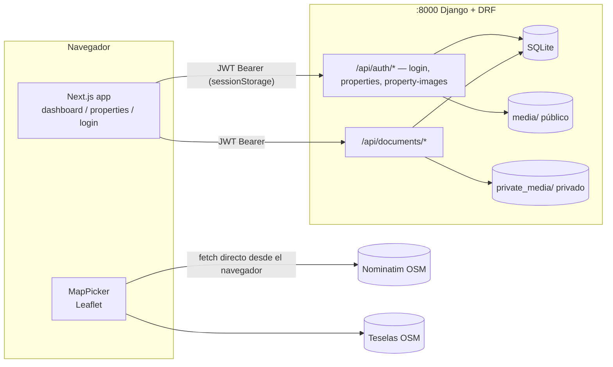

# Urbanex — Auditoría técnica del código

| Campo | Valor |
|---|---|
| Propósito | Fotografía técnica verificable del repositorio antes de tocarlo |
| Fecha de auditoría | 2026-10-22 |
| Rama observada | `develop` (con cambios **sin commit**) |
| Alcance | Backend Django, frontend Next.js, configuración, pruebas y estado de Git. Foco en HU-01, HU-03, HU-05, HU-37, HU-44, HU-45, HU-46 y dependencias de Avalúos |
| Estado de la información | Instantánea. **No se actualiza sola**: cualquier commit posterior puede invalidarla |

Documentos relacionados: [Estado de procesos](URBANEX_ESTADO_PROCESOS.md) · [GPS de archivos](URBANEX_GPS_ARCHIVOS.md) · [Deuda técnica](URBANEX_DEUDA_TECNICA.md) · [Guía de continuidad](URBANEX_GUIA_CONTINUIDAD.md)

Convención: **[H]** hecho comprobado (comando o lectura de código), **[I]** inferencia, **[?]** POR CONFIRMAR.

---

## 1. Estado de Git

### 1.1 Repositorio y ramas
- [H] Raíz: `C:/Users/Pablo/Desktop/Urbanex`. Rama actual: `develop`.
- [H] Ramas locales: `develop`, `master`, `test`. Remotas: `origin/develop`, `origin/master`, `origin/test`; `origin/HEAD -> origin/master`.
- [H] La rama principal es **`master`**, no `main` como dice `URBANEX_MASTER_CONTEXT.md` §2. Ver contradicción C-06 en [Estado de procesos](URBANEX_ESTADO_PROCESOS.md#contradicciones-entre-fuentes).
- [H] 25 commits; todos del autor Pablo Montalvo. No hay commits de otro desarrollador.
- [?] El papel exacto de la rama `test` (`PROJECT_PROGRESS.md` dice "fusionado y respaldado en `test`").

### 1.2 Cambios sin commit al momento de la auditoría
Nada está en *staging* (`git diff --cached --stat` vacío). `git diff --stat`: 15 archivos, +826/−321.

| Archivo | Estado | Origen (según evidencia de la sesión) |
|---|---|---|
| `backend/config/__pycache__/settings.cpython-314.pyc` | M | Artefacto; ya estaba modificado al iniciar la sesión del 2026-10-21 |
| `backend/db.sqlite3` | M | Base de desarrollo; ya modificada al iniciar la sesión; además se aplicaron `users.0006` y `documents.0001` el 2026-10-22 |
| `frontend/app/page.tsx`, `frontend/app/properties/page.tsx`, `frontend/app/properties/[id]/page.tsx` | M | Cambios previos a la sesión (2 líneas c/u: se quitó el uso de `SiteNav`) |
| `frontend/components/SiteNavbar.tsx` | D | Borrado previo a la sesión |
| `frontend/app/dashboard/page.tsx` | M | Previo + refactor de pestañas de la sesión 2026-10-21/22 |
| `frontend/components/MapPicker.tsx` | M | Buscador Nominatim (sesión) |
| `backend/apps/users/models.py`, `serializers.py`, `tests.py` | M | `latitude`/`longitude`, tipo `terreno`, arreglo de tests (sesión) |
| `backend/config/settings.py`, `backend/config/urls.py` | M | Registro de `apps.documents` y ruta `/api/documents/` (sesión) |
| `.gitignore` | M | Reescrito (sesión) |
| `Project_Progress.md` | M | Ver nota de mayúsculas abajo |
| `URBANEX_MASTER_CONTEXT.md` | ?? | **No rastreado** |
| `backend/apps/documents/` (10 archivos) | ?? | Nueva app (sesión) |
| `backend/apps/users/migrations/0006_...py` | ?? | Nueva migración (sesión) |
| `frontend/types/property.ts` | ?? | Nuevo tipo compartido (sesión) |

- [H] Git rastrea `Project_Progress.md`, pero en disco el archivo es `PROJECT_PROGRESS.md`. Windows no distingue mayúsculas; en Linux/macOS puede producir dos archivos. Ver DT-28.
- [H] **Riesgo de handoff:** `URBANEX_MASTER_CONTEXT.md` no está en Git, y `ProyectoCapstoneV4 (3).md` y `Understanding.txt` están **ignorados** por `.gitignore`. Si Sebas clona el repo, **no recibirá las fuentes de requisitos**. Ver DT-27.
- [H] Todo el trabajo de la sesión está sin commit; un `git checkout`/`git stash` descuidado puede perderlo.

---

## 2. Estructura real

```
Urbanex/
├── URBANEX_MASTER_CONTEXT.md        (no rastreado)
├── ProyectoCapstoneV4 (3).md        (ignorado por .gitignore — tesis, 213 KB)
├── PROJECT_PROGRESS.md              (Git lo rastrea como Project_Progress.md)
├── README.md / README.es.md
├── Pipfile                          (raíz, sin paquetes — residual)
├── docs/
│   ├── DefinitionOfDone.md / .es.md (DoD previo del equipo)
│   └── handoff/                     (estos 7 documentos)
├── backend/
│   ├── .env                         (SECRET_KEY, DEBUG, ALLOWED_HOSTS — valores no auditados)
│   ├── Pipfile / Pipfile.lock
│   ├── manage.py
│   ├── db.sqlite3                   (rastreado en Git)
│   ├── config/  settings.py, urls.py, wsgi.py, asgi.py
│   └── apps/                        (sin __init__.py → afecta descubrimiento de tests, DT-06)
│       ├── users/                   User, Property, PropertyImage + vistas de auth y propiedades
│       │   └── properties/          app registrada pero vacía (models/views sin contenido)
│       └── documents/               Document (expediente digital)
└── frontend/
    ├── app/  layout.tsx, page.tsx, (auth)/login, dashboard, properties, properties/[id]
    │         dashboard/properties/[id]/appraisal   (I-12, añadida el 2026-10-25)
    ├── components/  MapPicker.tsx, PropertyCard.tsx, SiteNav.tsx
    ├── lib/api.ts                   (authFetch/ApiError añadidos el 2026-10-25)
    ├── types/property.ts, appraisal.ts (appraisal.ts añadido el 2026-10-25)
    ├── CLAUDE.md  (apunta a @AGENTS.md, que no existe: DT-45)
    ├── next.config.mjs  (el que usa Next)   next.config.ts (ignorado por Next, DT-23)
    └── package.json
```

No existe `.github/` (sin CI), ni `.env.example` en backend o frontend, ni archivos Excel/Jira en el repositorio.

---

## 3. Stack confirmado

| Capa | Tecnología confirmada | Evidencia |
|---|---|---|
| Backend | Python 3.14, Django 6.1.2, DRF 3.18.3, SimpleJWT 5.5.1, django-cors-headers | `backend/Pipfile`, `pipenv run python -c "import django..."` |
| Entorno Python | Pipenv; virtualenv en `C:\Users\Pablo\.virtualenvs\backend-UjtNUF1q`; Pipenv carga `backend/.env` automáticamente | Salida "Loading .env environment variables..." |
| Base de datos | **SQLite** (`backend/db.sqlite3`) | `settings.py` `DATABASES` |
| Archivos | Imágenes: `ImageField` local en `backend/media/`. Documentos: `FileSystemStorage` privado en `backend/private_media/` (la carpeta **aún no existe**: Django la crea con la primera subida; hay 0 documentos en la BD) | `models.py` de ambas apps |
| Frontend | Next.js 16.3.4 (App Router, Turbopack), React 19.2.8, TypeScript 5.9.3, Tailwind 4.3.3 | `node_modules/*/package.json` |
| Mapa | Leaflet 1.9.4 + react-leaflet 5.0.0; teselas OSM; geocodificación Nominatim | `frontend/components/MapPicker.tsx` |
| Node/npm | Node v25.9.0, npm 10.9.8 | `node -v`, `npm -v` |

**No están en uso** (aunque el contexto maestro y el README los mencionan): PostgreSQL/Supabase, Supabase Storage, Cloudinary, Resend, LLM, Docker, Vercel/Render, GitHub Actions. `python-decouple` y `django-extensions` están instalados pero no se usan.



---

## 4. Backend

### 4.1 Modelos

| Modelo | Archivo | Campos clave | Observaciones |
|---|---|---|---|
| `User(AbstractUser)` | `backend/apps/users/models.py` | `role` (`admin`/`asesor`/`cliente`, por defecto `cliente`), `failed_attempts`, `is_locked` | `email` **no es único** (hereda de `AbstractUser`). Existe el rol `cliente`, que el contexto maestro no contempla para usuarios internos |
| `Property` | `backend/apps/users/models.py` | `title`, `description`, `property_type` (`casa`/`departamento`/`local`/`terreno`), `status` (por defecto `captacion`), `price`, `area_m2`, `bedrooms`, `bathrooms`, `parking_spaces`, `location`, `latitude`, `longitude` (Decimal 9,6, nulos), `agent` (FK), `unavailability_reason` | Vive en la app `users`, no en `apps.properties`. Un solo campo `agent` para captador **y** responsable. Estado `'reservador'` (errata). Faltan campos de RF-01: `zone`, `operation_type`, `usable_area_m2`, `age_years`, `conservation_state`, `floor_number`, `storage_units`, `code`, `slug`, `published_at` |
| `PropertyImage` | `backend/apps/users/models.py` | `property` (FK, CASCADE), `image`, `caption` | Sin `is_cover` ni `order` |
| `Document` | `backend/apps/documents/models.py` | UUID; `property` (FK **PROTECT**), `doc_type` (8 tipos), `is_critical`, `file` (privado), `original_filename`, `file_size_bytes`, `mime_type`, `version`, `is_current_version`, `issue_date`, `expiration_date`, `validation_status`, `rejection_reason`, `uploaded_by`, `validated_by`, `validated_at` | Ver §4.4 |

Migraciones: `users` 0001–0006 y `documents` 0001, **todas aplicadas** en `db.sqlite3` (`showmigrations`). `makemigrations --check --dry-run` → "No changes detected".

### 4.2 Endpoints

Todos los de `apps.users` cuelgan de `/api/auth/` (`backend/config/urls.py`, `backend/apps/users/urls.py`).

| Método y ruta | Vista | Permiso | Comportamiento verificado por lectura |
|---|---|---|---|
| `POST /api/auth/login/` | `LoginView` | Abierto | Busca usuario por email (`.first()`); rechaza si `is_locked` (403); suma `failed_attempts` y bloquea al llegar a 5; devuelve `access`, `refresh`, `role`. **No comprueba `is_active`** |
| `GET/POST /api/auth/properties/` | `PropertyListCreateView` | `IsAuthenticatedOrReadOnly` | **Lista todas las propiedades a usuarios anónimos, incluidas las `captacion`** (DT-07). `POST` asigna `agent=request.user` sin comprobar rol |
| `GET /api/auth/properties/mine/` | `MyPropertiesView` | Autenticado | Propiedades donde `agent == usuario` |
| `GET/PUT/PATCH/DELETE /api/auth/properties/<id>/` | `PropertyDetailView` | Dueño o `admin` para escritura; lectura abierta | `status` es escribible por PATCH (DT-09). `DELETE` permitido (DT-11) |
| `POST /api/auth/properties/<id>/publish/` | `PropertyPublishView` | Dueño o `admin` | Pasa a `disponible` **sin exigir avalúo, contrato de corretaje ni foto** (DT-08) |
| `CRUD /api/auth/property-images/` | `PropertyImageViewSet` | Autenticado | Sin control por propiedad: cualquier usuario autenticado puede subir, editar o borrar imágenes de cualquier propiedad (DT-10) |
| `GET /api/documents/?property=<id>[&all_versions=1]` | `DocumentViewSet.list` | Autenticado; asesor solo ve sus propiedades, `admin` todas | Por defecto solo versiones vigentes |
| `POST /api/documents/` | `DocumentViewSet.create` | Autenticado + dueño/admin de la propiedad | Multipart; crea versión n+1 |
| `GET /api/documents/<uuid>/` | `retrieve` | Igual | Metadatos, sin ruta de archivo |
| `GET /api/documents/<uuid>/file/` | acción `file` | Igual | Descarga protegida (provisional hasta URLs firmadas, HU-38) |
| `PATCH/PUT/DELETE /api/documents/<uuid>/` | — | — | **405** (no existen) |

Configuración DRF (`settings.py`): solo `JWTAuthentication`; **sin `DEFAULT_PERMISSION_CLASSES`** (por defecto `AllowAny`) y sin paginación. Las rutas no usan el prefijo `/api/v1/` que pide RNF-05.

### 4.3 Serializers
- `PropertySerializer` (`backend/apps/users/serializers.py`): campos explícitos, incluidos `latitude` y `longitude`; `agent` es de solo lectura. `validate()` exige motivo para `no_disponible` y prohíbe `vendido`/`arrendado`. `get_agent_name` está definido **dos veces** (gana el segundo). Hay un bloque de código comentado (cadena suelta).
- `DocumentSerializer` (lectura) y `DocumentUploadSerializer` (escritura) en `backend/apps/documents/serializers.py`. La subida detecta el tipo real por los primeros bytes (PDF, JPEG, PNG, WEBP), valida el límite de 20 MB y la coherencia de fechas, y comprueba el permiso sobre la propiedad.

### 4.4 Reglas de inmutabilidad documental (`apps.documents`)
| Regla | Dónde se aplica |
|---|---|
| No borrar | `Document.delete()` y `DocumentQuerySet.delete()` lanzan `ValidationError`; la API no expone DELETE; el admin de Django tiene `has_delete_permission=False` |
| Solo cambian campos de validación | `save()` compara con la BD y rechaza cambios fuera de `MUTABLE_FIELDS`; `QuerySet.update()` igual |
| Versión n+1 y una sola vigente | `Document.upload_new_version()` dentro de `transaction.atomic()` con `select_for_update`; `UniqueConstraint` (`property`, `doc_type`, `version`) y `UniqueConstraint` condicional (una vigente por `property`+`doc_type`) |
| 20 MB | `MAX_FILE_SIZE_BYTES = 20 * 1024 * 1024` (**bytes**, 20 MiB) en modelo, serializer y `CheckConstraint` |
| Fechas | `CheckConstraint` de vigencia ≥ emisión + `clean()` + serializer |
| Rechazo con motivo | `CheckConstraint` + `clean()` |
| Solo admin valida | `Document.validate_document()` exige `role == 'admin'` y versión vigente. **Sin endpoint ni UI** (HU-37 es del Sprint 7) |
| Alerta a 30 días | `is_expiring_soon` y `Document.objects.expiring_soon()`; no hay generador de alertas |

---

## 5. Frontend

| Archivo | Responsabilidad | Observaciones |
|---|---|---|
| `frontend/app/layout.tsx` | Layout raíz; incluye `SiteNav` | |
| `frontend/app/page.tsx` | Landing | Importa `SiteNav` sin usarlo (warning) |
| `frontend/app/(auth)/login/page.tsx` | Login (I-01) | Guarda `access`, `userRole` y `userEmail` en `sessionStorage`; **no guarda `refresh`**; usa `catch (err: any)` (error de lint) |
| `frontend/app/dashboard/page.tsx` | Panel del asesor (lista de propiedades) + modal de registro/edición con 4 pestañas. Desde 2026-10-25: botón "Avalúo", fila "Avalúo aprobado" real y `missing_requirements` al publicar (FX-14) | 6 URLs `http://127.0.0.1:8000` hardcodeadas (5 desde 2026-10-25, DT-22); error de lint por `setState` dentro de `useEffect` (código previo) |
| `frontend/components/MapPicker.tsx` | Mapa Leaflet + buscador Nominatim | Ver §5.2 |
| `frontend/app/properties/page.tsx` | Catálogo público (P-02) | Muestra lo que devuelve `/api/auth/properties/`, es decir, **también propiedades en captación** |
| `frontend/app/properties/[id]/page.tsx` | Ficha de detalle (P-03) | Renderiza `<SiteNav />` además del layout: **navbar duplicada** (por lectura de código; validación visual pendiente) |
| `frontend/components/PropertyCard.tsx` | Tarjeta del catálogo | Usa `@/types/property` |
| `frontend/lib/api.ts` | `apiFetch`, `getProperties`, `getPropertyById`; desde 2026-10-25 también `authFetch` y `ApiError` | Usa `NEXT_PUBLIC_API_URL` con *fallback* a `http://127.0.0.1:8000` |
| `frontend/app/dashboard/properties/[id]/appraisal/page.tsx` (2026-10-25) | Pantalla I-12: iniciar, calibrar y aprobar el avalúo | Sin valor sugerido hasta D-04 (DS-02); precio de publicación como referencia (DS-12). Ver [GPS HU-08](URBANEX_GPS_ARCHIVOS.md) |
| `frontend/types/appraisal.ts` (2026-10-25) | Tipos `Appraisal`, `AppraisalCalibratePayload`, `MissingRequirement`, `PublishErrorResponse` | Reflejan `AppraisalSerializer` y el 400 de publicar |
| `frontend/types/property.ts` | Tipos `Property`, `PropertyImage`, `PropertyType`, `PropertyStatus` | Reflejan `PropertySerializer` |

### 5.1 Modal con pestañas (`frontend/app/dashboard/page.tsx`)
- Estado único `formData: PropertyForm` en el componente padre: **los datos se conservan al cambiar de pestaña** (solo se monta la pestaña activa; el estado vive arriba).
- Pestañas (`TABS`): `general` (título, tipo con botones, precio, área, habitaciones, baños, parqueaderos, descripción) · `location` (dirección + `MapPicker` + latitud/longitud) · `media` (zona de carga, vistas previas, imágenes guardadas) · `docs` (requisitos para publicar, expediente guardado, formulario de documento y lista por subir).
- Validación en cliente `validateForm()`: errores por pestaña, marca "!" en la pestaña y salto a la primera con errores. Exige al menos 1 foto. **El backend no exige la foto** (DT-34).
- Guardado: `POST`/`PATCH` a `/api/auth/properties/`, después las imágenes una por una y luego los documentos a `/api/documents/`. Informa al final de cuántas imágenes o documentos fallaron.
- Coordenadas redondeadas a 6 decimales antes de enviarlas (DRF rechaza más decimales).

### 5.2 Mapa y Nominatim (`frontend/components/MapPicker.tsx`)
- Búsqueda con botón o Enter (Enter no envía el formulario). `GET https://nominatim.openstreetmap.org/search?q=…&format=jsonv2&limit=1&countrycodes=ec&accept-language=es`.
- Sin resultados → mensaje "No encontramos…"; error de red o HTTP → mensaje genérico; búsqueda vacía → botón deshabilitado.
- Con resultado: `flyTo` (zoom 16), mueve el marcador y rellena la dirección solo si estaba vacía.
- [H] Prueba real del 2026-10-22: respuesta `200`, `access-control-allow-origin: *`, `lat`/`lon` como cadenas; una consulta inexistente devuelve `[]`. Para "La Carolina, Quito" el primer resultado es la estación de metro "La Carolina" (cerca del sector, no el sector en sí).
- Política de Nominatim: máximo 1 petición por segundo y sin autocompletado; el navegador no permite fijar `User-Agent`. Ver DT-35.

---

## 6. Comprobaciones ejecutadas en esta auditoría (2026-10-22)

| # | Comando | Directorio | Resultado | Resumen |
|---|---|---|---|---|
| 1 | `git status --short --branch`, `git branch --show-current`, `git diff --stat`, `git diff --cached --stat`, `git ls-files --others --exclude-standard` | raíz | OK | Ver §1 |
| 2 | `pipenv run python manage.py test` | `backend/` | **0 pruebas** | "NO TESTS RAN": el descubrimiento sin etiquetas no encuentra pruebas (DT-06) |
| 3 | `pipenv run python manage.py test apps.users.tests apps.documents.tests -v 2` | `backend/` | **Aprobado: 22/22** | 3 de `users` y 19 de `documents` (10 de modelo + 9 de API) |
| 4 | `pipenv run python manage.py makemigrations --check --dry-run` | `backend/` | Aprobado | "No changes detected" |
| 5 | `pipenv run python manage.py check` | `backend/` | Aprobado | 0 problemas |
| 6 | `pipenv run python manage.py showmigrations users documents` | `backend/` | Aprobado | Todas aplicadas |
| 7 | `npx tsc --noEmit -p .` | `frontend/` | **Aprobado** | exit 0 |
| 8 | `npx eslint .` | `frontend/` | **Fallido: 2 errores, 4 warnings** | `no-explicit-any` en login; `set-state-in-effect` en dashboard (línea del `setUserInfo`, código previo); 2 `SiteNav` sin usar; 2 `window.location.href` en login |
| 9 | `npx next build` | `frontend/` | **Aprobado** | 6 rutas; usa `next.config.mjs` |
| 10 | `curl` a Nominatim (1 consulta válida + 1 inexistente) | — | Aprobado | Ver §5.2 |
| 11 | `manage.py shell -c` (conteos, solo lectura) | `backend/` | OK | Usuarios: 3, **todos con rol `cliente`**. Propiedades: 18 `captacion`, 7 `disponible`, 3 `no_disponible`. Con coordenadas: **0**. Imágenes: 16. Documentos: **0** |

Antes de la auditoría, durante la sesión de desarrollo (2026-10-21/22), se ejecutó `pipenv run python manage.py migrate` sobre `db.sqlite3`, con copia de respaldo previa en el scratchpad de la sesión. La auditoría no ejecutó migraciones.

**No ejecutado:** servidores `runserver`/`npm run dev` (lo hizo el usuario: confirmó que el dashboard obtiene datos tras migrar), pruebas E2E (no existen), pruebas del frontend (no existe framework de pruebas), Lighthouse ni Core Web Vitals.

---

## 7. Riesgos técnicos principales

Detalle, prioridad y criterio de cierre en [Deuda técnica](URBANEX_DEUDA_TECNICA.md).

1. **El catálogo público expone propiedades en captación** (DT-07). Incumple HU-01.
2. **Publicar no valida avalúo, corretaje ni foto** (DT-08), y la prueba `test_publish_property_permission` consolida ese comportamiento. Avalúos (HU-53) deberá cambiarla.
3. **Imágenes sin control de propiedad** (DT-10) y `status` escribible por PATCH (DT-09).
4. **Fuentes de requisitos fuera de Git** (DT-27).
5. **El descubrimiento de pruebas no funciona sin etiquetas** (DT-06) y **no hay CI** (DT-29).
6. **No hay usuarios `admin`/`asesor` en la base de desarrollo**: las reglas por rol no se pueden validar en la interfaz sin preparar datos.
7. `TIME_ZONE = 'UTC'` (DT-01).

## 8. Limitaciones de esta auditoría
- No se ejecutó la aplicación en el navegador; la validación visual se basa en lo que el usuario reportó.
- No se leyeron los valores de `backend/.env` (solo los nombres de las variables).
- No hay registros de Jira ni Excel en el repositorio: el estado en Jira es **POR CONFIRMAR**.
- Las imágenes de pantallas (Figma) de la tesis están embebidas como base64 y no se analizaron.
- Los hallazgos de seguridad DT-10 y DT-11 se basan en lectura de código y no se reprodujeron con peticiones reales.
