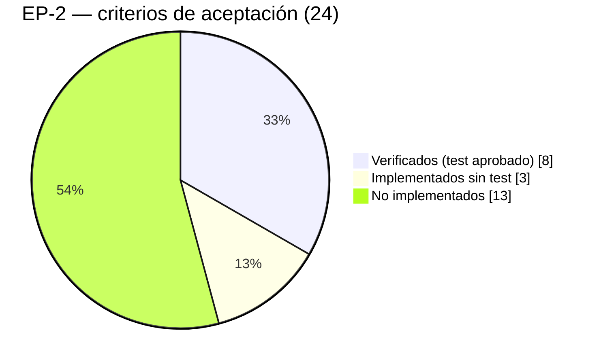

# Urbanex — Avance verificable de épicas (EP-1 y EP-2)

| Campo | Valor |
|---|---|
| Propósito | Medir el avance real de EP-1 y EP-2 con un método reproducible, separando lo escrito de lo probado y de lo validado |
| Fecha de auditoría | 2026-10-22 · rama `develop` con cambios sin commit |
| Última actualización | 2026-10-25 · HU-08: sus 2 criterios pasan a implementados y verificados con la pantalla I-12 (EP-2: 11/24 implementados, 8/24 verificados, 0/24 validados). Antes: 2026-10-24, filas de HU-01, HU-04, HU-08 y HU-53 |
| Fuentes | Composición de épicas: tesis, Anexo 4 (columna "Épica"), y contexto maestro §9.1 y §10. Criterios: tesis, Anexo 2. Evidencia: [Estado de procesos](URBANEX_ESTADO_PROCESOS.md) y [Auditoría de código](URBANEX_AUDITORIA_CODIGO.md) |
| No disponible | Tablero de Jira y planillas Excel (no están en el repositorio). El estado en Jira es **POR CONFIRMAR** |

## 1. Alcance de las épicas (comprobado)

| Épica | Nombre (tesis, tabla 23) | Alcance | HU (Anexo 4) | Puntos |
|---|---|---|---|---|
| EP-1 | Acceso y administración de usuarios | Autenticación, sesión, recuperación de contraseña, usuarios y roles, desbloqueo | HU-44, HU-45, HU-46 | 8 |
| EP-2 | Gestión de propiedades y avalúos | Registro y publicación, captador, inventario, documentación inicial, motor de avalúos HITL | HU-01, 02, 03, 04, 05, 06, 07, 08, 09, 53 | 33 |

La tabla 23 dice "9 historias" para EP-2, pero el Anexo 4 asigna 10 (contradicción C-03). Aquí se usan las **10**, igual que el contexto maestro.

## 2. Método de cálculo

**Unidad de medida:** criterio de aceptación del Anexo 2 de la tesis. **Denominador:** todos los criterios de las HU de la épica, incluidos los de HU bloqueadas o no iniciadas, que cuentan como no cumplidos.

Cada criterio se clasifica en tres niveles acumulativos:

| Nivel | Condición para contarlo |
|---|---|
| **Implementado** | El código del backend (y del frontend, si aplica) cumple el criterio completo; por lectura de código |
| **Verificado** | Implementado **y** una prueba automatizada que lo ejercita pasó en esta auditoría |
| **Validado** | Verificado **y** el flujo funcional/visual fue confirmado por una persona, con evidencia registrada |

```
Avance implementado = criterios implementados / criterios totales
Avance verificado   = criterios verificados   / criterios totales
Avance validado     = criterios validados     / criterios totales
HU completa (100 %) ⇔ todos sus criterios están validados y no queda ninguno obligatorio pendiente
Avance por puntos   = puntos de HU completas / puntos de la épica
```

Un criterio parcialmente implementado cuenta como **no** implementado. El avance por puntos solo cuenta HU completas.

## 3. EP-1 — Acceso y administración de usuarios

| HU | Criterio | Impl. | Verif. | Valid. | Motivo |
|---|---|:-:|:-:|:-:|---|
| HU-44 | Cada usuario tiene correo único | ✗ | ✗ | ✗ | `email` no es único |
| HU-44 | Admin no puede desactivar su propia cuenta | ✗ | ✗ | ✗ | Sin gestión de usuarios |
| HU-45 | Solo el administrador desbloquea | ✗ | ✗ | ✗ | Sin endpoint ni UI |
| HU-45 | Bloqueo tras cinco intentos fallidos | ✔ | ✗ | ✗ | Implementado en `LoginView`; la prueba solo cubre el primer intento |
| HU-46 | Solo usuarios activos inician sesión | ✗ | ✗ | ✗ | Se emite token a usuarios inactivos |
| HU-46 | Enlace de recuperación de 60 min y de un solo uso | ✗ | ✗ | ✗ | No existe |

| Métrica | Valor |
|---|---|
| Implementado | 1/6 = **16,7 %** |
| Verificado | 0/6 = **0 %** |
| Validado | 0/6 = **0 %** |
| HU completas / puntos | 0/3 HU · 0/8 pts = **0 %** |

**Lectura:** EP-1 (Sprint 1) tiene un login operativo que permite usar el sistema, pero **ninguno de sus criterios de aceptación está cumplido y probado**.

## 4. EP-2 — Gestión de propiedades y avalúos

| HU | Criterio | Impl. | Verif. | Valid. | Motivo |
|---|---|:-:|:-:|:-:|---|
| HU-01 | Campos obligatorios y al menos una fotografía | ✗ | ✗ | ✗ | La foto solo se exige en el frontend |
| HU-01 | En captación, sin exhibirse al público | ✗ | ✗ | ✗ | (2026-10-24) Oculta para anónimos y `POST` siempre en captación (DT-07 y DT-09 resueltos, probado); sigue ✗ porque un `cliente` autenticado la ve (DT-39) |
| HU-01 | Asesor como captador y responsable inicial | ✔ | ✔ | ✗ | `test_create_property_as_agent`; falta validación visual posterior al refactor |
| HU-02 | Asignación automática al asesor autenticado | ✔ | ✔ | ✗ | Misma prueba |
| HU-02 | El captador no es editable | ✗ | ✗ | ✗ | Editable desde el admin de Django |
| HU-02 | Responsable inicial hasta reasignación | ✗ | ✗ | ✗ | Campo único `agent` |
| HU-03 | Acepta PDF e imágenes | ✔ | ✗ | ✗ | Hay pruebas para PDF; ninguna sube una imagen |
| HU-03 | Registra fecha de vigencia | ✔ | ✔ | ✗ | Pruebas de API y modelo |
| HU-03 | Asociado a la propiedad | ✔ | ✔ | ✗ | Pruebas de API |
| HU-04 | Entre 3 y 5 comparables | ✗ | ✗ | ✗ | No iniciado |
| HU-04 | Avalúo requisito para publicar | ✔ | ✔ | ✗ | (2026-10-24) Exigido en `PropertyPublishView`, única vía de publicación tras FX-11; `test_publish_rejected_with_draft_appraisal_only` |
| HU-04 | Registro manual sin comparables suficientes | ✗ | ✗ | ✗ | No iniciado |
| HU-05 | Valores numéricos o selectores | ✔ | ✗ | ✗ | Los campos existentes cumplen; no hay prueba específica |
| HU-05 | Obligatorios validados antes de calcular | ✗ | ✗ | ✗ | No hay cálculo |
| HU-06 | Factores ponderados | ✗ | ✗ | ✗ | Bloqueado por D-04 |
| HU-06 | Cálculo registrado | ✗ | ✗ | ✗ | No iniciado |
| HU-07 | Borrador editable desde el cálculo | ✗ | ✗ | ✗ | No iniciado |
| HU-07 | Justificación manual si el servicio falla | ✗ | ✗ | ✗ | No iniciado |
| HU-08 | Conserva valor del motor, calibrado y diferencia | ✔ | ✔ | ✗ | (2026-10-25) Backend verificado (`apps.appraisals.tests`, 52/52) + pantalla I-12 (`af9b416`: `tsc`, `eslint`, `build`). La UI no tiene prueba automática (DT-37). Falta la validación visual de Pablo |
| HU-08 | El avalúo aprobado no se sobrescribe | ✔ | ✔ | ✗ | (2026-10-25) Backend verificado; I-12 oculta el formulario tras aprobar y ofrece "Crear reevaluación". Falta la validación visual |
| HU-09 | Cambiar entre estados; No disponible con motivo | ✗ | ✗ | ✗ | La regla del motivo está en el serializer, pero la UI no permite cambiar el estado y el PATCH acepta estados no previstos (DT-09) |
| HU-09 | No asignar Vendido/Arrendado manualmente | ✔ | ✗ | ✗ | En el serializer; sin prueba |
| HU-53 | Requiere avalúo y contrato de corretaje | ✔ | ✔ | ✗ | (2026-10-24) 8 pruebas de publicación + 2 de `status` de solo lectura (FX-11). (2026-10-25) La UI ya muestra `missing_requirements` y permite aprobar el avalúo (FX-14): solo falta la validación funcional de Pablo |
| HU-53 | Pasa a Disponible y genera URL con metaetiquetas | ✗ | ✗ | ✗ | Sin `slug` ni OpenGraph |

| Métrica | Valor |
|---|---|
| Total de criterios | 24 |
| Implementado | 11/24 = **45,8 %** (2026-10-25: +2 de HU-08; antes 9/24) |
| Verificado | 8/24 = **33,3 %** (2026-10-25: +2 de HU-08; antes 6/24) |
| Validado | 0/24 = **0 %** |
| HU completas / puntos | 0/10 HU · 0/33 pts = **0 %** |



**Lectura:** el trabajo hecho se concentra en el registro de propiedades y el expediente. Las HU de avalúo (HU-04, 06, 07, 08), que suman 16 de 33 puntos, están sin iniciar. HU-53 (publicar) y la parte "sin exhibirse al público" de HU-01 fallan respecto del proceso de negocio.

**Actualización 2026-10-24.** Con DT-09 cerrado (FX-11), HU-04 "requisito para publicar" y HU-53 "avalúo y corretaje" pasan a verificados: EP-2 sube a **6/24 verificados (25 %)**. Quedan 3 criterios con el backend verificado que esperan una sola condición:

| Criterios | Condición que falta para contarlos ✔ |
|---|---|
| HU-01 "sin exhibirse" | Cerrar **DT-39** (rol `cliente`) |
| HU-08 (los 2 criterios) | Pantalla **I-12** (DT-40) |

Con I-12, el verificado subiría a **8/24 (33,3 %)**; con DT-39, a **9/24 (37,5 %)**.

**Actualización 2026-10-25.** I-12 existe (commits `161f845` y `af9b416`): los 2 criterios de HU-08 pasan a ✔ implementado y ✔ verificado → **8/24 verificados (33,3 %)**. Criterio aplicado: la regla de negocio está probada en el backend (52/52) y la pantalla compila sin errores (`tsc`, `eslint`, `next build`); la UI no tiene pruebas automáticas (DT-37), así que **la validación visual de Pablo es la que confirmará el flujo**. HU-08 completa (5 pts) exige esa validación. El validado de EP-2 sigue en 0/24.

## 5. Bloqueos y dependencias que afectan al avance

| Bloqueo | HU afectadas | Cómo se desbloquea |
|---|---|---|
| D-04: fórmula, factores y umbrales del motor | HU-06, HU-08 y, por extensión, HU-53 | Aprobación del equipo y el tutor; registrar en el contexto maestro |
| C-02: 1–2 comparables, ¿cálculo o manual? | HU-04, HU-06 | Decisión de negocio |
| Faltan `zone` y los demás campos de RF-01 | HU-04, HU-05 | Definir los campos y crear una migración en `users` |
| No hay usuarios `asesor`/`admin` en la BD de desarrollo | Validación de todas las HU con reglas por rol | Crear usuarios de prueba (ver [Guía](URBANEX_GUIA_CONTINUIDAD.md)) |
| D-05: política de JWT y sesión | HU-46 | Decisión técnica |

## 6. Siguientes pasos para mover los porcentajes
1. **Validado (barato):** que una persona pruebe en el navegador HU-03 (subida de PDF e imagen, versión v2) y HU-01 (creación y asignación al asesor) y lo registre. Puede subir el avance validado de EP-2 a 3/24 sin escribir código.
2. **Verificado:** agregar una prueba que suba una imagen (HU-03) y otra para el bloqueo a los 5 intentos (HU-45).
3. ~~**Implementado:** filtrar el catálogo público (HU-01) y comenzar `apps.appraisals`~~ Hecho el 2026-10-24 (backend), junto con DT-09. ~~Construir I-12~~ Hecho el 2026-10-25. **Siguiente:** fase 3 de DT-40 (dashboard) y cerrar DT-39.
4. **Validado (en curso, 2026-10-25):** las 3 fases de DT-40 están implementadas (la fase 3 no cambia las métricas: HU-53 ya estaba verificado). Pablo valida I-12 y el dashboard. La validación de extremo a extremo (aprobar → publicar → ver en el catálogo anónimo) puede subir a la vez HU-08 (2 criterios), HU-04 "requisito para publicar" y HU-53 "avalúo y corretaje".

Cada vez que cambie un criterio, actualizar esta tabla y anotar la fecha y la evidencia (commit, prueba o captura).
