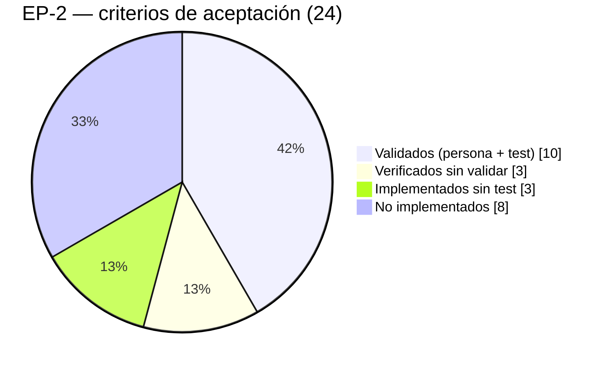

# Urbanex — Avance verificable de épicas (EP-1 y EP-2)

| Campo | Valor |
|---|---|
| Propósito | Medir el avance real de EP-1 y EP-2 con un método reproducible, separando lo escrito de lo probado y de lo validado |
| Fecha de auditoría | 2026-10-22 · rama `develop` con cambios sin commit |
| Última actualización | 2026-10-30 · ronda 3 validada (V-20 a V-25): EP-2 **10/24 validados (41,7 %)**; HU-04, HU-06 y HU-08 completas POR CONFIRMAR. Antes: 2026-10-28 (noche) · motor DS-21 (FX-17): EP-2 **16/24 implementados (66,7 %)** y **13/24 verificados (54,2 %)**; validados sin cambio (6/24). Antes: 2026-10-28 · validación V-13 a V-18 (tarea 3): **sin cambio de métricas** (ver la actualización del 2026-10-28). Antes: 2026-10-27 · validación de Pablo (V-01 a V-12): EP-2 **6/24 validados (25 %)**; HU-08 completa POR CONFIRMAR. Antes: 2026-10-25 · HU-08: sus 2 criterios pasan a implementados y verificados con la pantalla I-12 (EP-2: 11/24 implementados, 8/24 verificados, 0/24 validados). Antes: 2026-10-24, filas de HU-01, HU-04, HU-08 y HU-53 |
| Fuentes | Composición de épicas: tesis, Anexo 4 (columna "Épica"), y contexto maestro §9.1 y §10. Criterios: tesis, Anexo 2. Evidencia: [Estado de procesos](URBANEX_ESTADO_PROCESOS.md) y [Auditoría de código](URBANEX_AUDITORIA_CODIGO.md) |
| No disponible | Tablero de Jira y planillas Excel (no están en el repositorio). El estado en Jira es **POR CONFIRMAR** |

## 1. Alcance de las épicas (comprobado)

| Épica | Nombre (tesis, tabla 23) | Alcance | HU (Anexo 4) | Puntos |
|---|---|---|---|---|
| EP-1 | Acceso y administración de usuarios | Autenticación, sesión, recuperación de contraseña, usuarios y roles, desbloqueo | HU-44, HU-45, HU-46 | 8 |
| EP-2 | Gestión de propiedades y avalúos | Registro y publicación, captador, inventario, documentación inicial, motor de avalúos HITL | HU-01, 02, 03, 04, 05, 06, 07, 08, 09, 53 | 33 |

La tabla 23 dice "9 historias" para EP-2, pero el Anexo 4 asigna 10 (contradicción C-03). Aquí se usan las **10**, igual que el contexto maestro.

## 2. Método de cálculo

**Unidad de medida:** criterio de aceptación del Anexo 2 de la tesis. **Denominador:** todos los criterios de las HU de la épica, incluidos los de HU bloqueadas o no iniciadas, que cuentan como no cumplidos.

Cada criterio se clasifica en tres niveles acumulativos:

| Nivel | Condición para contarlo |
|---|---|
| **Implementado** | El código del backend (y del frontend, si aplica) cumple el criterio completo; por lectura de código |
| **Verificado** | Implementado **y** una prueba automatizada que lo ejercita pasó en esta auditoría |
| **Validado** | Verificado **y** el flujo funcional/visual fue confirmado por una persona, con evidencia registrada |

```
Avance implementado = criterios implementados / criterios totales
Avance verificado   = criterios verificados   / criterios totales
Avance validado     = criterios validados     / criterios totales
HU completa (100 %) ⇔ todos sus criterios están validados y no queda ninguno obligatorio pendiente
Avance por puntos   = puntos de HU completas / puntos de la épica
```

Un criterio parcialmente implementado cuenta como **no** implementado. El avance por puntos solo cuenta HU completas.

## 3. EP-1 — Acceso y administración de usuarios

| HU | Criterio | Impl. | Verif. | Valid. | Motivo |
|---|---|:-:|:-:|:-:|---|
| HU-44 | Cada usuario tiene correo único | ✗ | ✗ | ✗ | `email` no es único |
| HU-44 | Admin no puede desactivar su propia cuenta | ✗ | ✗ | ✗ | Sin gestión de usuarios |
| HU-45 | Solo el administrador desbloquea | ✗ | ✗ | ✗ | Sin endpoint ni UI |
| HU-45 | Bloqueo tras cinco intentos fallidos | ✔ | ✗ | ✗ | Implementado en `LoginView`; la prueba solo cubre el primer intento |
| HU-46 | Solo usuarios activos inician sesión | ✗ | ✗ | ✗ | Se emite token a usuarios inactivos |
| HU-46 | Enlace de recuperación de 60 min y de un solo uso | ✗ | ✗ | ✗ | No existe |

| Métrica | Valor |
|---|---|
| Implementado | 1/6 = **16,7 %** |
| Verificado | 0/6 = **0 %** |
| Validado | 0/6 = **0 %** |
| HU completas / puntos | 0/3 HU · 0/8 pts = **0 %** |

**Lectura:** EP-1 (Sprint 1) tiene un login operativo que permite usar el sistema, pero **ninguno de sus criterios de aceptación está cumplido y probado**.

## 4. EP-2 — Gestión de propiedades y avalúos

| HU | Criterio | Impl. | Verif. | Valid. | Motivo |
|---|---|:-:|:-:|:-:|---|
| HU-01 | Campos obligatorios y al menos una fotografía | ✗ | ✗ | ✗ | La foto solo se exige en el frontend |
| HU-01 | En captación, sin exhibirse al público | ✗ | ✗ | ✗ | (2026-10-24) Oculta para anónimos y `POST` siempre en captación (DT-07 y DT-09 resueltos, probado); sigue ✗ porque un `cliente` autenticado la ve (DT-39) |
| HU-01 | Asesor como captador y responsable inicial | ✔ | ✔ | ✗ | `test_create_property_as_agent`; falta validación visual posterior al refactor |
| HU-02 | Asignación automática al asesor autenticado | ✔ | ✔ | ✗ | Misma prueba |
| HU-02 | El captador no es editable | ✗ | ✗ | ✗ | Editable desde el admin de Django |
| HU-02 | Responsable inicial hasta reasignación | ✗ | ✗ | ✗ | Campo único `agent` |
| HU-03 | Acepta PDF e imágenes | ✔ | ✗ | ✗ | Hay pruebas para PDF; ninguna sube una imagen |
| HU-03 | Registra fecha de vigencia | ✔ | ✔ | ✔ | Pruebas de API y modelo. (2026-10-27) **V-03** (Pablo): v2 vigente hasta 2026-10-31 con el aviso "vence pronto" |
| HU-03 | Asociado a la propiedad | ✔ | ✔ | ✔ | Pruebas de API. (2026-10-27) **V-03**: el contrato aparece en el expediente de `#32` y la versión vigente pasa de v1 a v2 |
| HU-04 | Entre 3 y 5 comparables | ✔ | ✔ | ✔ | (2026-10-28, FX-17) El motor rechaza más de 5 y con menos de 3 no calcula; el servidor vuelve a validar tipo, estado, antigüedad y zona. Pruebas `test_invalid_selections_are_rejected`, `test_invalid_comparables_are_rejected_without_creating`, `test_candidates_are_same_type_zone_and_ranked`. Pantalla I-11: validación visual pendiente (V-20). **(2026-10-30) V-20 y V-21** (Pablo): con 6 o con menos de 3 marcados no deja calcular; con La Carolina 1 a 5 da el ejemplo de DS-21 §8 |
| HU-04 | Avalúo requisito para publicar | ✔ | ✔ | ✔ | (2026-10-24) Exigido en `PropertyPublishView`, única vía de publicación tras FX-11; `test_publish_rejected_with_draft_appraisal_only`. (2026-10-27) **V-02** (el avalúo aparece entre los requisitos faltantes) y **V-11** (publica tras aprobarlo en I-12) |
| HU-04 | Registro manual sin comparables suficientes | ✔ | ✔ | ✔ | (2026-10-28) Con 0–2 comparables el avalúo es manual y guarda los encontrados como referencia (C-02, opción A, provisional); botón "Registrar avalúo manual" en I-11. `test_fewer_than_three_is_manual_with_reference`, `test_two_comparables_give_manual_with_reference`. **(2026-10-29) V-23** (2 locales: manual, confianza Bajo, aprobado en $123.000) y **V-24** (sin comparables: Calcular desactivado, manual activo) |
| HU-05 | Valores numéricos o selectores | ✔ | ✗ | ✗ | Los campos existentes cumplen; no hay prueba específica |
| HU-05 | Obligatorios validados antes de calcular | ✔ | ✔ | ✗ | (2026-10-28) `subject_blocker()` exige superficie y coordenadas (zona provisional, DS-21 §7) antes de calcular; `test_candidates_exclude_stale_data_and_explain_blockers`. Cuando exista `zone` (N-03) también se exigirá |
| HU-06 | Factores ponderados | ✔ | ✔ | ✔ | (2026-10-28) DS-21: factores registrados y configurables por tipo, pesos por ajuste bruto. Ejemplo de DS-21 §8 como prueba (`test_worked_example_of_ds21`). **(2026-10-29/30) V-21** (factor, USD/m² ajustado y peso por comparable; $143.861,35, ALTO, atípico en gris) y **V-22** (Medio, CV 21,27 %) |
| HU-06 | Cálculo registrado | ✔ | ✔ | ✔ | (2026-10-28) Al crear el avalúo se guardan el valor, la confianza, la traza completa en `comparables_snapshot` y la versión de θ (inmutables). `test_create_with_comparables_runs_the_engine`, `test_engine_fields_stay_immutable`. **(2026-10-30) V-21** (I-12 muestra el valor, la confianza, la traza y "Motor paramétrico · parámetros v1") y **V-25** (θ v2 creada y v1 reactivada desde el admin, tras FX-18) |
| HU-07 | Borrador editable desde el cálculo | ✗ | ✗ | ✗ | No iniciado |
| HU-07 | Justificación manual si el servicio falla | ✗ | ✗ | ✗ | No iniciado |
| HU-08 | Conserva valor del motor, calibrado y diferencia | ✔ | ✔ | ✔ | (2026-10-25) Backend verificado (`apps.appraisals.tests`) + pantalla I-12 (`af9b416`: `tsc`, `eslint`, `build`). (2026-10-27) **V-05 a V-08** (Pablo). **Matiz:** se validó con el registro manual (DS-02): valor del motor "No disponible (D-04)" y diferencia "No aplica" |
| HU-08 | El avalúo aprobado no se sobrescribe | ✔ | ✔ | ✔ | (2026-10-25) Backend verificado. (2026-10-27) **V-08** (solo lectura tras aprobar) y **V-09** (la reevaluación crea otro folio y conserva el aprobado) |
| HU-09 | Cambiar entre estados; No disponible con motivo | ✗ | ✗ | ✗ | La regla del motivo está en el serializer, pero la UI no permite cambiar el estado y el PATCH acepta estados no previstos (DT-09) |
| HU-09 | No asignar Vendido/Arrendado manualmente | ✔ | ✗ | ✗ | En el serializer; sin prueba |
| HU-53 | Requiere avalúo y contrato de corretaje | ✔ | ✔ | ✔ | (2026-10-24) 8 pruebas de publicación + 2 de `status` de solo lectura (FX-11). (2026-10-27) **V-02** (lista de requisitos faltantes en `#35`), **V-11** y **V-12** (`#33` publicada y visible sin sesión): **DT-40 cerrado** |
| HU-53 | Pasa a Disponible y genera URL con metaetiquetas | ✗ | ✗ | ✗ | Sin `slug` ni OpenGraph |

| Métrica | Valor |
|---|---|
| Total de criterios | 24 |
| Implementado | 16/24 = **66,7 %** (2026-10-28: +5 del motor DS-21; antes 11/24) |
| Verificado | 13/24 = **54,2 %** (2026-10-28: +5 del motor DS-21; antes 8/24) |
| Validado | 10/24 = **41,7 %** (2026-10-30: +4 de la ronda 3, HU-04 ×2 y HU-06 ×2; antes 6/24: HU-03 ×2, HU-04 ×1, HU-08 ×2, HU-53 ×1) |
| HU completas / puntos | 0/10 HU · 0/33 pts = **0 %** (HU-04, HU-06 y HU-08 tienen todos sus criterios validados; si cuentan como completas está **POR CONFIRMAR**: ver la actualización del 2026-10-30) |



**Lectura:** el trabajo hecho se concentra en el registro de propiedades y el expediente. Las HU de avalúo (HU-04, 06, 07, 08), que suman 16 de 33 puntos, están sin iniciar. HU-53 (publicar) y la parte "sin exhibirse al público" de HU-01 fallan respecto del proceso de negocio.

**Actualización 2026-10-24.** Con DT-09 cerrado (FX-11), HU-04 "requisito para publicar" y HU-53 "avalúo y corretaje" pasan a verificados: EP-2 sube a **6/24 verificados (25 %)**. Quedan 3 criterios con el backend verificado que esperan una sola condición:

| Criterios | Condición que falta para contarlos ✔ |
|---|---|
| HU-01 "sin exhibirse" | Cerrar **DT-39** (rol `cliente`) |
| HU-08 (los 2 criterios) | Pantalla **I-12** (DT-40) |

Con I-12, el verificado subiría a **8/24 (33,3 %)**; con DT-39, a **9/24 (37,5 %)**.

**Actualización 2026-10-25.** I-12 existe (commits `161f845` y `af9b416`): los 2 criterios de HU-08 pasan a ✔ implementado y ✔ verificado → **8/24 verificados (33,3 %)**. Criterio aplicado: la regla de negocio está probada en el backend (52/52) y la pantalla compila sin errores (`tsc`, `eslint`, `next build`); la UI no tiene pruebas automáticas (DT-37), así que **la validación visual de Pablo es la que confirmará el flujo**. HU-08 completa (5 pts) exige esa validación. El validado de EP-2 sigue en 0/24.

**Actualización 2026-10-27.** Pablo validó en el navegador V-01 a V-12 (evidencia en `Project_Progress.md`) con los datos de `setup_demo_data`. Seis criterios pasan a ✔ validado → **6/24 (25,0 %)**; implementado (11/24) y verificado (8/24) no cambian. **DT-40 queda cerrado.**

- **HU-08 (5 pts), POR CONFIRMAR si cuenta como completa:** sus 2 criterios del Anexo 2 están validados, pero con el registro manual (DS-02). El criterio "conservar el valor del motor, el calibrado y su diferencia" se cumple sin motor solo en sentido estricto: el motor no existe (D-04, HU-06). **Pablo decide** si HU-08 suma sus 5 pts ahora (EP-2 pasaría a 1/10 HU · 5/33 pts = 15,2 %) o cuando exista el motor. Hasta entonces, 0 pts. **Decisión de Pablo (2026-10-27): ¡QUEDA POR CONFIRMAR!** Espera la fórmula de D-04 hasta el **2026-10-28 a las 08:00**; si no llega, se diseñará el motor con la normativa de valoración del municipio de Quito y de Ecuador (ver la directiva de plazo en `Project_Progress.md`).
- **Candidatos que no se cuentan por inferencia:** HU-01 "Asesor como captador" y HU-02 "Asignación automática". En V-01 la propiedad creada apareció en el dashboard del asesor, pero ninguna prueba miró el captador. Para validarlos basta con que una persona compruebe, en el admin de Django o en la ficha, que `agent` es `asesor.demo`.
- **Sin cambio de métricas:** HU-01 "sin exhibirse al público" (V-01 aprobado para anónimos, sigue abierto DT-39) y HU-05 "valores numéricos" (V-04 aprobó el mapa, pero el criterio no tiene prueba automática).

**Actualización 2026-10-28.** Pablo aprobó V-13 a V-18 (tarea 3, FX-16: modales y requisitos del servidor). **Las métricas no cambian:** EP-2 sigue en 11/24 implementados, 8/24 verificados y 6/24 validados, con 0/33 pts. La tarea 3 mejora la forma en que el asesor ve y corrige los requisitos de HU-53, pero no agrega ningún criterio del Anexo 2: "requiere avalúo y contrato de corretaje" ya estaba validado desde el 2026-10-27 y "URL con metaetiquetas" sigue sin implementar (sin `slug` ni OpenGraph). HU-08 completa sigue **POR CONFIRMAR** (D-04).

**Actualización 2026-10-28 (noche).** El motor DS-21 (FX-17) pasa a ✔ implementado y ✔ verificado cinco criterios: HU-04 ×2, HU-05 ×1 y HU-06 ×2. **EP-2: 16/24 implementados (66,7 %) y 13/24 verificados (54,2 %).** Los validados no cambian (6/24) hasta la ronda V-20 a V-24 de Pablo. HU-08 completa sigue **POR CONFIRMAR**: el motor ya existe, pero falta validarlo en la interfaz y que el tutor confirme C-02.

**Actualización 2026-10-30.** Pablo validó la ronda 3 (V-20 a V-25; evidencia en `Project_Progress.md`). Cuatro criterios pasan a ✔ validado: HU-04 ×2 (V-20, V-21, V-23 y V-24) y HU-06 ×2 (V-21, V-22 y V-25, esta tras FX-18) → **EP-2: 10/24 validados (41,7 %)**; implementado (16/24) y verificado (13/24) no cambian. HU-05 "obligatorios antes de calcular" sigue sin validar, porque ninguna prueba de la ronda probó una propiedad sin superficie o sin coordenadas.

- **HU-04 (todos sus criterios validados), HU-06 (ídem) y HU-08: si cuentan como completas está POR CONFIRMAR (Pablo).** El motor existe y está validado, pero C-02 (1–2 comparables → manual) es provisional hasta el tutor y θ v1 sigue EN OBSERVACIÓN. Hasta la decisión, 0 pts.

## 5. Bloqueos y dependencias que afectan al avance

| Bloqueo | HU afectadas | Cómo se desbloquea |
|---|---|---|
| ~~D-04: fórmula, factores y umbrales del motor~~ **Resuelta provisionalmente (2026-10-28, DS-21)** | HU-04, HU-06, HU-08 y, por extensión, HU-53 | Implementación en curso (`feat/URB-10-11-motor-avaluos`). Falta la confirmación del tutor para C-02 |
| C-02: 1–2 comparables, ¿cálculo o manual? | HU-04, HU-06 | Decisión de negocio |
| Faltan `zone` y los demás campos de RF-01 | HU-04, HU-05 | Definir los campos y crear una migración en `users` |
| ~~No hay usuarios `asesor`/`admin` en la BD de desarrollo~~ | ~~Validación de todas las HU con reglas por rol~~ | **Resuelto 2026-10-27:** `pipenv run python manage.py setup_demo_data` (DT-14) |
| D-05: política de JWT y sesión | HU-46 | Decisión técnica |

## 6. Siguientes pasos para mover los porcentajes
1. **Validado (barato):** que una persona pruebe en el navegador HU-03 (subida de PDF e imagen, versión v2) y HU-01 (creación y asignación al asesor) y lo registre. Puede subir el avance validado de EP-2 a 3/24 sin escribir código.
2. **Verificado:** agregar una prueba que suba una imagen (HU-03) y otra para el bloqueo a los 5 intentos (HU-45).
3. ~~**Implementado:** filtrar el catálogo público (HU-01) y comenzar `apps.appraisals`~~ Hecho el 2026-10-24 (backend), junto con DT-09. ~~Construir I-12~~ Hecho el 2026-10-25. **Siguiente:** fase 3 de DT-40 (dashboard) y cerrar DT-39.
4. **Validado (en curso, 2026-10-25):** las 3 fases de DT-40 están implementadas (la fase 3 no cambia las métricas: HU-53 ya estaba verificado). Pablo valida I-12 y el dashboard. La validación de extremo a extremo (aprobar → publicar → ver en el catálogo anónimo) puede subir a la vez HU-08 (2 criterios), HU-04 "requisito para publicar" y HU-53 "avalúo y corretaje".

Cada vez que cambie un criterio, actualizar esta tabla y anotar la fecha y la evidencia (commit, prueba o captura).
