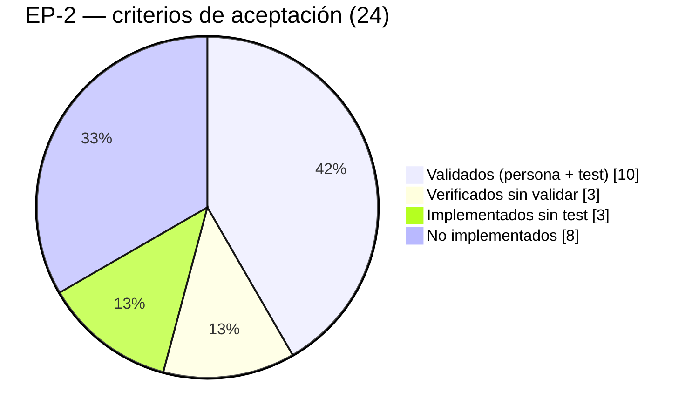
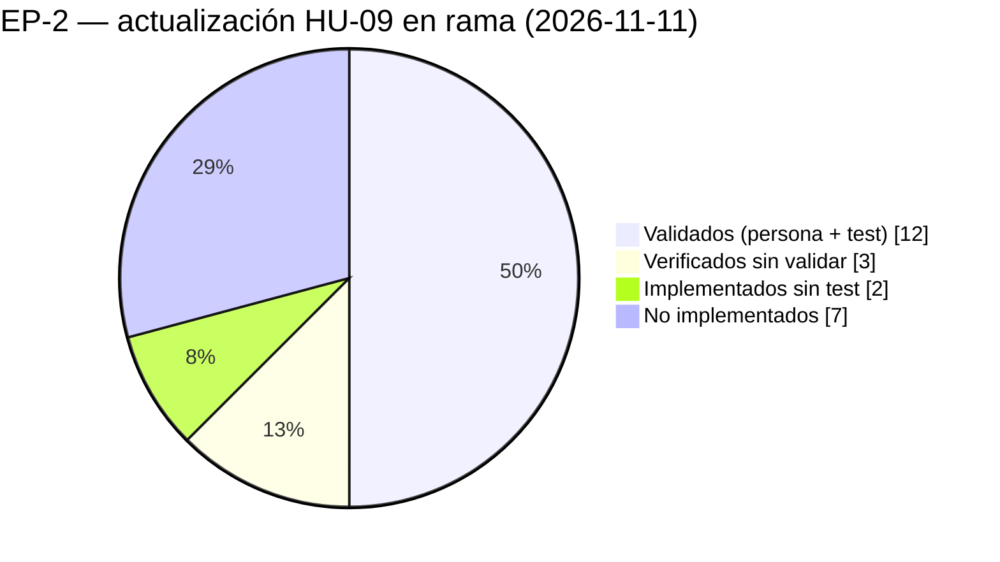

# Urbanex — Avance verificable de épicas (EP-1, EP-2 y EP-5)

| Campo | Valor |
|---|---|
| Última actualización HU-10 · integración comprobada | 2026-11-13 · develop c420e56 integrado; SQLite 372 OK, frontend 41/41 y check sin cambios; DT-92 Resuelto; sin push |
| Última actualización HU-10 · integración de develop | 2026-11-13 · Integración de c420e56, conflictos documentales conservados y pruebas de HU-09 adaptadas a results; suite integrada en ejecución |
| Última actualización HU-10 · preparación de integración | 2026-11-13 · DT-92 corregido con storage callable y migración de estado; commits e integración autorizados por Sebas |
| Última actualización HU-10 · distribución | 2026-11-13 · Filtrar, grupos uniformes y orden junto al conteo; V-46 humana Pendiente |
| Última actualización HU-10 · orden y simplificación | 2026-11-13 · Interfaz depurada y orden global; validación humana/métricas sin cambio |
| Última actualización HU-10 · preferencias | 2026-11-12 · Cantidades de parqueaderos acordadas por Sebas; pruebas registradas; sin cambios de métricas |
| Última actualización HU-10 · slider e histograma | 2026-11-12 · Interfaz y consultas sobre campos existentes; sin aprobación humana ni cambios de métricas |
| Última actualización HU-10 · barra superior | 2026-11-11 · Rediseño P-02 y comprobaciones automáticas; V-46 Pendiente, métricas sin cambio |
| Última actualización HU-10 · usabilidad | 2026-11-11 · Mejora móvil y datos de paginación locales; sin aprobaciones ni cambios de métricas |
| Última actualización HU-10 | 2026-11-11 · Implementación de catálogo en rama URB-16; V-46 Pendiente; métricas sin cambio |
| Última actualización · EP-1 con DS-35 | 2026-11-13 · Pablo (con Claude Code) · rama `docs/DT-157-estados-hu-listo`: §3 (EP-1), el criterio "solo usuarios activos" de HU-46 se cierra con la salida de `test_inactive_users_cannot_log_in` (DS-35, decisión de Pablo); EP-1 validado **4/6**, **2/3 HU · 5/8 pts (62,5 %)** |
| Última actualización · HU-45 Listo | 2026-11-12 · Pablo (con Claude Code) · rama `docs/DT-157-estados-hu-listo`: §3 (EP-1), HU-45 en **Listo** (según Pablo, confirmado por Sebas); métricas sin cambio |
| Última actualización · HU-46 Listo | 2026-11-12 · Pablo (con Claude Code) · rama `docs/DT-157-estados-hu-listo`: §3 (EP-1), HU-46 en **Listo** por decisión de Pablo; EP-1 validado 3/6; por el método de §2 sigue 1/3 HU · 2/8 pts (el criterio "solo usuarios activos" no tiene validación humana propia, POR CONFIRMAR) |
| Última actualización lote 4 · merge PR #22 | 2026-11-12 · Pablo (con Claude Code) · rama `docs/DT-157-estados-hu-listo`: §5C, 4/4 HU · 15/15 pts del lote 4 en **Listo**; §5 (EP-5), **4/9 HU · 16/32 pts (50 %)** (PR #22 auditado (§11: apta según el comentario de Pablo en el PR #22, "Auditoría §11: apta, 12-nov", publicado el 2026-11-13) y fusionado, `c64b41a`) |
| Última actualización lote 4 · Ronda 8 | 2026-11-12 · Pablo (con Claude Code) · §5 (EP-5): validado 10/20 con HU-29 y HU-30 (V-91 a V-95); §5C: HU-15 y HU-16 validadas (V-86 a V-90); 0/4 HU del lote completas hasta la auditoría y el merge del PR #22 |
| Última actualización lote 3 · merge PR #21 | 2026-11-11 · Pablo (con Claude Code) · §5B: 3/3 HU · 10/10 pts del lote 3 en **Listo** (PR #21 auditado y fusionado, `5ed0e3b`) |
| Última actualización lote 3 · Ronda 7 | 2026-11-11 · Pablo (con Claude Code) · §5B: los 3 criterios del lote 3 validados (V-78 a V-85, Pablo); 0/3 HU completas hasta la auditoría y el merge del PR #21 |
| Última actualización de corrección HU-09 | 2026-11-11 · bloque histórico de EP-2 restaurado; actualización vigente en sección aditiva; privacidad del motivo cubierta por pruebas |
| Última actualización aditiva HU-09 | 2026-11-11 · V-45 aprobada por Sebas el 2026-11-10; EP-2: 17/24 implementados, 15/24 verificados y 12/24 validados |
| Última actualización HU-46 · precisión JWT | 2026-11-09 · Corrección posterior a auditoría PR #20; HU-46 permanece en Pruebas |
| Última actualización · registro humano V-44 | 2026-11-09 · Fila incorporada por Sebas; auditoría y revisión pendientes |
| Última actualización HU-46 · desbloqueo | 2026-11-09 · Decisión de Sebas aplicada; validación visual del comportamiento nuevo Pendiente |
| Última actualización de integración HU-46 | 2026-11-09 · D-05 revisada; registro humano V-44 conservado; HU-46 en Pruebas |
| Última actualización aditiva HU-46 | 2026-11-06 · EP-1: recuperación implementada y verificada en SQLite; V-44 Pendiente |
| Actualización HU-45 (2026-11-04) | Según Sebas, V-43 cubrió ambos criterios de HU-45 después del último ajuste. Suite integrada: 159/159 OK en SQLite. Ver actualización de EP-1 |
| Propósito | Medir el avance real de EP-1, EP-2 y EP-5 con un método reproducible, separando lo escrito de lo probado y de lo validado |
| Fecha de auditoría | 2026-10-22 · rama `develop` con cambios sin commit |
| Última actualización | 2026-11-09 (noche) · Pablo (con Claude Code) · rama `feat/URB-20-21-35-36-HU-15-HU-16-HU-29-HU-30-contactos-crm` (lote 4): §5 con notas añadidas en HU-29 y HU-30 (EP-5 implementado y verificado 10/20; validado sin cambio 4/20) y nueva **§5C** (HU-15 y HU-16); 0/4 HU completas del lote. Antes: 2026-11-09 · Pablo (con Claude Code) · rama `feat/URB-23-24-28-HU-19-HU-20-HU-25-solicitud-visitas` (PR #21, borrador): nueva **§5B, EP-4 (lote 3)**: HU-19, HU-20 y HU-25 con 3/3 criterios implementados y verificados, 0/3 validados (V-78 a V-85 Pendiente); 0/3 HU completas; métricas de EP-1, EP-2 y EP-5 sin cambio. Antes: 2026-11-08 (noche) · Pablo (con Claude Code) · rama `docs/post-merge-pr15` (PR #18): nueva §8, **plan de reparto** (Sebas: HU-09 y HU-10; Pablo: lote 3 y lote 4) registrado como PLAN; **métricas sin cambio**. Antes: 2026-11-08 · Pablo (con Claude) · rama `feat/URB-19-18-27-HU-22-HU-18-HU-24-visitas` (PR #19): nueva sección **§5A, EP-4 (lote 2)**: HU-22, HU-18 y HU-24 con su validación visual aprobada (V-65 a V-77); **siguen en Pruebas** hasta la auditoría y el merge; métricas de EP-1, EP-2 y EP-5 sin cambio. Antes: 2026-11-04 (tras el merge del PR #15) · Pablo (con Claude Code) · rama `docs/post-merge-pr15`: EP-5 **2/9 HU · 6/32 pts (18,8 %)** completas, HU-27 y HU-34 (PR #15 fusionado en `develop`, `043cfb5`, DS-32); criterios sin cambio (4/20 implementados, verificados y validados). Antes: 2026-11-04 (noche) · Pablo (con Claude Code) · correcciones de la auditoría del PR #15: EP-5 cita también la repetición con hora y captura de V-26 a V-32 (2026-11-03); **métricas sin cambio**. Antes: 2026-11-04 · Pablo (con Claude Code) · rama `feat/URB-30-34-HU-27-HU-34-oportunidades`: merge de `origin/develop` (`5fb3910`, con los PR #14 y #16); se conservan las entradas de ambos lados. Antes (develop): 2026-11-02 · HU-44 sigue con **0/6 criterios validados**; V-33..V-42 Pendiente. Las observaciones previas de V-33..V-39 se atribuyen a Sebas; no hay evidencia visual adjunta. Suite automatizada reportada en SQLite (116/116); prueba local contra PostgreSQL **No ejecutado**. EP-2 sin cambios (**10/24 validados, 41,7 %**). Antes: 2026-10-31 · HU-44, Validado **0/6**; EP-2 sin cambios. Antes: 2026-10-30 · ronda 3 validada (V-20 a V-25): HU-04, HU-06 y HU-08 completas POR CONFIRMAR. Antes: 2026-10-28 (noche) · motor DS-21 (FX-17): EP-2 **16/24 implementados (66,7 %)** y **13/24 verificados (54,2 %)**; validados sin cambio (6/24). Antes: 2026-10-28 · validación V-13 a V-18 (tarea 3): **sin cambio de métricas** (ver la actualización del 2026-10-28). Antes: 2026-10-27 · validación de Pablo (V-01 a V-12): EP-2 **6/24 validados (25 %)**; HU-08 completa POR CONFIRMAR. Antes: 2026-10-25 · HU-08: sus 2 criterios pasan a implementados y verificados con la pantalla I-12 (EP-2: 11/24 implementados, 8/24 verificados, 0/24 validados). Antes: 2026-10-24, filas de HU-01, HU-04, HU-08 y HU-53 · Rama HU-12: 2026-11-02 · HU-12 validada en local (V-60 a V-62): **sin cambio de métricas** (rama sin fusionar; EP-3 no se mide aquí). Antes: 2026-11-01 · HU-12 (EP-3, rama `feat/URB-17-HU-12-compartir-ficha`, FX-24): **sin cambio de métricas**. EP-3 no se mide aquí; la fila de HU-53 "URL con metaetiquetas" anota el avance (metaetiquetas implementadas en una rama sin fusionar ni validar; sin `slug`, DT-111). Antes: 2026-10-30 · ronda 3 validada (V-20 a V-25): EP-2 **10/24 validados (41,7 %)**; HU-04, HU-06 y HU-08 completas POR CONFIRMAR. Antes: 2026-10-28 (noche) · motor DS-21 (FX-17): EP-2 **16/24 implementados (66,7 %)** y **13/24 verificados (54,2 %)**; validados sin cambio (6/24). Antes: 2026-10-28 · validación V-13 a V-18 (tarea 3): **sin cambio de métricas** (ver la actualización del 2026-10-28). Antes: 2026-10-27 · validación de Pablo (V-01 a V-12): EP-2 **6/24 validados (25 %)**; HU-08 completa POR CONFIRMAR. Antes: 2026-10-25 · HU-08: sus 2 criterios pasan a implementados y verificados con la pantalla I-12 (EP-2: 11/24 implementados, 8/24 verificados, 0/24 validados). Antes: 2026-10-24, filas de HU-01, HU-04, HU-08 y HU-53 · Rama de oportunidades: 2026-11-03 (noche) · correcciones de la auditoría: EP-5 verificado con 37 pruebas y sin la razón vieja de DT-105; métricas sin cambio. Antes: 2026-11-03 (tarde) · rama de oportunidades: pruebas de DT-106 y DT-107 (FX-25, suite 155 OK); **sin cambio de métricas** (EP-5 sigue en 4/20 validados; HU-27 y HU-34 en Pruebas hasta el merge). Antes: 2026-11-03 · Pablo (con Claude Code), rama `feat/URB-30-34-HU-27-HU-34-oportunidades`: merge de `origin/develop` (`a071b97`, con los PR #9 y #13); se conservan las entradas de ambos lados. Antes (rama de oportunidades, sin develop): 2026-11-01 · EP-5: validación visual aprobada 2026-11-01 (V-26 a V-32, Pablo): **4/20 validados (20 %)**; HU-27 y HU-34 siguen en Pruebas (0/9 HU completas). Antes: 2026-10-30 (tarde) · nueva sección **EP-5** (§5), primer corte (FX-19): **4/20 implementados y verificados (20 %)**, 0/20 validados (V-26 a V-32 pendientes). |
| Fuentes | Composición de épicas: tesis, Anexo 4 (columna "Épica"), y contexto maestro §9.1 y §10. Criterios: tesis, Anexo 2. Evidencia: [Estado de procesos](URBANEX_ESTADO_PROCESOS.md) y [Auditoría de código](URBANEX_AUDITORIA_CODIGO.md) |
| No disponible | Tablero de Jira y planillas Excel (no están en el repositorio). El estado en Jira es **POR CONFIRMAR** |

### Actualización aditiva EP-1/HU-46 — 2026-11-09

Las referencias anteriores a V-44 pendiente de registro son históricas: Sebas registró el 2026-11-07 a las 16:19 su comprobación de los cinco pasos y una captura local en `Project_Progress.md`, V-44. Se conserva esa declaración humana; el agente no aprueba validaciones ni recalcula porcentajes. HU-46 permanece en Pruebas para la revisión de integración y de cobertura de evidencia por criterio. D-05 está aplicada en código; no es una decisión técnica todavía por elegir.

### Decisión de recuperación y desbloqueo — 2026-11-09

**Decisión indicada por Sebas el 2026-11-09:** una cuenta activa que completa correctamente la recuperación segura de contraseña queda con `is_locked=False` y `failed_attempts=0`. El cambio se guarda junto con la contraseña dentro de la transacción existente de `PasswordResetConfirmView`; conserva la invalidación de JWT por `password_changed_at` y el consumo de los enlaces. Solicitar el correo no desbloquea. Los enlaces inválidos, vencidos o usados no cambian la contraseña, el bloqueo ni los contadores. Esta nota supersede la pregunta anterior sobre conservar el bloqueo; no se atribuye esta decisión a Pablo.

**Evidencia humana:** según Sebas en esta conversación (2026-11-09), las evidencias existentes están bien. Se conserva la fila humana de V-44 del 2026-11-07 sin añadir una aprobación del agente. El nuevo comportamiento de desbloqueo requiere una comprobación visual adicional por una persona; queda Pendiente y no se considera cubierto por la evidencia anterior.
No se recalculan porcentajes ni se declara HU-46 Listo con esta revisión. La evidencia previa se mantiene atribuida a Sebas; la ampliación de desbloqueo queda en Pruebas.


### Registro humano de ampliación V-44 — 2026-11-09

Sebas incorporó personalmente en `Project_Progress.md`, ampliación V-44, su comprobación del 2026-11-09 a las 15:13:56: recuperación válida con desbloqueo, reinicio de intentos e inicio de sesión con la contraseña nueva. Evidencia local: `evidence/ResetPasswordUsuarioBloqueado.png`; la fecha y hora fueron confirmadas por Sebas en la conversación. La fila humana supersede las menciones anteriores que dejaban esa comprobación o su transcripción Pendiente. El agente conserva ese registro sin emitir una aprobación nueva ni recalcular porcentajes. HU-46 permanece en Pruebas; auditoría de solo lectura y revisión para el merge pendientes. DT-92, DT-68 y los riesgos de seguridad no se cierran con esta nota.

## 1. Alcance de las épicas (comprobado)

| Épica | Nombre (tesis, tabla 23) | Alcance | HU (Anexo 4) | Puntos |
|---|---|---|---|---|
| EP-1 | Acceso y administración de usuarios | Autenticación, sesión, recuperación de contraseña, usuarios y roles, desbloqueo | HU-44, HU-45, HU-46 | 8 |
| EP-2 | Gestión de propiedades y avalúos | Registro y publicación, captador, inventario, documentación inicial, motor de avalúos HITL | HU-01, 02, 03, 04, 05, 06, 07, 08, 09, 53 | 33 |
| EP-5 | Seguimiento comercial (seguimiento de oportunidades, DS-27) | Conversaciones iniciales, apertura manual, asignación, avance de estados, interacciones, Perdida, recordatorios, detalle y filtros | HU-26, 27, 28, 29, 30, 31, 32, 33, 34 | 32 |

La tabla 23 dice "9 historias" para EP-2, pero el Anexo 4 asigna 10 (contradicción C-03). Aquí se usan las **10**, igual que el contexto maestro.

## 2. Método de cálculo

**Unidad de medida:** criterio de aceptación del Anexo 2 de la tesis. **Denominador:** todos los criterios de las HU de la épica, incluidos los de HU bloqueadas o no iniciadas, que cuentan como no cumplidos.

Cada criterio se clasifica en tres niveles acumulativos:

| Nivel | Condición para contarlo |
|---|---|
| **Implementado** | El código del backend (y del frontend, si aplica) cumple el criterio completo; por lectura de código |
| **Verificado** | Implementado **y** una prueba automatizada que lo ejercita pasó en esta auditoría |
| **Validado** | Verificado **y** el flujo funcional/visual fue confirmado por una persona, con evidencia registrada |

```
Avance implementado = criterios implementados / criterios totales
Avance verificado   = criterios verificados   / criterios totales
Avance validado     = criterios validados     / criterios totales
HU completa (100 %) ⇔ todos sus criterios están validados y no queda ninguno obligatorio pendiente
Avance por puntos   = puntos de HU completas / puntos de la épica
```

Un criterio parcialmente implementado cuenta como **no** implementado. El avance por puntos solo cuenta HU completas.

## 3. EP-1 — Acceso y administración de usuarios

| HU | Criterio | Impl. | Verif. | Valid. | Motivo |
|---|---|:-:|:-:|:-:|---|
| HU-44 | Cada usuario tiene correo único | ✔ | ✔ | ✗ | `apps.users.tests` 53/53 y suite backend 116/116 reportadas en SQLite. V-33..V-39 Pendiente; observaciones históricas atribuidas a Sebas, sin capturas. `users.0007` editada localmente después de aplicarse en Supabase; seguimiento en DT-93/DT-96 |
| HU-44 | Admin no puede desactivar su propia cuenta | ✔ | ✔ | ✗ | Endpoint API probado; HU-44 no se marca validada hasta completar las V-33..V-42 con la evidencia humana requerida |
| HU-45 | Solo el administrador desbloquea | ✗ | ✗ | ✗ | Sin endpoint ni UI |
| HU-45 | Bloqueo tras cinco intentos fallidos | ✔ | ✔ | ✗ | `LoginView` y prueba automatizada de cinco intentos |
| HU-46 | Solo usuarios activos inician sesión | ✔ | ✔ | ✗ | Inactivos rechazados antes de emitir JWT; prueba API |
| HU-46 | Enlace de recuperación de 60 min y de un solo uso | ✗ | ✗ | ✗ | No existe |

| Métrica | Valor |
|---|---|
| Implementado | 4/6 = **66,7 %** |
| Verificado | 4/6 = **66,7 %** |
| Validado | 0/6 = **0 %** |
| HU completas / puntos | 0/3 HU · 0/8 pts = **0 %** |

### Actualización aditiva de EP-1 para HU-46 (2026-11-06)

| HU | Criterio | Impl. | Verif. | Valid. | Evidencia |
|---|---|:-:|:-:|:-:|---|
| HU-46 | Enlace de recuperación de 60 min y de un solo uso | ✔ | ✔ | ✗ | Modelo y endpoints con pruebas automáticas; V-44 Pendiente |

El criterio agregado eleva a 6/6 los criterios de EP-1 implementados y verificados según el corte anterior y esta evidencia. La política D-05 está implementada y probada, pero no agrega un criterio al denominador. La validación humana/visual de HU-46 sigue Pendiente; no se declara completa la HU.

| Métrica EP-1 (corte aditivo HU-46) | Valor |
|---|---|
| Implementado | 6/6 = **100 %** |
| Verificado | 6/6 = **100 %** |

**Aclaración aditiva (2026-11-06):** el párrafo «Lectura» y las métricas iniciales son un corte histórico; las actualizaciones aditivas de HU-45 y HU-46 describen el código vigente. V-44 sigue **Pendiente**. Esta sesión actualiza implementación/verificación técnica, no la validación humana ni el avance por puntos.

### Actualización aditiva de EP-1 para HU-45 (2026-11-03)

| HU | Criterio | Impl. | Verif. | Valid. | Evidencia |
|---|---|:-:|:-:|:-:|---|
| HU-45 | Solo el administrador desbloquea | ✔ | ✔ | ✗ | Endpoint, A-01 y pruebas incluidas en la suite de 120 OK en SQLite en memoria; V-43 Pendiente |

| Métrica EP-1 actualizada | Valor |
|---|---|
| Implementado | 5/6 = **83,3 %** |
| Verificado | 5/6 = **83,3 %** |
| Validado | 0/6 = **0 %** |
| HU completas / puntos | 0/3 HU · 0/8 pts = **0 %** |

### Actualización aditiva de HU-45 (2026-11-04)

La pantalla de inicio de sesión ahora borra la contraseña después de un rechazo `401` y muestra «No se pudo iniciar sesión. Revisa tus credenciales.». Según Sebas, V-43 se completó después del último ajuste y cubrió el flujo de desbloqueo y el comportamiento del login; ver el registro detallado en `Project_Progress.md`.

| Actualización de validación EP-1 (2026-11-04) | Valor |
|---|---|
| Criterio HU-45 «Solo el administrador desbloquea» | Validado por Sebas mediante V-43; los estados Pendiente de la nota del 2026-11-03 quedan supersedidos |
| Validado | 1/6 = **16,7 %** |
| HU completas / puntos | 0/3 HU · 0/8 pts = **0 %**; HU-45 conserva otro criterio sin validación registrada |

### Actualización de validación HU-45 tras integrar `develop` (2026-11-04)

Esta actualización supersede la lectura anterior de hoy: el flujo detallado de V-43 sí incluyó los dos criterios de HU-45. Según Sebas, la validación se realizó después del último ajuste y cubrió bloquear la cuenta tras cinco intentos, desbloquearla como administrador y volver a iniciar sesión. DT-117 (notificación persistente al administrador) sigue fuera del alcance de HU-45.

| Métrica / criterio | Resultado vigente |
|---|---|
| HU-45: bloqueo tras cinco intentos fallidos | Validado por Sebas mediante V-43 |
| HU-45: solo el administrador desbloquea | Validado por Sebas mediante V-43 |
| EP-1 implementado | 5/6 = **83,3 %** |
| EP-1 verificado | 5/6 = **83,3 %**; suite backend integrada 159/159 OK en SQLite |
| EP-1 validado | 2/6 = **33,3 %** |
| HU completas / puntos | 1/3 HU · 2/8 pts = **25 %**; HU-45 aporta 2 puntos según `URBANEX_MASTER_CONTEXT.md` §10 |

### Actualización aditiva de EP-1 para HU-45 (2026-11-12)

HU-45 pasa a **Listo**: según Pablo (2026-11-12), Sebas confirmó que está terminada (V-43, PR #17 fusionado, `94843c7`). **Métricas sin cambio:** la actualización del 2026-11-04 ya la contaba como completa (1/3 HU · 2/8 pts). DT-120 queda abierto aparte (DT-157).

### Actualización aditiva de EP-1 para HU-46 (2026-11-12, decisión de Pablo)

HU-46 pasa a **Listo** (decisión de Pablo, 2026-11-12, DT-157): auditoría §11 del PR #20, V-44 aprobada por Sebas (2026-11-07 y 2026-11-09) y PR #20 y #23 fusionados (`47d09ed`, `97f0e0c`). No se reescriben las notas anteriores de Sebas.

| Métrica / criterio | Resultado vigente |
|---|---|
| HU-46: enlace de recuperación de 60 min y de un solo uso | Validado por Sebas mediante V-44 (pasos 1 a 3, 2026-11-07, 16:19) |
| HU-46: solo los usuarios activos inician sesión | ~~**Sin validación humana propia**: V-44 no lo prueba (sus pasos cubren recuperación, sesión y logout). Lo cubre la prueba automática de `LoginView`; la observación de Sebas en V-37 (HU-44, asesor inactivo rechazado) sigue Pendiente~~ **(2026-11-13, decisión de Pablo, DS-35)** Cuenta como validado con la salida de su prueba automática: `apps.users.tests.UserManagementApiTests.test_inactive_users_cannot_log_in` (`backend/apps/users/tests.py:1361`; `POST /api/auth/login/` con el asesor inactivo → 401, regla `not user.is_active` de `LoginView` en `backend/apps/users/views.py:165`). Ejecutada el 2026-11-13 en SQLite: "Ran 1 test … OK", exit 0. La HU conserva su validación humana (V-44, Sebas). V-37 (HU-44) sigue Pendiente y no cambia esto |
| EP-1 validado | ~~3/6 = 50 % (2 de HU-45 y 1 de HU-46)~~ **(2026-11-13)** 4/6 = **66,7 %** (2 de HU-45 y 2 de HU-46) |
| HU completas / puntos (método §2) | ~~Sin cambio: 1/3 HU · 2/8 pts = 25 %. Con el método de §2, HU-46 no cuenta como completa mientras su primer criterio no tenga validación humana, aunque su estado sea **Listo** por decisión de Pablo. POR CONFIRMAR (Pablo): aceptar la prueba automática para ese criterio o validarlo con V-37~~ **(2026-11-13)** 2/3 HU · 5/8 pts = **62,5 %** (HU-45, 2 pts; HU-46, 3 pts). POR CONFIRMAR cerrado: Pablo acepta la prueba automática para ese criterio según DS-35 ("si lo prueba una prueba automática, basta su salida") |

## 4. EP-2 — Gestión de propiedades y avalúos

| HU | Criterio | Impl. | Verif. | Valid. | Motivo |
|---|---|:-:|:-:|:-:|---|
| HU-01 | Campos obligatorios y al menos una fotografía | ✗ | ✗ | ✗ | La foto solo se exige en el frontend |
| HU-01 | En captación, sin exhibirse al público | ✗ | ✗ | ✗ | (2026-10-24) Oculta para anónimos y `POST` siempre en captación (DT-07 y DT-09 resueltos, probado); sigue ✗ porque un `cliente` autenticado la ve (DT-39) |
| HU-01 | Asesor como captador y responsable inicial | ✔ | ✔ | ✗ | `test_create_property_as_agent`; falta validación visual posterior al refactor |
| HU-02 | Asignación automática al asesor autenticado | ✔ | ✔ | ✗ | Misma prueba |
| HU-02 | El captador no es editable | ✗ | ✗ | ✗ | Editable desde el admin de Django |
| HU-02 | Responsable inicial hasta reasignación | ✗ | ✗ | ✗ | Campo único `agent` |
| HU-03 | Acepta PDF e imágenes | ✔ | ✗ | ✗ | Hay pruebas para PDF; ninguna sube una imagen |
| HU-03 | Registra fecha de vigencia | ✔ | ✔ | ✔ | Pruebas de API y modelo. (2026-10-27) **V-03** (Pablo): v2 vigente hasta 2026-10-31 con el aviso "vence pronto" |
| HU-03 | Asociado a la propiedad | ✔ | ✔ | ✔ | Pruebas de API. (2026-10-27) **V-03**: el contrato aparece en el expediente de `#32` y la versión vigente pasa de v1 a v2 |
| HU-04 | Entre 3 y 5 comparables | ✔ | ✔ | ✔ | (2026-10-28, FX-17) El motor rechaza más de 5 y con menos de 3 no calcula; el servidor vuelve a validar tipo, estado, antigüedad y zona. Pruebas `test_invalid_selections_are_rejected`, `test_invalid_comparables_are_rejected_without_creating`, `test_candidates_are_same_type_zone_and_ranked`. Pantalla I-11: validación visual pendiente (V-20). **(2026-10-30) V-20 y V-21** (Pablo): con 6 o con menos de 3 marcados no deja calcular; con La Carolina 1 a 5 da el ejemplo de DS-21 §8 |
| HU-04 | Avalúo requisito para publicar | ✔ | ✔ | ✔ | (2026-10-24) Exigido en `PropertyPublishView`, única vía de publicación tras FX-11; `test_publish_rejected_with_draft_appraisal_only`. (2026-10-27) **V-02** (el avalúo aparece entre los requisitos faltantes) y **V-11** (publica tras aprobarlo en I-12) |
| HU-04 | Registro manual sin comparables suficientes | ✔ | ✔ | ✔ | (2026-10-28) Con 0–2 comparables el avalúo es manual y guarda los encontrados como referencia (C-02, opción A, provisional); botón "Registrar avalúo manual" en I-11. `test_fewer_than_three_is_manual_with_reference`, `test_two_comparables_give_manual_with_reference`. **(2026-10-29) V-23** (2 locales: manual, confianza Bajo, aprobado en $123.000) y **V-24** (sin comparables: Calcular desactivado, manual activo) |
| HU-05 | Valores numéricos o selectores | ✔ | ✗ | ✗ | Los campos existentes cumplen; no hay prueba específica |
| HU-05 | Obligatorios validados antes de calcular | ✔ | ✔ | ✗ | (2026-10-28) `subject_blocker()` exige superficie y coordenadas (zona provisional, DS-21 §7) antes de calcular; `test_candidates_exclude_stale_data_and_explain_blockers`. Cuando exista `zone` (N-03) también se exigirá |
| HU-06 | Factores ponderados | ✔ | ✔ | ✔ | (2026-10-28) DS-21: factores registrados y configurables por tipo, pesos por ajuste bruto. Ejemplo de DS-21 §8 como prueba (`test_worked_example_of_ds21`). **(2026-10-29/30) V-21** (factor, USD/m² ajustado y peso por comparable; $143.861,35, ALTO, atípico en gris) y **V-22** (Medio, CV 21,27 %) |
| HU-06 | Cálculo registrado | ✔ | ✔ | ✔ | (2026-10-28) Al crear el avalúo se guardan el valor, la confianza, la traza completa en `comparables_snapshot` y la versión de θ (inmutables). `test_create_with_comparables_runs_the_engine`, `test_engine_fields_stay_immutable`. **(2026-10-30) V-21** (I-12 muestra el valor, la confianza, la traza y "Motor paramétrico · parámetros v1") y **V-25** (θ v2 creada y v1 reactivada desde el admin, tras FX-18) |
| HU-07 | Borrador editable desde el cálculo | ✗ | ✗ | ✗ | No iniciado |
| HU-07 | Justificación manual si el servicio falla | ✗ | ✗ | ✗ | No iniciado |
| HU-08 | Conserva valor del motor, calibrado y diferencia | ✔ | ✔ | ✔ | (2026-10-25) Backend verificado (`apps.appraisals.tests`) + pantalla I-12 (`af9b416`: `tsc`, `eslint`, `build`). (2026-10-27) **V-05 a V-08** (Pablo). **Matiz:** se validó con el registro manual (DS-02): valor del motor "No disponible (D-04)" y diferencia "No aplica" |
| HU-08 | El avalúo aprobado no se sobrescribe | ✔ | ✔ | ✔ | (2026-10-25) Backend verificado. (2026-10-27) **V-08** (solo lectura tras aprobar) y **V-09** (la reevaluación crea otro folio y conserva el aprobado) |
| HU-09 | Cambiar entre estados; No disponible con motivo | ✗ | ✗ | ✗ | La regla del motivo está en el serializer, pero la UI no permite cambiar el estado y el PATCH acepta estados no previstos (DT-09) |
| HU-09 | No asignar Vendido/Arrendado manualmente | ✔ | ✗ | ✗ | En el serializer; sin prueba |
| HU-53 | Requiere avalúo y contrato de corretaje | ✔ | ✔ | ✔ | (2026-10-24) 8 pruebas de publicación + 2 de `status` de solo lectura (FX-11). (2026-10-27) **V-02** (lista de requisitos faltantes en `#35`), **V-11** y **V-12** (`#33` publicada y visible sin sesión): **DT-40 cerrado** |
| HU-53 | Pasa a Disponible y genera URL con metaetiquetas | ✗ | ✗ | ✗ | Sin `slug` ni OpenGraph. **(2026-11-01)** Las metaetiquetas de la ficha ya existen en la rama de HU-12 (FX-24, sin fusionar; V-60 a V-62 aprobadas por Pablo el 2026-11-02, V-63 Pendiente por DT-110). Las marcas no cambian: falta el `slug` (DT-111) y la rama no está en `develop` |

| Métrica | Valor |
|---|---|
| Total de criterios | 24 |
| Implementado | 16/24 = **66,7 %** (2026-10-28: +5 del motor DS-21; antes 11/24) |
| Verificado | 13/24 = **54,2 %** (2026-10-28: +5 del motor DS-21; antes 8/24) |
| Validado | 10/24 = **41,7 %** (2026-10-30: +4 de la ronda 3, HU-04 ×2 y HU-06 ×2; antes 6/24: HU-03 ×2, HU-04 ×1, HU-08 ×2, HU-53 ×1) |
| HU completas / puntos | 0/10 HU · 0/33 pts = **0 %** (HU-04, HU-06 y HU-08 tienen todos sus criterios validados; si cuentan como completas está **POR CONFIRMAR**: ver la actualización del 2026-10-30) |



**Lectura:** el trabajo hecho se concentra en el registro de propiedades y el expediente. Las HU de avalúo (HU-04, 06, 07, 08), que suman 16 de 33 puntos, están sin iniciar. HU-53 (publicar) y la parte "sin exhibirse al público" de HU-01 fallan respecto del proceso de negocio.

**Actualización 2026-10-24.** Con DT-09 cerrado (FX-11), HU-04 "requisito para publicar" y HU-53 "avalúo y corretaje" pasan a verificados: EP-2 sube a **6/24 verificados (25 %)**. Quedan 3 criterios con el backend verificado que esperan una sola condición:

| Criterios | Condición que falta para contarlos ✔ |
|---|---|
| HU-01 "sin exhibirse" | Cerrar **DT-39** (rol `cliente`) |
| HU-08 (los 2 criterios) | Pantalla **I-12** (DT-40) |

Con I-12, el verificado subiría a **8/24 (33,3 %)**; con DT-39, a **9/24 (37,5 %)**.

**Actualización 2026-10-25.** I-12 existe (commits `161f845` y `af9b416`): los 2 criterios de HU-08 pasan a ✔ implementado y ✔ verificado → **8/24 verificados (33,3 %)**. Criterio aplicado: la regla de negocio está probada en el backend (52/52) y la pantalla compila sin errores (`tsc`, `eslint`, `next build`); la UI no tiene pruebas automáticas (DT-37), así que **la validación visual de Pablo es la que confirmará el flujo**. HU-08 completa (5 pts) exige esa validación. El validado de EP-2 sigue en 0/24.

**Actualización 2026-10-27.** Pablo validó en el navegador V-01 a V-12 (evidencia en `Project_Progress.md`) con los datos de `setup_demo_data`. Seis criterios pasan a ✔ validado → **6/24 (25,0 %)**; implementado (11/24) y verificado (8/24) no cambian. **DT-40 queda cerrado.**

- **HU-08 (5 pts), POR CONFIRMAR si cuenta como completa:** sus 2 criterios del Anexo 2 están validados, pero con el registro manual (DS-02). El criterio "conservar el valor del motor, el calibrado y su diferencia" se cumple sin motor solo en sentido estricto: el motor no existe (D-04, HU-06). **Pablo decide** si HU-08 suma sus 5 pts ahora (EP-2 pasaría a 1/10 HU · 5/33 pts = 15,2 %) o cuando exista el motor. Hasta entonces, 0 pts. **Decisión de Pablo (2026-10-27): ¡QUEDA POR CONFIRMAR!** Espera la fórmula de D-04 hasta el **2026-10-28 a las 08:00**; si no llega, se diseñará el motor con la normativa de valoración del municipio de Quito y de Ecuador (ver la directiva de plazo en `Project_Progress.md`).
- **Candidatos que no se cuentan por inferencia:** HU-01 "Asesor como captador" y HU-02 "Asignación automática". En V-01 la propiedad creada apareció en el dashboard del asesor, pero ninguna prueba miró el captador. Para validarlos basta con que una persona compruebe, en el admin de Django o en la ficha, que `agent` es `asesor.demo`.
- **Sin cambio de métricas:** HU-01 "sin exhibirse al público" (V-01 aprobado para anónimos, sigue abierto DT-39) y HU-05 "valores numéricos" (V-04 aprobó el mapa, pero el criterio no tiene prueba automática).

**Actualización 2026-10-28.** Pablo aprobó V-13 a V-18 (tarea 3, FX-16: modales y requisitos del servidor). **Las métricas no cambian:** EP-2 sigue en 11/24 implementados, 8/24 verificados y 6/24 validados, con 0/33 pts. La tarea 3 mejora la forma en que el asesor ve y corrige los requisitos de HU-53, pero no agrega ningún criterio del Anexo 2: "requiere avalúo y contrato de corretaje" ya estaba validado desde el 2026-10-27 y "URL con metaetiquetas" sigue sin implementar (sin `slug` ni OpenGraph). HU-08 completa sigue **POR CONFIRMAR** (D-04).

**Actualización 2026-10-28 (noche).** El motor DS-21 (FX-17) pasa a ✔ implementado y ✔ verificado cinco criterios: HU-04 ×2, HU-05 ×1 y HU-06 ×2. **EP-2: 16/24 implementados (66,7 %) y 13/24 verificados (54,2 %).** Los validados no cambian (6/24) hasta la ronda V-20 a V-24 de Pablo. HU-08 completa sigue **POR CONFIRMAR**: el motor ya existe, pero falta validarlo en la interfaz y que el tutor confirme C-02.

**Actualización 2026-10-30.** Pablo validó la ronda 3 (V-20 a V-25; evidencia en `Project_Progress.md`). Cuatro criterios pasan a ✔ validado: HU-04 ×2 (V-20, V-21, V-23 y V-24) y HU-06 ×2 (V-21, V-22 y V-25, esta tras FX-18) → **EP-2: 10/24 validados (41,7 %)**; implementado (16/24) y verificado (13/24) no cambian. HU-05 "obligatorios antes de calcular" sigue sin validar, porque ninguna prueba de la ronda probó una propiedad sin superficie o sin coordenadas.

- **HU-04 (todos sus criterios validados), HU-06 (ídem) y HU-08: si cuentan como completas está POR CONFIRMAR (Pablo).** El motor existe y está validado, pero C-02 (1–2 comparables → manual) es provisional hasta el tutor y θ v1 sigue EN OBSERVACIÓN. Hasta la decisión, 0 pts.

## 5. EP-5 — Seguimiento de oportunidades (2026-10-30)

Composición: contexto maestro §9.1 y §10 (9 HU, 32 pts, sprints 5 y 6). Criterios: tesis, Anexo 2 (`ProyectoCapstoneV4 (3).md`, sección "Seguimiento de oportunidades"). El orden se adelantó por DS-26; el primer corte es HU-27 y HU-34 (FX-19).

| HU | Criterio | Impl. | Verif. | Valid. | Motivo |
|---|---|:-:|:-:|:-:|---|
| HU-26 | Lista las conversaciones pendientes | ✗ | ✗ | ✗ | No iniciado (`InitialConversation`, Messenger) |
| HU-26 | El asesor puede marcarlas como atendidas | ✗ | ✗ | ✗ | No iniciado |
| HU-27 | Exige un teléfono válido | ✔ | ✔ | ✔ | (2026-10-30, FX-19) Celular de Ecuador normalizado (DS-28). `NormalizePhoneTests`, `test_invalid_phone_is_rejected_and_nothing_is_created`. Validación visual aprobada 2026-11-01 (V-27, Pablo); **(2026-11-04)** repetida con hora y captura el 2026-11-03 |
| HU-27 | Reutiliza el contacto si ya existe | ✔ | ✔ | ✔ | (2026-10-30) Por teléfono, sin cambiar sus datos y con aviso (DS-28). `test_existing_contact_is_reused_without_changing_its_data`. Validación visual aprobada 2026-11-01 (V-28, Pablo); **(2026-11-04)** repetida con hora y captura el 2026-11-03 |
| HU-28 | La reasignación exige un motivo | ✗ | ✗ | ✗ | No iniciado (`AssignmentHistory`) |
| HU-28 | Notifica al asesor entrante y al saliente | ✗ | ✗ | ✗ | No iniciado |
| HU-29 | Avanza en la secuencia de RF-06 | ✔ | ✔ | ~~✗~~ ✔ | Corte posterior (DS-26); los estados existen en el modelo, sin transiciones. **(2026-11-09, lote 4, nota añadida)** `advance_status()`: un paso a la vez hasta Pendiente de cierre, sin Reservada ni Evaluación documental (corte temporal, C-09); `test_full_sequence_with_its_requirements`, `test_cannot_skip_steps_or_go_back`. V-91 y V-92 Pendiente · **(2026-11-12)** V-91 y V-92 aprobada (Pablo) |
| HU-29 | Cada cambio registra fecha, hora y usuario | ✔ | ✔ | ~~✗~~ ✔ | Parcial: `OpportunityStatusHistory` registra la apertura (inmutable, probado), pero aún no hay cambios de estado. Parcial = no cuenta. **(2026-11-09, lote 4, nota añadida)** cada avance usa `change_status()` con el usuario; `test_full_sequence_with_its_requirements`, `test_admin_can_advance_any_opportunity`. V-91 Pendiente · **(2026-11-12)** V-91 aprobada (Pablo) |
| HU-29 | Pendiente de Cierre es el tope del asesor | ✔ | ✔ | ~~✗~~ ✔ | No iniciado. **(2026-11-09, lote 4, nota añadida)** desde Pendiente de cierre no hay siguiente paso (`next_status` null); `test_states_outside_the_cut_do_not_advance`. V-93 Pendiente · **(2026-11-12)** V-93 aprobada (Pablo) |
| HU-29 | Registra el precio final acordado al pasar a Pendiente de Cierre | ✔ | ✔ | ~~✗~~ ✔ | El campo `agreed_final_price` existe (DS-28), sin uso. **(2026-11-09, lote 4, nota añadida)** obligatorio y > 0 solo en ese paso; `test_price_only_on_the_step_to_pendiente_cierre_and_positive`. V-93 Pendiente · **(2026-11-12)** V-93 aprobada (Pablo) |
| HU-30 | La negociación no modifica el precio público | ✔ | ✔ | ~~✗~~ ✔ | No iniciado (`OpportunityInteraction`). **(2026-11-09, lote 4, nota añadida)** `OpportunityInteraction` (`opportunities.0003`), CONTRAOFERTA con `offered_price`; `test_counteroffer_does_not_change_the_public_price`. V-94 Pendiente · **(2026-11-12)** V-94 aprobada (Pablo) |
| HU-30 | El historial no es editable retroactivamente | ✔ | ✔ | ~~✗~~ ✔ | No iniciado. **(2026-11-09, lote 4, nota añadida)** sin edición ni borrado (modelo, QuerySet y admin); `OpportunityInteractionModelTests`. V-95 Pendiente · **(2026-11-12)** V-95 aprobada (Pablo) |
| HU-31 | Exige un motivo | ✗ | ✗ | ✗ | El campo `loss_or_reversion_reason` existe, sin uso |
| HU-31 | Puede hacerse desde cualquier estado | ✗ | ✗ | ✗ | No iniciado |
| HU-32 | Recordatorios por inactividad, visita, documento o asignación | ✗ | ✗ | ✗ | No iniciado (`Reminder`, D-06) |
| HU-32 | No se duplican para la misma oportunidad | ✗ | ✗ | ✗ | No iniciado |
| HU-33 | Muestra estado, interacciones y documentos vinculados | ✗ | ✗ | ✗ | Sin I-06A; los documentos dependen de DT-31 |
| HU-33 | El historial se presenta en orden cronológico | ✗ | ✗ | ✗ | El modelo ya ordena por fecha, pero no hay pantalla que lo muestre |
| HU-34 | Los filtros se combinan | ✔ | ✔ | ✔ | (2026-10-30) Asesor, propiedad, estado y fechas en hora de Ecuador. `test_filters_combine`, `test_date_range_is_read_in_ecuador_time`. Validación visual aprobada 2026-11-01 (V-30, Pablo); **(2026-11-04)** repetida con hora y captura el 2026-11-03 |
| HU-34 | El asesor ve su cartera; el administrador ve todas | ✔ | ✔ | ✔ | (2026-10-30) `test_agent_sees_only_his_portfolio_and_admin_sees_all`, `test_agent_filter_does_not_leak_other_portfolios`. Validación visual aprobada 2026-11-01 (V-31, Pablo); **(2026-11-04)** repetida con hora y captura el 2026-11-03 |

| Métrica | Valor |
|---|---|
| Total de criterios | 20 |
| Implementado | 4/20 = **20 %** (2026-10-30). **(2026-11-09, lote 4, nota añadida) 10/20 = 50 %** (+4 de HU-29 y +2 de HU-30) |
| Verificado | **(2026-11-09, lote 4, nota añadida) 10/20 = 50 %** (HU-29 y HU-30 con pruebas en `apps.opportunities.tests`, suite 318 OK). Antes: 4/20 = **20 %** (backend: ~~35~~ 37 pruebas de `apps.opportunities.tests`, FX-25 (corregido por Pablo, 2026-11-03); las pantallas I-06 e I-07 compilan con `tsc`, `eslint` y `next build`, sin pruebas automáticas, DT-37) |
| Validado | ~~4/20 = **20 %**, sin cambio el 2026-11-09 (V-91 a V-95 Pendiente)~~ **(2026-11-12) 10/20 = 50 %** (+4 de HU-29 y +2 de HU-30, V-91 a V-95, Pablo). Antes: 4/20 = 20 % (validación visual aprobada 2026-11-01, V-26 a V-32, Pablo; **(2026-11-04)** repetida con hora y captura el 2026-11-03, 22:50 a 23:49) |
| HU completas / puntos | **(2026-11-09, lote 4, nota añadida)** sin cambio: HU-29 y HU-30 quedan en **Pruebas** (0 pts más) hasta la validación de Pablo (V-91 a V-95), la auditoría y el merge. 0/9 HU · 0/32 pts = **0 %** (2026-11-01: los 4 criterios de HU-27 y HU-34 están validados, pero las dos siguen en **Pruebas** por decisión de Pablo: ~~falta comprobar DT-105 con HU-44 fusionada,~~ faltan la auditoría y el merge; DT-105 se comprobó el 2026-11-03, FX-25) (corregido por Pablo, 2026-11-03). **(2026-11-04, nota añadida) 2/9 HU · 6/32 pts = 18,8 %**: HU-27 (3 pts) y HU-34 (3 pts) completas tras el merge del PR #15 en `develop` (`043cfb5`, DS-32). **(2026-11-12, nota añadida)** HU-29 y HU-30 validadas (V-91 a V-95), pero siguen en **Pruebas** hasta la auditoría y el merge del PR #22: sin cambio, 2/9 HU · 6/32 pts. **(2026-11-12, nota añadida, DT-157) 4/9 HU · 16/32 pts = 50 %**: HU-29 (5 pts) y HU-30 (5 pts) completas tras la auditoría y el merge del PR #22 en `develop` (`c64b41a`) |

**Lectura:** el primer corte cubre los dos criterios de HU-27 y los dos de HU-34 en el backend y en la interfaz, y su validación visual se aprobó el 2026-11-01 (V-26 a V-32) y se repitió con hora y captura el 2026-11-03 (Pablo, 22:50 a 23:49; filas nuevas en `Project_Progress.md`, Ronda 4) (corregido por Pablo, 2026-11-04). HU-27 (3 pts) y HU-34 (3 pts) pasarán a completas (**2/9 HU · 6/32 pts, 18,8 %**) cuando se fusionen en `develop` después de la auditoría (criterio conservador, decisión de Pablo del 2026-11-01). **(2026-11-04, nota añadida)** Se cumplió: el PR #15 se fusionó en `develop` (`043cfb5`) y las dos pasan a completas (**2/9 HU · 6/32 pts, 18,8 %**). Lo fusionó el administrador sin la revisión del compañero; Sebas revisa después (DS-32).

## 5A. EP-4 — Agendamiento de visitas: lote 2 (2026-11-08)

Composición: HU-22 (3 pts), HU-18 (3 pts) y HU-24 (2 pts) del backlog (contexto maestro §10). Los criterios del Anexo 2 de la tesis para estas HU no están en el repositorio: **POR CONFIRMAR**. Mientras tanto se usan las reglas del backlog; el total de criterios y de puntos de EP-4 también queda POR CONFIRMAR, por eso no se calcula un porcentaje de la épica.

| HU | Criterio (backlog §10) | Impl. | Verif. | Valid. | Evidencia |
|---|---|:-:|:-:|:-:|---|
| HU-22 | Reglas semanales y excepciones, mínimo 30 min | ✔ | ✔ | ✔ | Pruebas de `apps.visits` (suite 228/228, 2026-11-06); V-68 a V-71 (Pablo, 2026-11-07) |
| HU-18 | Muestra solo franjas libres reales | ✔ | ✔ | ✔ | Ídem; V-72 a V-74 (Pablo, 2026-11-07/08) |
| HU-24 | Agenda restringida al asesor | ✔ | ✔ | ✔ | Ídem; V-75 a V-77 (Pablo, 2026-11-08) |

| Métrica | Valor |
|---|---|
| Criterios del lote 2 (backlog) | 3/3 implementados, verificados y validados |
| HU completas / puntos | **0/3 HU · 0/8 pts** del lote: siguen en **Pruebas** hasta la auditoría y el merge del PR #19 (mismo criterio que HU-27 y HU-34). Tras el merge: 3 HU · 8 pts |

## 5B. EP-4 — Agendamiento de visitas: lote 3 (2026-11-09)

Composición: HU-19 (5 pts), HU-20 (3 pts) y HU-25 (2 pts) del backlog (contexto maestro §10); decisiones en DS-39. Anexo 2 de la tesis: **POR CONFIRMAR** (igual que el lote 2), así que no se calcula un porcentaje de la épica.

| HU | Criterio (backlog §10) | Impl. | Verif. | Valid. | Evidencia |
|---|---|:-:|:-:|:-:|---|
| HU-19 | Bloqueo transaccional sin doble reserva | ✔ | ✔ (SQLite) | ✔ | `VisitRequestTests`, `VisitRequestThrottleTests` (suite 263 OK, 2026-11-09); PostgreSQL **No ejecutado** (DT-143); ~~V-78 a V-81 Pendiente~~ **(2026-11-11)** V-78 a V-81 aprobadas (Pablo) |
| HU-20 | Confirmación por canal permitido | ✔ | ✔ | ✔ | `VisitNotificationTests`, `PublicVisitTests`; ~~V-79, V-82, V-83 Pendiente~~ **(2026-11-11)** V-79, V-82, V-83 aprobadas (Pablo; evidencia: bitácora por correo) |
| HU-25 | Resultado de la visita (solo Realizada habilitará la negociación, HU-29) | ✔ | ✔ | ✔ | `VisitOutcomeTests`; ~~V-84, V-85 Pendiente~~ **(2026-11-11)** V-84, V-85 aprobadas (Pablo) |

| Métrica | Valor |
|---|---|
| Criterios del lote 3 (backlog) | 3/3 implementados y verificados; ~~0/3 validados~~ **(2026-11-11)** 3/3 validados (Ronda 7, Pablo) |
| HU completas / puntos | ~~**0/3 HU · 0/10 pts**: en **Pruebas** hasta la validación de Pablo, la auditoría (§11) y el merge del PR #21~~ **(2026-11-11)** **3/3 HU · 10/10 pts** del lote: **Listo** (PR #21 auditado y fusionado en `develop`, `5ed0e3b`) |

## 5C. EP-4 y EP-5 — Contactos y seguimiento: lote 4 (2026-11-09)

Composición: HU-15 (3 pts) y HU-16 (2 pts) de EP-4, más HU-29 (5 pts) y HU-30 (5 pts) de EP-5 (contexto maestro §10); decisiones en DS-50. Los criterios de HU-29 y HU-30 se cuentan en la tabla de EP-5 (§5); aquí, los de EP-4 (backlog §10, Anexo 2 **POR CONFIRMAR**).

| HU | Criterio (backlog §10) | Impl. | Verif. | Valid. | Evidencia |
|---|---|:-:|:-:|:-:|---|
| HU-15 | Botón de WhatsApp solo con propiedad Disponible y asesor activo con celular (RF-02) | ✔ | ✔ | ~~Pendiente~~ ✔ | `WhatsAppContactApiTests` (7), `opportunityPipeline.test.mjs`; ~~V-86, V-87 Pendiente~~ **(2026-11-12)** V-86 y V-87 aprobadas (Pablo). "Registrar lead antes de redirección" **no se implementa** (simplificación, DS-50) |
| HU-16 | Consentimiento y no duplicación | ✔ | ✔ | ~~Pendiente~~ ✔ | `WebInterestApiTests` (11), `WebInterestThrottleTests` (3); ~~V-88 a V-90 Pendiente~~ **(2026-11-12)** V-88 a V-90 aprobadas (Pablo) |

| Métrica | Valor |
|---|---|
| Criterios del lote 4 (EP-4) | 2/2 implementados y verificados (HU-15 con la desviación de DS-50); ~~0/2 validados~~ **(2026-11-12)** 2/2 validados (Ronda 8, Pablo) |
| HU completas / puntos del lote | **0/4 HU · 0/15 pts**: en **Pruebas** hasta la validación de Pablo (V-86 a V-95), la auditoría (§11) y el merge (después del PR #21 del lote 3). **(2026-11-12)** Validación hecha (V-86 a V-95, Pablo); faltan la auditoría y el merge del PR #22. **(2026-11-12, nota añadida, DT-157)** **4/4 HU · 15/15 pts** del lote: **Listo** (PR #22 auditado (§11: apta según el comentario de Pablo en el PR #22, "Auditoría §11: apta, 12-nov", publicado el 2026-11-13) y fusionado en `develop`, `c64b41a`) |

## 6. Bloqueos y dependencias que afectan al avance

| Bloqueo | HU afectadas | Cómo se desbloquea |
|---|---|---|
| ~~D-04: fórmula, factores y umbrales del motor~~ **Resuelta provisionalmente (2026-10-28, DS-21)** | HU-04, HU-06, HU-08 y, por extensión, HU-53 | Implementación en curso (`feat/URB-10-11-motor-avaluos`). Falta la confirmación del tutor para C-02 |
| C-02: 1–2 comparables, ¿cálculo o manual? | HU-04, HU-06 | Decisión de negocio |
| Faltan `zone` y los demás campos de RF-01 | HU-04, HU-05 | Definir los campos y crear una migración en `users` |
| ~~No hay usuarios `asesor`/`admin` en la BD de desarrollo~~ | ~~Validación de todas las HU con reglas por rol~~ | **Resuelto 2026-10-27:** `pipenv run python manage.py setup_demo_data` (DT-14) |
| D-05: política de JWT y sesión | HU-46 | Decisión técnica |

## 7. Siguientes pasos para mover los porcentajes
1. **Validado (barato):** que una persona pruebe en el navegador HU-03 (subida de PDF e imagen, versión v2) y HU-01 (creación y asignación al asesor) y lo registre. Puede subir el avance validado de EP-2 a 3/24 sin escribir código.
2. **Verificado:** agregar una prueba que suba una imagen (HU-03) y otra para el bloqueo a los 5 intentos (HU-45).
3. ~~**Implementado:** filtrar el catálogo público (HU-01) y comenzar `apps.appraisals`~~ Hecho el 2026-10-24 (backend), junto con DT-09. ~~Construir I-12~~ Hecho el 2026-10-25. **Siguiente:** fase 3 de DT-40 (dashboard) y cerrar DT-39.
4. **Validado (en curso, 2026-10-25):** las 3 fases de DT-40 están implementadas (la fase 3 no cambia las métricas: HU-53 ya estaba verificado). Pablo valida I-12 y el dashboard. La validación de extremo a extremo (aprobar → publicar → ver en el catálogo anónimo) puede subir a la vez HU-08 (2 criterios), HU-04 "requisito para publicar" y HU-53 "avalúo y corretaje".

Cada vez que cambie un criterio, actualizar esta tabla y anotar la fecha y la evidencia (commit, prueba o captura).

## 8. Plan de reparto (2026-11-08) **[PLAN]**

Decisión de Pablo (2026-11-08, PR #18). **Es un plan, no avance:** ninguna de estas HU cambia de estado ni suma en las métricas de arriba hasta que esté completa según el §2. Puntos según la matriz del [USM §5](URBANEX_USM_TRAZABILIDAD.md#5-matriz-por-épica-hu--rf-prioridad-puntos).

| Persona | Orden | HU | Pts | Épica |
|---|---|---|---|---|
| Sebas | 1 | HU-09 Actualizar una propiedad publicada | 2 | EP-2 |
| Sebas | 2 | HU-10 Filtrar el catálogo | 5 | EP-3 |
| Pablo | Lote 3 | HU-19 Solicitar la visita · HU-20 Confirmación · HU-25 Registrar el resultado de la visita | 5 + 3 + 2 = 10 | EP-4 |
| Pablo | Lote 4 | HU-15 Contacto por WhatsApp · HU-16 Interés por formulario · HU-29 Avanzar el estado de la oportunidad · HU-30 Registrar interacciones y negociación | 3 + 2 + 5 + 5 = 15 | EP-4, EP-5 |

### Actualización aditiva EP-2/HU-09 — 2026-11-09

HU-09 incorpora retirada con motivo, reactivación a captación y edición sin asignación manual de estados finales. `PropertyWithdrawalApiTests` cubre sus reglas en SQLite; resultados en Estándares §4. Sebas aprobó V-45 el 2026-11-10 a las 14:59 (Bogotá): los dos criterios quedan Implementados, Verificados y Validados. HU-09 permanece en **Pruebas** hasta la auditoría y el merge; por eso sus 2 puntos todavía no se suman al avance de `develop`. La definición de las transiciones procede de Sebas en la conversación del 2026-11-09; no se atribuye a Pablo.

### Corrección posterior a auditoría PR #20 — precisión de JWT (2026-11-09)

La corrección de HU-46 agrega dos pruebas de regresión para JWT emitidos en el mismo segundo y para tokens heredados sin versión precisa. La sesión nueva debe funcionar y las anteriores deben rechazarse. Los resultados técnicos se registran en [Estándares §4](URBANEX_ESTANDARES_DOD.md#4-pruebas-y-definition-of-done-por-hu). No se recalculan porcentajes ni se modifican registros humanos; HU-46 permanece en Pruebas.

### HU-10 / URB-16 — catálogo con filtros (2026-11-11)

Implementación en rama `feat/URB-16-HU-10-catalogo-filtros`, **Pruebas**: filtros combinados por campos existentes según DS-16, paginación de 20, búsqueda conservada en URL, estados públicos y etiqueta Reservado. Evidencia automática en Estándares §4 y validación humana propuesta V-46 en Progress, **Pendiente**. Sin aprobación del agente ni recálculo de porcentajes; criterios literales del Anexo 2 pendientes de cotejo. No está fusionada en develop.

### HU-10 — ampliación de usabilidad (2026-11-11)

Panel de filtros lateral en escritorio y desplegable en móvil, selectores de mínimos y decimales guiados; cuatro pruebas nuevas de utilidades frontend y seis del comando de preparación de datos. En SQLite local se agregaron 24 ejemplos por el flujo HU-53, conservando exactamente usuarios y propiedades anteriores; permite ejecutar el caso humano de paginación. Se aplicaron dos migraciones existentes de visits para corregir tablas locales faltantes, sin modificar HU-22 ni sus estados. V-46, móvil, fixture Reservado y cotejo literal del Anexo 2 siguen **Pendiente**; no se recalculan porcentajes ni se declaran aprobaciones humanas.

### HU-10 — rediseño de barra superior (2026-11-11)

La barra superior sustituye el lateral para dar ancho al inventario; paneles con borrador/Aplicar/Cancelar, diálogo móvil y tarjetas compactas. Comprobaciones automáticas registradas en Estándares §4 y capturas locales en evidence/HU-10; no constituyen aprobación humana. Estado **Pruebas**, V-46 **Pendiente** y métricas sin cambio. No se amplían RF, campos del modelo, filtros de API ni estados de negocio.

### HU-10 — slider doble e histograma (2026-11-12)

Se conecta distribución agregada real (antes de precio y paginación), una pista con dos controles a pasos de 100 USD y parqueaderos mínimos sobre el campo existente. El mínimo visual proviene de inventario; no se impone cero o una campana ficticia. Pruebas automáticas y evidencia local en Estándares §4. La validación humana V-46 sigue Pendiente, la HU sigue Pruebas y no cambian porcentajes. Ascensor, mascotas y decisiones de modelo se posponen por indicación de Sebas.

### HU-10 — selección Sin preferencia (2026-11-12)

Botones y consulta ajustados al acuerdo de Sebas: habitaciones/baños con mínimos; parqueaderos con exactos 0/1/2 y 3+. Sin preferencia elimina la restricción en los tres grupos; cero no equivale a sin filtro. Evidencia automática en Estándares §4; V-46 humana sigue Pendiente, HU-10 en Pruebas y métricas sin cambio. Sin modelos, migraciones o datos nuevos.

### HU-10 — orden y simplificación (2026-11-13)

Orden global por precio/recientes con conservación de filtros y paginación; UI sin botón de preferencia ni explicaciones visibles; importe junto al control de precio. Parqueaderos 1+/2+/3+ como mínimos por aclaración de Sebas posterior a Fase 0, sin cero visible. Evidencia automática en Estándares §4; HU-10 sigue Pruebas, V-46 humana Pendiente y métricas sin cambio. Pasos de slider por operación/modelos siguen pospuestos.


### HU-10 — distribución de controles (2026-11-13)

Fase 0 aprobada por Sebas para tres archivos frontend y siete documentos. `CatalogFilters.tsx` distribuye botones de igual ancho: habitaciones/baños en cuatro columnas, parqueaderos en tres y tipos en dos con Todos en fila completa. El único botón de acción del panel es **Filtrar**; se elimina Cancelar visible y se conservan X, Escape y cierre exterior que descartan el borrador, con retorno del foco. **Limpiar filtros** es global junto a las etiquetas activas, que permiten eliminación individual; no se repite dentro de los paneles y conserva el orden.

El nuevo `CatalogResultsHeader.tsx` muestra conteo a la izquierda y **Ordenar por** a la derecha, fuera de la barra, con ajuste de filas en móvil. `app/properties/page.tsx` conecta conteo, filtros y errores; sin respuesta válida muestra Resultados sin inventar cero coincidencias. Opciones: Más recientes, Precio: menor a mayor y Precio: mayor a menor. No cambia la API. Sin modelos, migraciones, datos, dependencias, SiteNav o layout modificados en esta ampliación.

UX: [Baymard, filtros aplicados](https://baymard.com/research-articles/how-to-design-applied-filters) respalda visibilidad y eliminación de filtros; ubicar el borrado global junto a etiquetas es una aplicación al catálogo, no un requisito literal. [W3C APG, diálogo modal](https://www.w3.org/WAI/ARIA/apg/patterns/dialog-modal/) contempla cierre visible, Escape y retorno del foco; la X permite quitar Cancelar. Referencias consultadas el 2026-11-13.

Edge automático: orden fuera de barra, sin Cancelar y con Filtrar; tipos con Todos de 366 px y otras opciones de 179 px. A 320 px, documento de 320 px, botones de habitaciones/baños de 57.5 px y parqueaderos de aproximadamente 79.33 px. Escape cierra y devuelve el foco a Filtros. Capturas locales `evidence/HU-10/distribucion-*-20261113.png`, ignoradas por Git. Los primeros envíos de Escape por CDP no cerraron; activar pestaña y enviar código virtual 27 permitió comprobar el cierre. No se atribuye ese fallo del arnés al producto.

HU-10 sigue **Pruebas**, V-46 humana **Pendiente**. Pasos humanos adicionales: revisar alineación y grupos en escritorio/móvil; Filtrar aplica; X/Escape/exterior descartan; foco retorna al disparador; cada etiqueta quita su filtro; Limpiar filtros elimina todos conservando orden; ordenar conserva filtros y reinicia página. Cotejo literal Anexo 2, Reservado humano y auditoría en chat nuevo pendientes. No se cambian porcentajes ni aprobaciones.


### HU-10 — DT-92 y preparación de integración (2026-11-13)

Sebas autorizó corregir DT-92, crear commits por grupos e incorporar develop; no autorizó push ni PR. `backend/apps/documents/models.py` cambia private_storage de instancia con ruta absoluta a función que resuelve BASE_DIR/private_media en el equipo actual; FileField conserva su contrato y serializa la función. `backend/apps/documents/migrations/0002_alter_document_file.py` usa SeparateDatabaseAndState con database_operations vacío: actualiza el estado de migraciones sin reconstruir tablas, mover archivos o reescribir rutas guardadas. No se modifica documents.0001 ni se aplica migrate a la SQLite de trabajo o Supabase. `backend/apps/documents/tests.py` agrega tres casos de serialización sin ruta de equipo, traslado de carpeta y lectura/escritura privada fuera de MEDIA_ROOT. Sin dependencias nuevas.

DT-92: corrección implementada; resultado técnico y criterio de cierre en Estándares §4. Historial previo de exit 1 se conserva. Seguridad: N/A, mantiene ubicación privada y permisos; no cambia exposición pública. V-46 mantiene las nueve aprobaciones humanas de Sebas, con el alcance y limitaciones escritos por él; Reservado humano permanece Pendiente y HU-10 en Pruebas. La decisión de Sebas de no usar Anexo 2 para esta entrega consta en V-46; no se reescriben reglas generales ni registros anteriores.

Archivos compartidos de HU-10: users/views.py, frontend/types/property.ts y frontend/lib/api.ts se preparan en commits propios. Incorporar origin/develop traerá también los cambios ajenos ya fusionados (incluido HU-09), sin atribuirlos a HU-10. Los conflictos se resolverán conservando ambas aportaciones; si requieren nuevos cambios funcionales fuera de alcance, se consultará. Auditoría de solo lectura en chat nuevo sigue Pendiente.


### Corrección aditiva de auditoría HU-09 — 2026-11-11

El bloque original de criterios, métricas y gráfico de EP-2 se conserva literalmente respecto de `origin/develop`. Es histórico: para HU-09 prevalecen las filas siguientes y la actualización aditiva del 2026-11-09. Se corrige así la sustitución de filas anteriores detectada en la revisión, conforme a `AGENTS.md` §4.

| HU | Criterio | Implementado | Verificado | Validado | Evidencia |
|---|---|---|---|---|---|
| HU-09 | Cambiar entre estados; No disponible con motivo | ✔ | ✔ | ✔ | Acciones explícitas de retirada/reactivación, `PropertyWithdrawalApiTests` y V-45 registrada por Sebas el 2026-11-10 a las 14:59 (Bogotá) |
| HU-09 | No asignar Vendido/Arrendado manualmente | ✔ | ✔ | ✔ | `status` de solo lectura, pruebas de edición/transiciones y la misma V-45; no se añade una aprobación humana |

| Métrica EP-2 actualizada en esta rama | Valor |
|---|---|
| Total de criterios | 24 |
| Implementado | 17/24 = **70,8 %** (+1 de HU-09 respecto del bloque histórico) |
| Verificado | 15/24 = **62,5 %** (+2 de HU-09) |
| Validado | 12/24 = **50,0 %** (+2 de HU-09, según V-45 de Sebas) |
| HU completas / puntos en `develop` | 0/10 HU · 0/33 pts; los 2 puntos de HU-09 no se suman antes de la auditoría y el merge |



La corrección de privacidad del motivo de retiro se verifica por pruebas automáticas; no cambia las marcas de aceptación ni el registro humano V-45. HU-09 permanece en **Pruebas**. Resultados de ejecución en Estándares §4.


### HU-10 — integración de develop c420e56 (2026-11-13)

`git pull --no-rebase --no-commit origin develop` incorporó `c420e56` (PR #24, incluye HU-09 y lotes anteriores). Hubo conflictos solo en los siete documentos de seguimiento. Resolución aditiva: conserva todas las líneas de develop y todas las adiciones de HU-10 respecto de la base común; comprobación por conteos de líneas → ALL_HU10_ADDITIONS_AND_ALL_DEVELOP_LINES_PRESERVED. El primer control que comparaba también líneas históricas de HEAD señaló metadatos modificados legítimamente en develop; se ajustó el control a adiciones de HU-10 frente a base común y contenido completo de develop. No se descartaron aportaciones ajenas. AGENTS incorpora únicamente el cambio entrante de rango DS-50..69 de Pablo.

Las pruebas de retirada/privacidad de HU-09 necesitaban leer results del catálogo paginado. `users/tests.py` adapta cuatro lecturas, conservando las aserciones de ausencia del motivo público y visibilidad interna; /properties/mine/ mantiene array. Primer intento focal: 10 pruebas, 1 error por una lectura heredada adicional; corregida → 10 OK (2.539s), exit 0. No se cambia el serializer ni la implementación de HU-09. La primera suite integrada se interrumpió voluntariamente al detectar la incompatibilidad para corregirla; no cuenta como ejecución completa.

La SQLite de trabajo no se migró: showmigrations devuelve pendientes documents.0002, visits.0003 y opportunities.0002/0003. Las suites usan base de prueba independiente y aplican allí las migraciones. Antes de usar en navegador las funcionalidades entrantes, coordinar respaldo y aplicación local de las migraciones pendientes; no se atribuye la suite a esa SQLite. PostgreSQL No ejecutado (DT-68). Las aprobaciones humanas previas se conservan, Reservado humano y auditoría permanecen Pendiente. Sin push ni PR.


**Resultado final de integración HU-10 (2026-11-13):** suite integrada SQLite 372 OK (443.805s), exit 0; migraciones No changes detected, exit 0; frontend 41/41, TypeScript/ESLint/build exit 0, un aviso previo. DT-92 Resuelto por su criterio técnico; sqlmigrate de documents.0002 no-op. Se conserva develop c420e56 y el alcance de HU-10; controles documentales 7/7 y nueve aprobaciones humanas conservadas. Sin push, PR ni migrate en la base de trabajo. PostgreSQL No ejecutado (DT-68). Las notas previas de integración/suite en curso son historial y quedan sustituidas por este resultado. HU-10 en Pruebas; Reservado humano y auditoría Pendiente. Las migraciones locales pendientes indicadas arriba requieren respaldo y aplicación coordinada antes de usar los flujos entrantes en la SQLite de trabajo.
