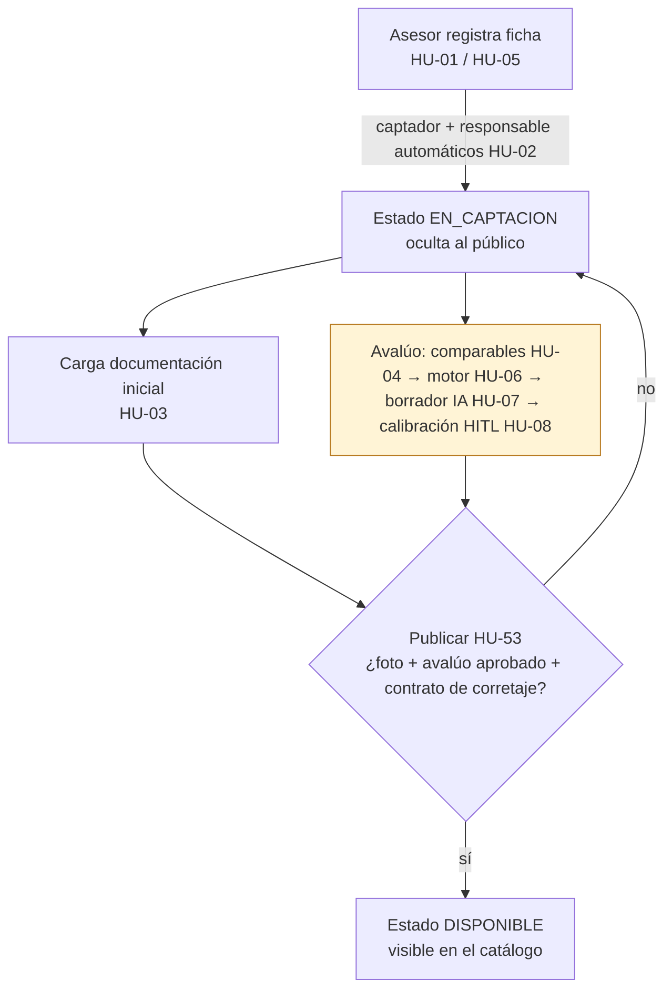

# Urbanex — Estado de procesos de negocio por historia de usuario

| Campo | Valor |
|---|---|
| Propósito | Conectar lo construido con los procesos reales de la inmobiliaria, HU por HU |
| Fecha de auditoría | 2026-10-22 · rama `develop` con cambios sin commit |
| Última actualización | 2026-10-30 · ronda 3 validada por Pablo (V-20 a V-25): HU-04 y HU-06 siguen en **Pruebas** por decisión de Pablo (el proceso se comparará de otra forma), con funcional y visual aprobadas (completas POR CONFIRMAR: C-02 y θ v1 provisionales); HU-08 validada también con el valor del motor; FX-18 (θ en el admin por rol admin). Antes: 2026-10-29 · tabla resumen y secciones al día con el código (auditoría documental): HU-04 y HU-06 pasan a **Pruebas** (técnica aprobada, 88 OK; funcional y visual pendientes, V-20 a V-25); HU-05, HU-08, HU-53, HU-01, la tabla de proceso y C-02 sin referencias vencidas a D-04 o DT-40. Antes: 2026-10-28 (noche) · HU-04 y HU-06 implementadas con el motor DS-21 (FX-17), validación visual pendiente. Antes: 2026-10-28 · HU-53: validación V-13 a V-18 de la tarea 3 (modales y requisitos del servidor) aprobada; DT-72 (estado de los datos demo). Antes: 2026-10-27 (noche) · validación de Pablo V-01 a V-12 aprobada: **DT-40 cerrado**; resumen actualizado para HU-01, 03, 05, 08 y 53. Antes, el mismo día: PR #2 (URB-15) fusionada en `develop` con pruebas por Postman, **sin validación en la interfaz**; las validaciones pendientes pasan a `Project_Progress.md` (V-01 a V-12). Antes: 2026-10-25 · rama `feat/URB-13-HU-08-pantalla-avaluo` · HU-08: pantalla I-12 e integración en el dashboard (fases 1, 2 y 3 de DT-40); HU-53: `missing_requirements` en la UI. Antes: 2026-10-24, HU-01 (DT-07), HU-08 (modelo base) y HU-53 (bloqueo de publicación) |
| Alcance | HU-01, HU-03, HU-05, HU-37, HU-44, HU-45, HU-46 (pedidas) + HU-02, HU-09, HU-53 (EP-2, relevantes para Avalúos) + HU-04, HU-06, HU-08 (punto de partida de Sebas) |
| Fuentes de requisitos | `ProyectoCapstoneV4 (3).md` (Anexo 2: criterios de aceptación; Anexo 4: backlog) y `URBANEX_MASTER_CONTEXT.md` (§4 RF, §10 backlog definitivo, §11 reglas) |

Detalle técnico en [Auditoría de código](URBANEX_AUDITORIA_CODIGO.md) · archivos en [GPS](URBANEX_GPS_ARCHIVOS.md) · porcentajes en [Avance de épicas](URBANEX_AVANCE_EPICAS.md).

## Cómo leer este documento

Cada HU tiene un **estado de trabajo** y cuatro **resultados de validación** independientes.

| Estado de trabajo | Significado |
|---|---|
| **Por hacer** | Sin implementación. Estado inicial de Jira; se añade porque los 5 estados del prompt no cubren historias no iniciadas |
| **En Curso** | Implementación incompleta o que incumple algún criterio |
| **Listo** | Implementación candidata a revisión; **no** significa proceso aprobado |
| **Pruebas** | Implementación completa a nivel técnico; falta validación funcional o visual |
| **Bloqueado** | No puede avanzar sin resolver una dependencia o decisión |
| **POR CONFIRMAR** | Evidencia insuficiente |

Validación por dimensión: **Aprobado** · **Fallido** · **Pendiente** · **No aplicable**.

- **Técnica:** pruebas automatizadas ejecutadas.
- **Funcional:** el proceso de negocio se cumple de extremo a extremo.
- **Visual:** la interfaz se comprobó en el navegador.

## Resumen

| HU | Nombre (tesis, Anexo 2) | Épica | Sprint (backlog definitivo) | Estado | Técnica | Funcional | Visual |
|---|---|---|---|---|---|---|---|
| [HU-01](#hu-01) | Registrar una propiedad en captación | EP-2 | 1 | En Curso | Aprobado (parcial) | Parcial: anónimos no ven la captación (V-01, 2026-10-27); quedan DT-34 y DT-39 | Aprobado (V-01) |
| [HU-02](#hu-02) | Registrarse como captador y responsable inicial | EP-2 | 1 | En Curso | Aprobado (parcial) | Pendiente | Pendiente |
| [HU-03](#hu-03) | Cargar la documentación inicial | EP-2 | 1 | Pruebas | Aprobado | Aprobado para PDF (V-03, 2026-10-27); la subida de una imagen no se probó | Aprobado (V-03; ver DT-60) |
| [HU-05](#hu-05) | Registrar las características del inmueble | EP-2 | 1 | En Curso | Pendiente | Parcial: el mapa guarda la ubicación (V-04); faltan los campos de RF-01 (DT-19) | Aprobado (V-04) |
| [HU-09](#hu-09) | Actualizar una propiedad publicada | EP-2 | 2 | En Curso | Pendiente | Pendiente | Pendiente |
| [HU-53](#hu-53) | Publicar una propiedad | EP-2 | 3 | En Curso | Aprobado (requisitos de publicación) | Aprobado para los requisitos (V-02, V-11, V-12; **DT-40 cerrado** 2026-10-27); falta `slug`/metaetiquetas | Aprobado (V-02, V-11, V-12; ver DT-57, DT-58) |
| [HU-04](#hu-04) | Seleccionar comparables para el avalúo | EP-2 | 2 | **Pruebas** (FX-17, 2026-10-28: endpoint de candidatos + pantalla I-11; validada en la ronda 3; sigue en Pruebas por decisión de Pablo, el proceso se comparará de otra forma; completa **POR CONFIRMAR**: C-02 provisional, falta el tutor) | Aprobado (90 OK, 2026-10-30) | Aprobado (V-20, V-23, V-24; Pablo, 2026-10-29/30) | Aprobado (V-20, V-23, V-24; ver DT-80, DT-81) |
| [HU-06](#hu-06) | Obtener el valor sugerido del motor | EP-2 | 2 | **Pruebas** (FX-17, 2026-10-28: motor DS-21, D-04 resuelta provisionalmente; FX-18 para θ en el admin; validada en la ronda 3; sigue en Pruebas por decisión de Pablo; completa **POR CONFIRMAR**: θ v1 en observación) | Aprobado (90 OK, 2026-10-30) | Aprobado (V-21, V-22, V-25; Pablo, 2026-10-29/30; V-25 tras FX-18) | Aprobado (V-21, V-22, V-25; ver DT-80) |
| [HU-08](#hu-08) | Calibrar y aprobar el avalúo | EP-2 | 2 | **Pruebas** (backend + pantalla I-12 + integración en el dashboard, 2026-10-25; validada el 2026-10-27 con registro manual; con el valor del motor, validada en V-21 a V-23 el 2026-10-29/30; completa **POR CONFIRMAR**, decisión de Pablo) | Aprobado (backend; frontend `tsc` y `build`; `eslint`: **2 errores previos de DT-24, ninguno nuevo**) | Aprobado con registro manual (V-05 a V-10, Pablo, 2026-10-27; ver N-05) | Aprobado (V-05 a V-10; ver DT-55, DT-56) |
| [HU-37](#hu-37) | Validar un documento | EP-6 | 7 | En Curso (regla de modelo adelantada) | Aprobado (solo modelo) | Pendiente | No aplicable aún |
| [HU-44](#hu-44) | Gestionar usuarios internos | EP-1 | 1 | **Pruebas** | **Aprobado (53/53 en `apps.users.tests`; suite 116/116)** | Aprobadas: V-26 a V-31; V-32 parcial, tras cambios de usabilidad pendiente revalidar | Parcial: validación funcional aprobada; retestar límite visual del teléfono y su presencia en la lista |
| [HU-45](#hu-45) | Desbloquear una cuenta | EP-1 | 1 | En Curso | Aprobado (bloqueo tras 5 intentos) | **Fallido** (desbloqueo admin pendiente) | Pendiente |
| [HU-46](#hu-46) | Iniciar sesión y recuperar contraseña | EP-1 | 1 | En Curso | Aprobado (login e inactivos) | Pendiente (recuperación pendiente) | Pendiente |

> **Ninguna HU auditada está completa al 100 %.** Ver regla de cálculo en [Avance de épicas](URBANEX_AVANCE_EPICAS.md).

### Evidencia de validación aportada por el usuario (2026-10-22, conversación de desarrollo)
- Vio el modal con las 4 pestañas y lo calificó positivamente → la **pestaña se renderiza** (evidencia visual parcial para la pantalla I-10).
- Tras aplicar las migraciones, "ya hace fetch de la base de datos" → el **dashboard carga la lista** de propiedades.
- **No reportó todavía:** búsqueda en el mapa, guardado de coordenadas, subida de documentos ni edición. La base de desarrollo tiene **0 propiedades con coordenadas** y **0 documentos**, lo que indica que esos flujos aún no se probaron después del cambio.

---

## Proceso de negocio: captación de una propiedad (RF-01, RF-10, RF-11)

**Estado al 2026-10-24: el proceso ya se aplica en el servidor.** El hueco 1 (DT-09) se cerró el mismo día (FX-11): `status` es de solo lectura y la única vía hacia `disponible` es la acción de publicar. Queda el hueco 2 (DT-40).

| Tramo | Antes (2026-10-22) | Ahora (2026-10-24) |
|---|---|---|
| Captación oculta al público | Visible para todos | Oculta para anónimos (DT-07 resuelto). HU-44 elimina el rol `cliente`; `users.0007` y `users.0008` se aplicaron en Supabase según Sebas (2026-10-29). SEC-01 sigue abierto: un asesor ve las captaciones de otros asesores |
| Avalúo | No existía | `apps.appraisals`: borrador → calibración → aprobación inmutable. **(2026-10-28, FX-17)** Motor DS-21 y pantalla I-11 de comparables; **FX-18** habilita la gestión de θ por rol admin. Ronda 3 validada por Pablo; línea base de `origin/develop`: 90 pruebas (2026-10-30) |
| Publicar | Sin requisitos | `POST …/publish/` exige foto + corretaje vigente no rechazado + avalúo aprobado, solo desde captación |
| ~~**Hueco 1 — DT-09 (P0)**~~ | — | **Resuelto (FX-11):** `POST` crea siempre en `captacion`; `PATCH` ignora `status` (`test_create_ignores_status`, `test_patch_cannot_change_status`) |
| **Hueco 2 — DT-40** | — | Desde la UI no se puede aprobar un avalúo, así que **ninguna propiedad se puede publicar desde el navegador**. Es el comportamiento de negocio esperado hasta que exista I-12. **2026-10-25: implementado en las 3 fases.** I-12 (`/dashboard/properties/[id]/appraisal`) aprueba desde la UI; el dashboard enlaza a I-12, muestra el estado del avalúo en el Expediente y lista `missing_requirements` al publicar. Se cierra cuando una persona publique desde el navegador. **Cerrado el 2026-10-27** (DT-40, validación V-11 y V-12 de Pablo) |

---

## HU-01

**Registrar una propiedad en captación** · EP-2 · RF-01, RF-08 · Pantalla I-10 · Sprint 1 (URB-05)

**Proceso:** el asesor incorpora un inmueble con información técnica y multimedia; la ficha queda interna hasta cumplir los requisitos de publicación.

| Criterio de aceptación (Anexo 2) | Implementación encontrada | Prueba | Resultado |
|---|---|---|---|
| Exige campos obligatorios y al menos una fotografía | Campos obligatorios: sí en el modelo/serializer. Foto: **solo en el frontend** (`validateForm`); el backend crea la propiedad sin imágenes | `test_create_property_as_agent` crea, pero no prueba rechazos | Parcial |
| Al guardarse queda En captación, sin exhibirse al público | `status` por defecto `captacion` ✔. **Desde 2026-10-24** un anónimo solo recibe `disponible`/`reservador` en la lista y 404 en el detalle de una ficha en captación (`PUBLIC_STATUSES`, commit `2817dcd`). Desde FX-11 el `POST` siempre guarda `captacion` (DT-09 resuelto). `users.0007` ya se aplicó en Supabase; el rol `cliente` fue eliminado del modelo y sus cuentas heredadas se mapearon a roles internos | `test_create_property_as_agent`, `test_create_ignores_status`, `test_anonymous_list_only_shows_public_statuses`, `test_anonymous_cannot_read_captacion_detail`, `test_owner_still_reads_captacion_detail` | Parcial (anónimos ✔; validación manual pendiente) |
| El asesor queda como captador y responsable inicial | `perform_create` asigna `agent=request.user`; `agent` de solo lectura en la API | `test_create_property_as_agent` verifica `agent` | Aprobado (técnico) |

- **Interfaz:** modal con 4 pestañas en `frontend/app/dashboard/page.tsx`. Los datos persisten al cambiar de pestaña; errores por pestaña; vistas previas de imágenes.
- **Bloqueos y riesgos:** ~~DT-07~~ y ~~DT-09~~ (resueltos 2026-10-24), DT-39 (rol `cliente`), DT-34 (foto al registrar solo en frontend), DT-10 (imágenes sin control de propiedad).
- **Siguiente paso:** ~~validar en el navegador sin sesión: una propiedad recién creada **no** aparece en `/properties` ni se abre en `/properties/<id>`~~ **Hecho el 2026-10-27 (V-01, Pablo, Aprobado).** Quedan DT-39/SEC-01 (también afecta a asesores) y DT-34.

## HU-02

**Registrarse como captador y responsable inicial** · EP-2 · RF-01, RF-08 · Sprint 1 (URB-06)

| Criterio | Implementación | Prueba | Resultado |
|---|---|---|---|
| El sistema asigna automáticamente al asesor autenticado | `agent=request.user` | `test_create_property_as_agent` | Aprobado |
| El dato de captador no es editable | Solo lectura en la API; **editable desde el admin de Django** | Ninguna | Parcial |
| Responsable inicial hasta una eventual reasignación | Un único campo `agent` cumple ambos papeles: una reasignación (HU-47) **sobrescribiría al captador** | Ninguna | Pendiente (requiere `captor_agent` + `responsible_agent`) |

Impacto para Avalúos: bajo. Impacto para co-intermediación (RF-07): alto. Ver DT-17.

## HU-03

**Cargar la documentación inicial** · EP-2 · RF-10 · Pantalla I-13 (dentro del modal, pestaña Expediente) · Sprint 1 (URB-07)

**Proceso:** el asesor respalda la captación con documentos (cédula catastral, prediales, contrato de corretaje) que quedan privados y versionados.

| Criterio | Implementación | Prueba (ejecutada 2026-10-22) | Resultado |
|---|---|---|---|
| Acepta archivos PDF e imágenes | Detección por bytes iniciales: PDF, JPEG, PNG, WEBP; rechaza tipos falsificados | `test_rejects_spoofed_content_type`, `test_rejects_files_over_20mb_and_invalid_types`; **ninguna prueba sube una imagen** | Aprobado para PDF; imágenes sin prueba |
| Cada documento registra su fecha de vigencia | `issue_date` y `expiration_date` obligatorias; vigencia ≥ emisión | `test_rejects_expiration_before_issue`, `test_failed_upload_keeps_previous_version_current` | Aprobado |
| El documento queda asociado a la propiedad | FK `property` (PROTECT); permisos por propiedad | `test_owner_uploads_and_new_upload_creates_version_2`, `test_other_agent_cannot_upload_or_see_documents` | Aprobado |

- Reglas adicionales del contexto maestro ya cubiertas: versionado inmutable, 20 MB, solo el dueño o el admin. Son 19 pruebas en total.
- **Fuera de alcance aún:** URLs firmadas de Supabase (HU-38, Sprint 6); hoy existe una descarga protegida provisional. La relación `opportunity` llega en el Sprint 7.
- **Siguiente paso, validación visual:** editar una propiedad; en Expediente, subir un PDF y una imagen; guardar; volver a abrir y comprobar que aparecen con versión v1, estado "Pendiente" y sin opción de borrar. Subir el mismo tipo otra vez y verificar v2.

## HU-05

**Registrar las características del inmueble** · EP-2 · RF-11 (tesis) / RF-01 y RF-11 (contexto maestro) · Pantallas I-10 e I-11 · Sprint 1 (URB-08)

**Proceso:** las características se capturan en forma estructurada para alimentar el motor de avalúo.

| Criterio | Implementación | Prueba | Resultado |
|---|---|---|---|
| Datos con valores numéricos o selectores, sin texto libre | Tipo (botones), precio, área, habitaciones, baños y parqueaderos son numéricos. Ubicación exacta por mapa y buscador Nominatim; latitud y longitud ya se **persisten** (migración `users.0006`) | Ninguna específica | Implementado para los campos existentes, sin prueba; el conjunto de campos de RF-01 está incompleto |
| Los campos obligatorios se validan antes de calcular | ~~No existe el cálculo (HU-06)~~ **(2026-10-28, FX-17)** `subject_blocker()` exige superficie > 0 y coordenadas antes de proponer comparables o calcular; si faltan, I-11 lo explica y ofrece el registro manual (`backend/apps/appraisals/services.py:17-24`) | `test_candidates_exclude_stale_data_and_explain_blockers` (`backend/apps/appraisals/tests.py:438`) | Implementado y verificado; validación visual pendiente |

- **Falta para el avalúo:** RF-01 pide `zone`, `operation_type`, `usable_area_m2`, `age_years`, `conservation_state`, `floor_number` y `storage_units`; **ninguno existe** en `Property` (DT-19). Sin `zone` no se pueden segmentar los comparables (RF-11).
- **Mapa:** búsqueda real comprobada contra Nominatim (200, CORS `*`). Faltan la validación visual y comprobar en BD que, tras guardar, las coordenadas no quedan en el valor por defecto de Quito.
- **Siguiente paso:** decidir con el equipo qué campos se agregan y si `zone` es texto controlado (selector) o se deriva de las coordenadas (**decisión de negocio**).

## HU-09

**Actualizar una propiedad publicada** · EP-2 · RF-01 · Sprint 2 (URB-09)

| Criterio | Implementación | Resultado |
|---|---|---|
| Cambiar entre En captación, Disponible y No disponible; No disponible exige motivo | **Desde FX-11 (2026-10-24) `status` es de solo lectura**: ningún estado se cambia por PATCH. HU-09 necesita una **acción explícita** (p. ej. `POST …/withdraw/` con motivo) que hoy no existe; la regla del motivo en `validate()` queda sin uso efectivo (DT-44). La UI tampoco permite cambiar el estado | No cumplido (falta la acción de HU-09) |
| No permite asignar Vendido o Arrendado manualmente | `validate()` lo rechaza | Implementado, sin prueba |

## HU-53

**Publicar una propiedad** · EP-2 · RF-01, RF-10, RF-11 · Pantallas I-10B y P-03 · Sprint 3 (URB-15)

| Criterio | Implementación | Resultado |
|---|---|---|
| Requiere avalúo registrado y contrato de corretaje cargado | **Desde 2026-10-24 (commit `cca371e`):** `PropertyPublishView` responde **400** con `missing_requirements` si falta ≥1 `PropertyImage`, un `CORRETAJE` vigente (versión actual, no vencido, no `RECHAZADO`; `PENDIENTE` sí sirve, DS-04) o un `Appraisal` `APROBADO`. Solo publica desde `captacion` (409 en otro estado, DS-07). Todo en `transaction.atomic` + `select_for_update`. Desde FX-11 es la **única** vía hacia `disponible` | Aprobado (técnico) |
| Al publicarse pasa a Disponible y se genera su URL con metaetiquetas | Pasa a `disponible`. No existen `slug` ni metaetiquetas OpenGraph | Parcial |

**Pruebas (`apps.users.tests`):** `test_publish_property_permission` (reescrita: 403 de un no dueño + 200 con todos los requisitos, corretaje `PENDIENTE`), `test_publish_rejected_without_image`, `…_without_corretaje`, `…_with_expired_corretaje`, `…_with_rejected_corretaje`, `…_with_draft_appraisal_only`, `test_publish_rejected_lists_all_missing_requirements`, `test_publish_only_from_captacion`.

**(2026-10-27, FX-16, DS-15)** Nuevo `GET /api/auth/properties/<id>/publication-requirements/` con la misma regla, sin publicar. El Expediente del dashboard lo consulta al editar, así que también muestra si el corretaje está vencido o rechazado. "Publicar" pide confirmación en un modal, y un 400 abre otro modal con enlaces a la pestaña donde se corrige cada requisito. **Validado por Pablo el 2026-10-28 (V-13 a V-18):** confirmación en modal que se cancela con "Cancelar" y con Escape; modal de requisitos con "Abrir Multimedia" (abre esa pestaña) y "Abrir Expediente"; el Expediente muestra "lista para publicar" y "ya no está en captación"; los errores de guardado quedan dentro del modal. Sin ver todavía, por el estado de los datos demo (DT-72): el resumen "faltan N requisito(s)" y "Ir al avalúo" dentro del modal (V-19). **Proceso:** un asesor que publica sin requisitos ya no recibe una ventana del navegador, sino la lista de lo que falta con el camino para resolverlo.

**Contrato del 400** (lo que la UI debe mostrar): `{"detail": "No se puede publicar: …", "missing_requirements": [{"code": "image" | "brokerage_contract" | "appraisal", "message": "…"}]}`. **Desde 2026-10-25 (`3783919`)** el dashboard lo muestra como lista sobre la tabla, con "Ir al avalúo" cuando falta el avalúo; el botón "Publicar" solo aparece en `captacion`.

**Validación de extremo a extremo** (~~pendiente, Pablo~~ **validada el 2026-10-27: V-01, V-02, V-11 y V-12**, `Project_Progress.md`; queda V-19, ver DT-72):
1. Sin foto, sin corretaje o sin avalúo, "Publicar" muestra la lista con lo que falta.
2. Con foto + corretaje + avalúo aprobado en I-12, "Publicar" muestra el aviso verde y el estado pasa a "Disponible"; el botón desaparece.
3. Sin sesión, la propiedad aparece en `/properties` y su ficha abre.

**Bloqueo funcional esperado (DT-40):** ~~como no existen las pantallas I-11/I-12, un avalúo solo se aprueba por la API.~~ **Desbloqueado en el código el 2026-10-25:** el avalúo se aprueba en I-12 y la publicación se hace desde el dashboard. La fila "Avalúo aprobado" del Expediente ya consulta los avalúos reales. Pendiente: que `get_missing_publication_requirements()` alimente también la Vista 360° (I-10B), que no existe.

**Validación funcional pendiente:** con un asesor de prueba, aprobar un avalúo (desde 2026-10-25 se puede hacer en la pantalla I-12 en lugar de la API), cargar foto y corretaje y publicar desde el dashboard; luego, sin sesión, comprobar que aparece en `/properties`. **Pablo confirmó el 2026-10-25 que todavía no ha hecho esta validación ni la del catálogo anónimo.** **(2026-10-27)** Sigue Pendiente: no hay usuario asesor hasta el seeder (DT-14). Los pasos, el resultado esperado y la fila para registrar la evidencia están en `Project_Progress.md` → "Validaciones pendientes de Pablo": **V-01, V-02, V-11 y V-12** para HU-53 y HU-01; **V-05 a V-10** para HU-08; **V-03** para HU-03; **V-04** para HU-05. **(2026-10-27) Hechas y aprobadas** V-01 a V-12 (DT-40 cerrado); lo anterior de este párrafo queda como historial.

## HU-04

**Seleccionar comparables para el avalúo** · EP-2 · RF-11 · Pantalla I-11 · Sprint 2 (URB-10)

- Criterios (tesis): no permite calcular con menos de 3 ni más de 5 comparables; el avalúo se hace durante la captación y es requisito para publicar; sin comparables suficientes, el avalúo se registra de forma manual.
- **Implementación (2026-10-28, FX-17, DS-21):**
  - `GET /api/appraisals/candidates/?property=<id>` propone candidatos del **mismo tipo**, con estado `disponible`, `reservador` o `vendido`, un dato de 365 días como máximo y de la **misma zona** (provisional: hasta 1,5 km, porque no existe `zone`). Los ordena por superficie más parecida y preselecciona 5.
  - La pantalla **I-11** (`/dashboard/properties/[id]/appraisal/comparables`) deja elegir de 3 a 5 y crea el borrador calculado.
  - Con menos de 3, el avalúo es **manual** y guarda los encontrados como referencia (C-02, opción A, **provisional hasta el tutor**).
  - El servidor vuelve a validar cada comparable que envía el cliente.
- **Proceso:** el asesor ya no inventa el valor desde cero: parte de datos de mercado de la base interna (RF-11) y deja la traza de qué comparó.
- **Datos de prueba:** `setup_comparables_demo` (DS-23) crea comparables sintéticos en `vendido` alrededor de las propiedades demo (casos ALTO, MEDIO, manual con 2 y manual con 0).
- **Pendientes:** ~~validación visual (V-20 a V-24)~~ **aprobada por Pablo el 2026-10-29/30** (V-20, V-23 y V-24; V-21 solo se pudo repetir tras aprobar un borrador previo, DT-74); `zone` (N-03), la fecha real del dato (DT-75), la visibilidad de datos de otros asesores (DT-76), comparables identificados solo por id en I-12 (DT-80) y el registro manual lento (DT-81).

## HU-06

**Obtener el valor sugerido del motor** · EP-2 · RF-11 · Pantalla I-12 · Sprint 2 (URB-11)

- Criterios: el motor procesa los comparables con factores ponderados; el cálculo queda registrado.
- ~~Bloqueado por D-04~~ **D-04 resuelta provisionalmente con DS-21 (2026-10-28).**
- **Implementación (FX-17):** motor determinista en `apps/appraisals/engine/` (método comparativo de mercado):
  - homogeneización con factores registrados y configurables por tipo (`superficie@1`, `negociacion@1`);
  - descarte de atípicos y combinación con pesos;
  - confianza ALTO o MEDIO según el CV (≤ 15 %).
- **Qué se registra al crear el avalúo:** el valor exacto, la confianza, la traza (`comparables_snapshot`) y la versión de θ (`EngineParameters`), todo inmutable. La interfaz muestra el valor **redondeado a cientos**.
- **Pruebas:** 24 nuevas, entre ellas el ejemplo de DS-21 §8 (USD 143.861,35, ALTO).
- **Pendientes:** ~~validación visual~~ **aprobada por Pablo el 2026-10-29/30**:
  - V-21: ejemplo de DS-21 §8, ≈ $143.900, exacto $143.861,35, CV 1,63 %, ALTO, con el atípico en gris;
  - V-22: Medio, CV 21,27 %;
  - V-25: θ v2 creada y v1 reactivada desde el admin, tras FX-18.

  Siguen pendientes: confirmar C-02 y la adaptación de la superficie a viviendas con el tutor; θ v1 sigue EN OBSERVACIÓN; un admin creado desde A-01 no podrá gestionar θ (DT-82).

## HU-08

**Calibrar y aprobar el avalúo** · EP-2 · RF-11 · Pantalla I-12 · Sprint 2 (URB-13)

| Criterio | Implementación (2026-10-24, commit `58b968c`) | Prueba | Resultado |
|---|---|---|---|
| Conservar el valor del motor, el calibrado y su diferencia | `Appraisal` guarda `suggested_value`, `calibrated_value`, `difference_amount` y `difference_percentage`; `approve()` calcula la diferencia (nula si no hay valor del motor). **I-12 (2026-10-25)** muestra el valor del motor ("No disponible (D-04)"), el calibrado y la diferencia ("No aplica (sin valor del motor)"). **(2026-10-28, FX-17)** Con el motor, I-12 muestra el valor sugerido redondeado y el exacto, o "No disponible (registro manual)" cuando hay menos de 3 comparables (`frontend/app/dashboard/properties/[id]/appraisal/page.tsx:347`) | `test_approve_computes_differences_when_engine_value_exists`, `test_approve_without_suggested_value_leaves_differences_null` | Aprobado (backend). Visual con registro manual: aprobado (V-05 a V-08, 2026-10-27). Con el valor del motor: aprobado (V-21 a V-23, Pablo, 2026-10-29/30) |
| Un avalúo aprobado no se sobrescribe | Inmutabilidad igual que `Document`: `delete()` y `QuerySet.delete()` bloqueados; `save()` y `QuerySet.update()` validan `MUTABLE_FIELDS`; aprobado = ningún campo cambia. Restricciones de BD: un borrador abierto por propiedad, aprobado exige calibración y justificación. Admin de Django de solo lectura | `test_approved_appraisal_cannot_be_saved`, `…_bulk_updated`, `…_recalibrated_or_reapproved`, `test_appraisals_cannot_be_deleted`, `test_draft_engine_fields_are_immutable`, API: PATCH/approve tras aprobar → 400, PUT/DELETE → 405 | Aprobado (backend) |

- **Ciclo:** `POST /api/appraisals/` (borrador) → `PATCH /api/appraisals/<id>/` (`calibrated_value`, `final_justification`) → `POST /api/appraisals/<id>/approve/`. Permisos: asesor dueño o admin (DS-05). Reevaluar = nuevo avalúo (DS-06).
- **Placeholder (DS-02):** sin motor (D-04), cada avalúo nace con `suggested_value = NULL`, `is_manual_fallback = True` y confianza `BAJO`. Marcado con `# TODO: Implementar motor de cálculo HITL` en `Appraisal.create_draft()`. **(2026-10-28, FX-17)** Superado: `Appraisal.create_draft(comparables=…)` calcula con el motor DS-21 (`backend/apps/appraisals/models.py:270`) y el `TODO` ya no existe. El registro manual (DS-02) se mantiene solo cuando hay menos de 3 comparables (C-02, provisional).
- **Pantalla I-12 (2026-10-25, commits `161f845` y `af9b416`):** ruta `/dashboard/properties/[id]/appraisal` (DS-10).
  - Sin avalúos: botón explícito **"Iniciar avalúo"** (DS-11).
  - Tarjeta "Referencia": **"Precio actual de publicación"** en un campo gris deshabilitado, solo como referencia (DS-12).
  - Tarjeta "Resultado del motor": valor sugerido "No disponible (D-04)", confianza `BAJO`, origen "Registro manual" (DS-02). **(2026-10-28, FX-17)** Ahora muestra el valor del motor, la confianza y el origen "Motor paramétrico · parámetros v{n}", o "Registro manual" (`page.tsx:370-371`).
  - Calibración: valor calibrado (> 0, 2 decimales) y justificación; "Guardar borrador" (PATCH) y "Aprobar avalúo", que pide confirmar que es irreversible y se desactiva si hay cambios sin guardar.
  - Aprobado: vista de solo lectura, "Crear reevaluación" (DS-06) e historial de aprobados.
- **Integración en el dashboard (fase 3, 2026-10-25, commit `3783919`):** botón "Avalúo" en cada fila; en el modal de edición, la fila "Avalúo aprobado" del Expediente muestra Aprobado (verde), En borrador (ámbar) o Falta, con el enlace "Abrir avalúo".
- **Validación visual** (~~pendiente (Pablo)~~ **hecha el 2026-10-27 con registro manual: V-05 a V-10, Aprobado**; la parte del motor, aprobada en V-21 a V-23 el 2026-10-29/30). Pasos sugeridos originales, como asesor dueño de una propiedad en captación, entrando con el botón "Avalúo" del dashboard:
  1. Ves el precio en el campo gris y el botón "Iniciar avalúo"; al pulsarlo aparece el folio y el formulario.
  2. "Aprobar avalúo" está desactivado hasta guardar valor y justificación.
  3. Un valor `0` o `12,5` muestra el error del campo; un valor válido se guarda.
  4. Al aprobar sale la confirmación; después el formulario desaparece y queda la vista de solo lectura y el historial.
  5. "Crear reevaluación" abre un borrador nuevo sin borrar el aprobado.
  6. De vuelta en el dashboard, "Editar" → pestaña Expediente: la fila "Avalúo aprobado" está en verde.
- **Falta:** ~~las validaciones~~ (hechas el 2026-10-27, V-05 a V-10); HU-07 (borrador IA) llenará `ai_draft_justification`. ~~HU-06 llenará `suggested_value` y `confidence_level`~~ **Desde FX-17 (2026-10-28) HU-06 los llena**; validado en la interfaz en V-21 a V-23 (2026-10-29/30).
- **BD local:** migración aplicada en la copia de Pablo el 2026-10-24 (`showmigrations appraisals` → `[X] 0001_initial`). Cualquier otra copia debe ejecutar `pipenv run python manage.py migrate` (DT-43).

## HU-37

**Validar un documento** · EP-6 · RF-10 · Pantalla I-13 · **Sprint 7** (URB-41)

| Criterio (tesis) | Implementación | Resultado |
|---|---|---|
| Solo el administrador valida | `Document.validate_document()` exige `role == 'admin'` | Aprobado a nivel de modelo (`test_only_admin_can_validate`, `test_rejection_requires_reason`, `test_old_versions_cannot_be_validated`). Sin endpoint ni UI |
| Un documento rechazado o faltante bloquea el avance | Esta regla **sí está escrita en la tesis** (Anexo 2) y en RF-10 ("Impide pasar de Evaluación Documental a Pendiente de Cierre…"). No implementada: no existen las oportunidades (Sprint 5–6) | Pendiente |

~~Pregunta de negocio abierta (N-01)~~ **Resuelta 2026-10-24 (DS-04):** un `CORRETAJE` vigente en estado `RECHAZADO` **impide publicar**; uno `PENDIENTE` lo permite. Implementado en HU-53.

En la base de desarrollo no hay ningún usuario con rol `admin`, así que esta regla no se puede validar en la interfaz sin preparar datos. **(2026-10-27)** `setup_demo_data` crea `admin.demo@urbanex.test` (DT-14, FX-15); la regla sigue sin endpoint ni UI (Sprint 7).

## HU-44

**Gestionar usuarios internos** · EP-1 · RF-12 · Pantalla A-01 · Sprint 1 (URB-02)

| Criterio | Implementación | Resultado |
|---|---|---|
| Correo único | `User.email` único y validado en API; duplicados rechazados | Aprobado en pruebas |
| Roles internos | Solo `admin` y `asesor`; la migración convierte roles heredados `cliente` (superusuario → admin, resto → asesor) | Aplicado en Supabase según confirmación del usuario |
| Crear usuario | API admin-only; cuenta inactiva, contraseña inutilizable y enlace de activación enviado | Aprobado en pruebas; entrega real no verificada |
| Editar usuario | Solo nombre, apellido, teléfono y rol; email no editable | Aprobado en pruebas |
| Desactivar usuario | Sin `DELETE`; motivo obligatorio; no permite autodesactivación; asesor conserva registro y sus propiedades quedan sin responsable; las cuentas desactivadas no se reactivan en este alcance | Aprobado en pruebas |
| Activar cuenta | Token guardado como hash, de un solo uso, 24 horas; contraseña validada; inactivos no pueden iniciar sesión | Pruebas automatizadas aprobadas; V-27 y V-28 comprobadas manualmente |
| Reenvío de invitación | Solo para cuentas pendientes de activación; no reenvía invitaciones a cuentas desactivadas por un administrador | V-29 aprobada manualmente: al reenviar, el enlace anterior deja de servir |
| Envío de invitación | Resend integrado como proveedor seleccionable por variables de entorno; consola permanece como opción local | Integración probada; el modo de prueba de Resend limita destinatarios y el dominio no está verificado. Validación manual de correo real pendiente |
| Pantalla A-01 | Next.js en `/dashboard/users`; visible solo a rol admin; Django Admin queda como herramienta interna; cierre de sesión en navegación global | V-31 aprobada: asesor no ve la pantalla y `GET /api/auth/users/` responde 403 |

**Estado HU-44: Pruebas.** `apps.users.tests` pasó 53/53; la suite backend pasó 116/116 con SQLite y correo de consola. Sebas confirmó manualmente V-26 a V-31, incluyendo que el enlace anterior no sirve después del reenvío y que la API responde 403 para un asesor. También confirmó la validación del celular; después se ajustó el campo para aceptar solo dígitos (máximo 10), mostrar el teléfono en la lista y desplazar el formulario a la vista. Falta revalidar esos cambios de interfaz (V-32). Los correos de la prueba se imprimieron en consola; no se verificó entrega real por Resend.

Las migraciones `users.0007` y `users.0008` están aplicadas en Supabase. Sebas confirmó el 2026-10-30 que copió datos de `db.sqlite3` a Supabase; registrar este origen en DT-65 y confirmar la rotación de credenciales de las cuentas importadas.

## HU-45

**Desbloquear una cuenta** · EP-1 · RF-13 · Pantalla A-01 · Sprint 1 (URB-03)

| Criterio | Implementación | Resultado |
|---|---|---|
| La cuenta se bloquea tras 5 intentos fallidos | `LoginView`: `failed_attempts += 1`; `is_locked=True` al llegar a 5; responde 403 si está bloqueada | Aprobado en pruebas: 5 intentos fallidos bloquean el acceso |
| Solo el administrador desbloquea | No hay endpoint ni acción de desbloqueo en A-01 | **Pendiente** |

Tampoco existe la notificación in-app al admin que pide RF-13.

## HU-46

**Iniciar sesión y recuperar contraseña** · EP-1 · RF-13 · Pantallas I-01 e I-02 · Sprint 1 (URB-04)

| Criterio | Implementación | Resultado |
|---|---|---|
| Solo los usuarios activos inician sesión | `LoginView` rechaza usuarios inactivos antes de emitir JWT | Aprobado en pruebas |
| Enlace de recuperación de 60 min y de un solo uso | No existe (`PasswordResetToken`, I-02, Resend) | **Fallido** |

- Sesión: `access` en `sessionStorage` (aislado por pestaña), vigencia de 1 día; el `refresh` no se guarda; no hay cierre por inactividad. Depende de la decisión D-05.
- El pedido original agrupaba HU-44, HU-45 y HU-46 con el "modal de propiedades". En la tesis son historias de acceso (ver C-01). El modal se audita en HU-01, HU-03 y HU-05.

---

## Contradicciones entre fuentes

| ID | Contradicción | Fuentes | Decisión que debe confirmar el equipo |
|---|---|---|---|
| C-01 | El pedido de auditoría asocia HU-44, HU-45 y HU-46 al modal con pestañas; la tesis las define como gestión de usuarios, desbloqueo y login | Prompt de auditoría vs Anexo 2 y Anexo 4 de la tesis | Confirmar que el modal pertenece a HU-01, HU-03 y HU-05 (pantalla I-10) |
| C-02 | HU-04: "no permite calcular con menos de 3 comparables". RF-11 y el contexto maestro: confianza `Medio` con 1–2 comparables y `Bajo` (manual) con 0 | Anexo 2 vs RF-11 y `URBANEX_MASTER_CONTEXT.md` §4 | ¿Con 1–2 comparables se calcula (confianza media) o se pasa a manual? ~~Bloquea el diseño de HU-04 y HU-06~~ **(2026-10-28) Provisional por DS-21: manual con 1–2 comparables; pendiente de confirmar con el tutor** ([Deuda C-02](URBANEX_DEUDA_TECNICA.md)) |
| C-03 | EP-2 tiene "9 historias / 33 pts" (Tabla 23), pero el Anexo 4 le asigna 10 HU (HU-01 a HU-09 + HU-53) que suman 33 pts | Tesis, tabla 23 vs anexo 4 | El contexto maestro adopta 10 HU / 33 pts; corregir la tabla 23 |
| C-04 | Plan de sprints: la tesis (Tabla 24) pone propiedades en el Sprint 2 y avalúo en el 3; el backlog definitivo del contexto maestro pone propiedades en el 1 y avalúo en el 2 | Tesis vs contexto maestro §8 y §10 | El contexto maestro se declara el plan adoptado; confirmar |
| C-05 | HU-01 en el Anexo 4 se titula "Registrar y publicar"; en el Anexo 2, "Registrar en captación" (la publicación es HU-53) | Tesis | Usar el título del Anexo 2 |
| C-06 | El contexto maestro nombra `main` y ramas `feat/URB-XX-…`; el repositorio usa `master`/`develop`/`test`, y el prompt propone `feature/HU-XX-…` | Contexto maestro §2, repositorio, prompt | Elegir una convención única (ver [Estándares](URBANEX_ESTANDARES_DOD.md#5-gitflow-y-colaboración)) |
| C-07 | La arquitectura documentada (PostgreSQL/Supabase/Cloudinary) no coincide con la real (SQLite y almacenamiento local) | README y contexto maestro vs `settings.py` | Registrar cuándo se migra (Sprint 8 / URB-55, POR CONFIRMAR) |
| C-08 | El rol `cliente` existe en `User` y es el valor por defecto; RF-12 solo define `Administrador` y `Asesor` | `models.py` vs RF-12 | Decisión de Sebas (Mateo Cartagena en GitHub; comunicada por WhatsApp, 2026-10-29): limitar roles a `admin`/`asesor`; pendiente de confirmar por Pablo y, si aplica, por el tutor |
