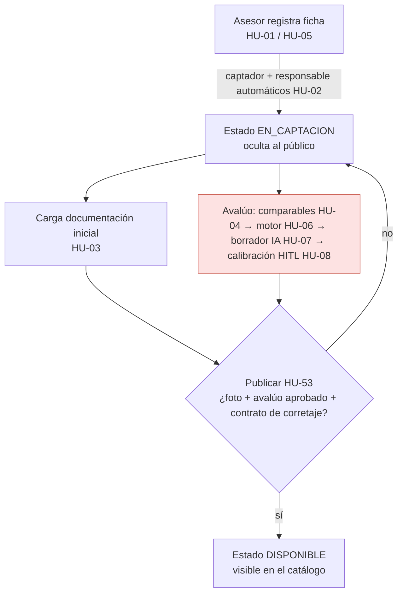

# Urbanex — Estado de procesos de negocio por historia de usuario

| Campo | Valor |
|---|---|
| Propósito | Conectar lo construido con los procesos reales de la inmobiliaria, HU por HU |
| Fecha de auditoría | 2026-10-22 · rama `develop` con cambios sin commit |
| Alcance | HU-01, HU-03, HU-05, HU-37, HU-44, HU-45, HU-46 (pedidas) + HU-02, HU-09, HU-53 (EP-2, relevantes para Avalúos) + HU-04, HU-06, HU-08 (punto de partida de Sebas) |
| Fuentes de requisitos | `ProyectoCapstoneV4 (3).md` (Anexo 2: criterios de aceptación; Anexo 4: backlog) y `URBANEX_MASTER_CONTEXT.md` (§4 RF, §10 backlog definitivo, §11 reglas) |

Detalle técnico en [Auditoría de código](URBANEX_AUDITORIA_CODIGO.md) · archivos en [GPS](URBANEX_GPS_ARCHIVOS.md) · porcentajes en [Avance de épicas](URBANEX_AVANCE_EPICAS.md).

## Cómo leer este documento

Cada HU tiene un **estado de trabajo** y cuatro **resultados de validación** independientes.

| Estado de trabajo | Significado |
|---|---|
| **Por hacer** | Sin implementación. Estado inicial de Jira; se añade porque los 5 estados del prompt no cubren historias no iniciadas |
| **En Curso** | Implementación incompleta o que incumple algún criterio |
| **Listo** | Implementación candidata a revisión; **no** significa proceso aprobado |
| **Pruebas** | Implementación completa a nivel técnico; falta validación funcional o visual |
| **Bloqueado** | No puede avanzar sin resolver una dependencia o decisión |
| **POR CONFIRMAR** | Evidencia insuficiente |

Validación por dimensión: **Aprobado** · **Fallido** · **Pendiente** · **No aplicable**.

- **Técnica:** pruebas automatizadas ejecutadas.
- **Funcional:** el proceso de negocio se cumple de extremo a extremo.
- **Visual:** la interfaz se comprobó en el navegador.

## Resumen

| HU | Nombre (tesis, Anexo 2) | Épica | Sprint (backlog definitivo) | Estado | Técnica | Funcional | Visual |
|---|---|---|---|---|---|---|---|
| [HU-01](#hu-01) | Registrar una propiedad en captación | EP-2 | 1 | En Curso | Aprobado (parcial) | **Fallido** | Pendiente |
| [HU-02](#hu-02) | Registrarse como captador y responsable inicial | EP-2 | 1 | En Curso | Aprobado (parcial) | Pendiente | Pendiente |
| [HU-03](#hu-03) | Cargar la documentación inicial | EP-2 | 1 | Pruebas | Aprobado | Pendiente | Pendiente |
| [HU-05](#hu-05) | Registrar las características del inmueble | EP-2 | 1 | En Curso | Pendiente | Pendiente | Pendiente |
| [HU-09](#hu-09) | Actualizar una propiedad publicada | EP-2 | 2 | En Curso | Pendiente | Pendiente | Pendiente |
| [HU-53](#hu-53) | Publicar una propiedad | EP-2 | 3 | En Curso | **Fallido** | **Fallido** | Pendiente |
| [HU-04](#hu-04) | Seleccionar comparables para el avalúo | EP-2 | 2 | Por hacer | Pendiente | Pendiente | Pendiente |
| [HU-06](#hu-06) | Obtener el valor sugerido del motor | EP-2 | 2 | **Bloqueado** (D-04) | Pendiente | Pendiente | Pendiente |
| [HU-08](#hu-08) | Calibrar y aprobar el avalúo | EP-2 | 2 | Por hacer | Pendiente | Pendiente | Pendiente |
| [HU-37](#hu-37) | Validar un documento | EP-6 | 7 | En Curso (regla de modelo adelantada) | Aprobado (solo modelo) | Pendiente | No aplicable aún |
| [HU-44](#hu-44) | Gestionar usuarios internos | EP-1 | 1 | Por hacer | **Fallido** | **Fallido** | Pendiente |
| [HU-45](#hu-45) | Desbloquear una cuenta | EP-1 | 1 | En Curso | Pendiente | **Fallido** | Pendiente |
| [HU-46](#hu-46) | Iniciar sesión y recuperar contraseña | EP-1 | 1 | En Curso | Aprobado (parcial) | **Fallido** | Pendiente |

> **Ninguna HU auditada está completa al 100 %.** Ver regla de cálculo en [Avance de épicas](URBANEX_AVANCE_EPICAS.md).

### Evidencia de validación aportada por el usuario (2026-10-22, conversación de desarrollo)
- Vio el modal con las 4 pestañas y lo calificó positivamente → la **pestaña se renderiza** (evidencia visual parcial para la pantalla I-10).
- Tras aplicar las migraciones, "ya hace fetch de la base de datos" → el **dashboard carga la lista** de propiedades.
- **No reportó todavía:** búsqueda en el mapa, guardado de coordenadas, subida de documentos ni edición. La base de desarrollo tiene **0 propiedades con coordenadas** y **0 documentos**, lo que indica que esos flujos aún no se probaron después del cambio.

---

## Proceso de negocio: captación de una propiedad (RF-01, RF-10, RF-11)

**Hoy el sistema no aplica este proceso:** (1) las propiedades `captacion` ya son visibles en el catálogo, (2) publicar no exige ni avalúo ni corretaje, y (3) el avalúo no existe. El proceso está documentado, pero **el software todavía se comporta como un CRUD** en este tramo.

---

## HU-01

**Registrar una propiedad en captación** · EP-2 · RF-01, RF-08 · Pantalla I-10 · Sprint 1 (URB-05)

**Proceso:** el asesor incorpora un inmueble con información técnica y multimedia; la ficha queda interna hasta cumplir los requisitos de publicación.

| Criterio de aceptación (Anexo 2) | Implementación encontrada | Prueba | Resultado |
|---|---|---|---|
| Exige campos obligatorios y al menos una fotografía | Campos obligatorios: sí en el modelo/serializer. Foto: **solo en el frontend** (`validateForm`); el backend crea la propiedad sin imágenes | `test_create_property_as_agent` crea, pero no prueba rechazos | Parcial |
| Al guardarse queda En captación, sin exhibirse al público | `status` por defecto `captacion` ✔. **`GET /api/auth/properties/` y `/properties/<id>/` devuelven también las de captación a anónimos**, y `frontend/app/properties/page.tsx` las muestra | `test_create_property_as_agent` verifica `captacion` | **Fallido** (exposición pública) |
| El asesor queda como captador y responsable inicial | `perform_create` asigna `agent=request.user`; `agent` de solo lectura en la API | `test_create_property_as_agent` verifica `agent` | Aprobado (técnico) |

- **Interfaz:** modal con 4 pestañas en `frontend/app/dashboard/page.tsx`. Los datos persisten al cambiar de pestaña; errores por pestaña; vistas previas de imágenes.
- **Bloqueos y riesgos:** DT-07 (exposición pública), DT-34 (foto solo en frontend), DT-10 (imágenes sin control de propiedad).
- **Siguiente paso:** filtrar el catálogo público a `disponible` y `reservado` en el backend (RF-01) y exigir la foto también en el servidor. Después, validar en el navegador: crear con y sin foto, y comprobar que la propiedad no aparece en `/properties`.

## HU-02

**Registrarse como captador y responsable inicial** · EP-2 · RF-01, RF-08 · Sprint 1 (URB-06)

| Criterio | Implementación | Prueba | Resultado |
|---|---|---|---|
| El sistema asigna automáticamente al asesor autenticado | `agent=request.user` | `test_create_property_as_agent` | Aprobado |
| El dato de captador no es editable | Solo lectura en la API; **editable desde el admin de Django** | Ninguna | Parcial |
| Responsable inicial hasta una eventual reasignación | Un único campo `agent` cumple ambos papeles: una reasignación (HU-47) **sobrescribiría al captador** | Ninguna | Pendiente (requiere `captor_agent` + `responsible_agent`) |

Impacto para Avalúos: bajo. Impacto para co-intermediación (RF-07): alto. Ver DT-17.

## HU-03

**Cargar la documentación inicial** · EP-2 · RF-10 · Pantalla I-13 (dentro del modal, pestaña Expediente) · Sprint 1 (URB-07)

**Proceso:** el asesor respalda la captación con documentos (cédula catastral, prediales, contrato de corretaje) que quedan privados y versionados.

| Criterio | Implementación | Prueba (ejecutada 2026-10-22) | Resultado |
|---|---|---|---|
| Acepta archivos PDF e imágenes | Detección por bytes iniciales: PDF, JPEG, PNG, WEBP; rechaza tipos falsificados | `test_rejects_spoofed_content_type`, `test_rejects_files_over_20mb_and_invalid_types`; **ninguna prueba sube una imagen** | Aprobado para PDF; imágenes sin prueba |
| Cada documento registra su fecha de vigencia | `issue_date` y `expiration_date` obligatorias; vigencia ≥ emisión | `test_rejects_expiration_before_issue`, `test_failed_upload_keeps_previous_version_current` | Aprobado |
| El documento queda asociado a la propiedad | FK `property` (PROTECT); permisos por propiedad | `test_owner_uploads_and_new_upload_creates_version_2`, `test_other_agent_cannot_upload_or_see_documents` | Aprobado |

- Reglas adicionales del contexto maestro ya cubiertas: versionado inmutable, 20 MB, solo el dueño o el admin. Son 19 pruebas en total.
- **Fuera de alcance aún:** URLs firmadas de Supabase (HU-38, Sprint 6); hoy existe una descarga protegida provisional. La relación `opportunity` llega en el Sprint 7.
- **Siguiente paso, validación visual:** editar una propiedad; en Expediente, subir un PDF y una imagen; guardar; volver a abrir y comprobar que aparecen con versión v1, estado "Pendiente" y sin opción de borrar. Subir el mismo tipo otra vez y verificar v2.

## HU-05

**Registrar las características del inmueble** · EP-2 · RF-11 (tesis) / RF-01 y RF-11 (contexto maestro) · Pantallas I-10 e I-11 · Sprint 1 (URB-08)

**Proceso:** las características se capturan en forma estructurada para alimentar el motor de avalúo.

| Criterio | Implementación | Prueba | Resultado |
|---|---|---|---|
| Datos con valores numéricos o selectores, sin texto libre | Tipo (botones), precio, área, habitaciones, baños y parqueaderos son numéricos. Ubicación exacta por mapa y buscador Nominatim; latitud y longitud ya se **persisten** (migración `users.0006`) | Ninguna específica | Implementado para los campos existentes, sin prueba; el conjunto de campos de RF-01 está incompleto |
| Los campos obligatorios se validan antes de calcular | No existe el cálculo (HU-06) | — | Pendiente |

- **Falta para el avalúo:** RF-01 pide `zone`, `operation_type`, `usable_area_m2`, `age_years`, `conservation_state`, `floor_number` y `storage_units`; **ninguno existe** en `Property` (DT-19). Sin `zone` no se pueden segmentar los comparables (RF-11).
- **Mapa:** búsqueda real comprobada contra Nominatim (200, CORS `*`). Faltan la validación visual y comprobar en BD que, tras guardar, las coordenadas no quedan en el valor por defecto de Quito.
- **Siguiente paso:** decidir con el equipo qué campos se agregan y si `zone` es texto controlado (selector) o se deriva de las coordenadas (**decisión de negocio**).

## HU-09

**Actualizar una propiedad publicada** · EP-2 · RF-01 · Sprint 2 (URB-09)

| Criterio | Implementación | Resultado |
|---|---|---|
| Cambiar entre En captación, Disponible y No disponible; No disponible exige motivo | `PropertySerializer.validate()` exige el motivo. **La UI no permite cambiar el estado.** Por PATCH se puede poner cualquier estado, incluido `disponible` (salta HU-53) o `reservador` | No cumplido (sin UI; riesgo DT-09) |
| No permite asignar Vendido o Arrendado manualmente | `validate()` lo rechaza | Implementado, sin prueba |

## HU-53

**Publicar una propiedad** · EP-2 · RF-01, RF-10, RF-11 · Pantallas I-10B y P-03 · Sprint 3 (URB-15)

| Criterio | Implementación | Resultado |
|---|---|---|
| Requiere avalúo registrado y contrato de corretaje cargado | `PropertyPublishView` **solo comprueba permisos**; publica sin avalúo, sin corretaje y sin foto. `test_publish_property_permission` **afirma** ese comportamiento | **Fallido** |
| Al publicarse pasa a Disponible y se genera su URL con metaetiquetas | Pasa a `disponible`. No existen `slug` ni metaetiquetas OpenGraph | Parcial |

Dependencia directa de Avalúos: cuando exista el avalúo aprobado, esta vista debe exigirlo junto con `Document` vigente de tipo `CORRETAJE` y al menos una foto. La prueba actual deberá reescribirse. La pestaña Expediente ya muestra "Avalúo aprobado — Módulo de avalúos (Sprint 2)" como requisito pendiente.

## HU-04

**Seleccionar comparables para el avalúo** · EP-2 · RF-11 · Pantalla I-11 · Sprint 2 (URB-10)

- Criterios (tesis): no permite calcular con menos de 3 ni más de 5 comparables; el avalúo se hace durante la captación y es requisito para publicar; sin comparables suficientes, el avalúo se registra de forma manual.
- Implementación: **ninguna** (no existe `apps.appraisals`).
- Dependencias: `Property.zone` (inexistente), datos de comparables (la base de desarrollo no tiene un conjunto de prueba diseñado) y la contradicción C-02.

## HU-06

**Obtener el valor sugerido del motor** · EP-2 · RF-11 · Pantalla I-12 · Sprint 2 (URB-11)

- Criterios: el motor procesa los comparables con factores ponderados; el cálculo queda registrado.
- **Bloqueado** por la decisión **D-04** del contexto maestro (fórmula, factores, umbrales de confianza y datos iniciales), que debe resolverse antes de URB-11. No se debe inventar la fórmula.

## HU-08

**Calibrar y aprobar el avalúo** · EP-2 · RF-11 · Pantalla I-12 · Sprint 2 (URB-13)

- Criterios: conservar el valor del motor, el calibrado y su diferencia; un avalúo aprobado no se sobrescribe.
- Implementación: ninguna. Patrón reutilizable: la inmutabilidad de `Document` (bloqueo de `save`/`delete`/`update` y restricciones de BD) en `backend/apps/documents/models.py`.

## HU-37

**Validar un documento** · EP-6 · RF-10 · Pantalla I-13 · **Sprint 7** (URB-41)

| Criterio (tesis) | Implementación | Resultado |
|---|---|---|
| Solo el administrador valida | `Document.validate_document()` exige `role == 'admin'` | Aprobado a nivel de modelo (`test_only_admin_can_validate`, `test_rejection_requires_reason`, `test_old_versions_cannot_be_validated`). Sin endpoint ni UI |
| Un documento rechazado o faltante bloquea el avance | Esta regla **sí está escrita en la tesis** (Anexo 2) y en RF-10 ("Impide pasar de Evaluación Documental a Pendiente de Cierre…"). No implementada: no existen las oportunidades (Sprint 5–6) | Pendiente |

Pregunta de negocio abierta: ¿un documento `RECHAZADO` de tipo `CORRETAJE` debe impedir también **publicar** la propiedad (HU-53)? RF-01 solo dice "contrato de corretaje cargado". **POR CONFIRMAR con el equipo.**

En la base de desarrollo no hay ningún usuario con rol `admin`, así que esta regla no se puede validar en la interfaz sin preparar datos.

## HU-44

**Gestionar usuarios internos** · EP-1 · RF-12 · Pantalla A-01 · Sprint 1 (URB-02)

| Criterio | Implementación | Resultado |
|---|---|---|
| Cada usuario tiene un correo único | `User.email` **no** es único; el login usa `.filter(email=...).first()` | **Fallido** |
| El administrador no puede desactivar su propia cuenta | No hay gestión de usuarios propia; solo el `UserAdmin` genérico de Django, que **no muestra `role`, `is_locked` ni `failed_attempts`** | **Fallido** |

No hay pantalla A-01 ni endpoints `/users/`.

## HU-45

**Desbloquear una cuenta** · EP-1 · RF-13 · Pantalla A-01 · Sprint 1 (URB-03)

| Criterio | Implementación | Resultado |
|---|---|---|
| La cuenta se bloquea tras 5 intentos fallidos | `LoginView`: `failed_attempts += 1`; `is_locked=True` al llegar a 5; responde 403 si está bloqueada; reinicia al acertar | Implementado. La prueba solo verifica el primer intento fallido (`test_login_failed_with_invalid_credentials`) |
| Solo el administrador desbloquea | No hay endpoint ni UI; `is_locked` no aparece en el admin de Django | **Fallido** |

Tampoco existe la notificación in-app al admin que pide RF-13.

## HU-46

**Iniciar sesión y recuperar contraseña** · EP-1 · RF-13 · Pantallas I-01 e I-02 · Sprint 1 (URB-04)

| Criterio | Implementación | Resultado |
|---|---|---|
| Solo los usuarios activos inician sesión | `LoginView` **no comprueba `is_active`**; SimpleJWT `for_user` solo registra una advertencia y emite el token. Las peticiones protegidas posteriores sí lo rechazan (`CHECK_USER_IS_ACTIVE=True`). Efecto: un inactivo "entra" al dashboard y luego falla | **Fallido** (por lectura de código; no reproducido) |
| Enlace de recuperación de 60 min y de un solo uso | No existe (`PasswordResetToken`, I-02, Resend) | **Fallido** |

- Sesión: `access` en `sessionStorage` (aislado por pestaña), vigencia de 1 día; el `refresh` no se guarda; no hay cierre por inactividad. Depende de la decisión D-05.
- El pedido original agrupaba HU-44, HU-45 y HU-46 con el "modal de propiedades". En la tesis son historias de acceso (ver C-01). El modal se audita en HU-01, HU-03 y HU-05.

---

## Contradicciones entre fuentes

| ID | Contradicción | Fuentes | Decisión que debe confirmar el equipo |
|---|---|---|---|
| C-01 | El pedido de auditoría asocia HU-44, HU-45 y HU-46 al modal con pestañas; la tesis las define como gestión de usuarios, desbloqueo y login | Prompt de auditoría vs Anexo 2 y Anexo 4 de la tesis | Confirmar que el modal pertenece a HU-01, HU-03 y HU-05 (pantalla I-10) |
| C-02 | HU-04: "no permite calcular con menos de 3 comparables". RF-11 y el contexto maestro: confianza `Medio` con 1–2 comparables y `Bajo` (manual) con 0 | Anexo 2 vs RF-11 y `URBANEX_MASTER_CONTEXT.md` §4 | ¿Con 1–2 comparables se calcula (confianza media) o se pasa a manual? **Bloquea el diseño de HU-04 y HU-06** |
| C-03 | EP-2 tiene "9 historias / 33 pts" (Tabla 23), pero el Anexo 4 le asigna 10 HU (HU-01 a HU-09 + HU-53) que suman 33 pts | Tesis, tabla 23 vs anexo 4 | El contexto maestro adopta 10 HU / 33 pts; corregir la tabla 23 |
| C-04 | Plan de sprints: la tesis (Tabla 24) pone propiedades en el Sprint 2 y avalúo en el 3; el backlog definitivo del contexto maestro pone propiedades en el 1 y avalúo en el 2 | Tesis vs contexto maestro §8 y §10 | El contexto maestro se declara el plan adoptado; confirmar |
| C-05 | HU-01 en el Anexo 4 se titula "Registrar y publicar"; en el Anexo 2, "Registrar en captación" (la publicación es HU-53) | Tesis | Usar el título del Anexo 2 |
| C-06 | El contexto maestro nombra `main` y ramas `feat/URB-XX-…`; el repositorio usa `master`/`develop`/`test`, y el prompt propone `feature/HU-XX-…` | Contexto maestro §2, repositorio, prompt | Elegir una convención única (ver [Estándares](URBANEX_ESTANDARES_DOD.md#5-gitflow-y-colaboración)) |
| C-07 | La arquitectura documentada (PostgreSQL/Supabase/Cloudinary) no coincide con la real (SQLite y almacenamiento local) | README y contexto maestro vs `settings.py` | Registrar cuándo se migra (Sprint 8 / URB-55, POR CONFIRMAR) |
| C-08 | El rol `cliente` existe en `User` y es el valor por defecto; RF-12 solo define `Administrador` y `Asesor` | `models.py` vs RF-12 | Decidir si se elimina `cliente` como rol interno |
