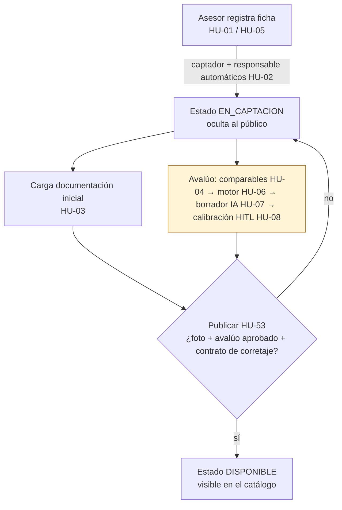

# Urbanex — Estado de procesos de negocio por historia de usuario

| Campo | Valor |
|---|---|
| Última actualización aditiva HU-46 | 2026-11-06 · I-02 y D-05 implementados; suite SQLite 165/165; V-44 Pendiente |
| Confirmación V-43 (2026-11-04) | Según Sebas, V-43 se ejecutó después del último ajuste e incluyó bloquear con cinco intentos, desbloquear desde A-01 y volver a iniciar sesión. Suite integrada: 159 pruebas OK en SQLite |
| Aclaración HU-45 (2026-11-05) | Las filas iniciales de HU-45 describen el estado previo a su implementación; las actualizaciones aditivas del 2026-11-03/04 documentan el endpoint, la acción en A-01 y el login neutral. La notificación persistente continúa pendiente en DT-120 |
| Actualización HU-46 (2026-11-06) | Implementación de I-02, refresh en cookie y rechazo de JWT anteriores al cambio de contraseña; suite automatizada 165/165 OK en SQLite. Validación humana V-44 **Pendiente** |
| Última actualización aditiva | 2026-11-05 · Copilot con Sebas · aclaración de HU-45 y referencia DT-120 |
| Propósito | Conectar lo construido con los procesos reales de la inmobiliaria, HU por HU |
| Fecha de auditoría | 2026-10-22 · rama `develop` con cambios sin commit |
| Última actualización | 2026-11-08 (noche) · Pablo (con Claude Code) · rama `docs/post-merge-pr15`: merge de `origin/develop` (`e19a5df`, PR #19); **HU-22**, **HU-18** y **HU-24** pasan de Pruebas a **Listo** (PR #19 auditado y fusionado; decisión de Pablo); sección **Plan de reparto** (PLAN, sin cambios de estado). Antes: 2026-11-08 · Pablo (con Claude) · rama `feat/URB-19-18-27-HU-22-HU-18-HU-24-visitas` (PR #19): nuevas secciones **HU-22**, **HU-18** y **HU-24** (EP-4, lote 2) en **Pruebas**, con la validación visual V-65 a V-77 aprobada por Pablo; pasan a completas tras la auditoría y el merge. Antes: 2026-11-04 (tras el merge del PR #15) · Pablo (con Claude Code) · rama `docs/post-merge-pr15`: **HU-27** y **HU-34** pasan de Pruebas a **Listo** (PR #15 fusionado en `develop`, `043cfb5`; fusionado por el administrador sin revisión del compañero, DS-32; Sebas revisa después). Antes: 2026-11-04 (noche) · Pablo (con Claude Code) · correcciones de la auditoría del PR #15: HU-27 y HU-34 citan también la repetición con hora y captura de V-27, V-28, V-30 y V-31 (2026-11-03). Antes: 2026-11-04 · Pablo (con Claude Code) · rama `feat/URB-30-34-HU-27-HU-34-oportunidades`: merge de `origin/develop` (`5fb3910`, con los PR #14 y #16); se conservan las entradas de ambos lados. Antes (develop): 2026-11-03 (tarde) · rama `feat/URB-17-HU-12-compartir-ficha`: correcciones de la auditoría de HU-12 (ruta de las capturas de V-60 a V-62; "Fuera de alcance" de HU-12 con el PR #9 ya fusionado y la migración del `slug` coordinada con Sebas). Antes: 2026-11-03 · rama `feat/URB-17-HU-12-compartir-ficha`: HU-12, V-64 (escape de metaetiquetas) aprobada por Pablo; sigue en **Pruebas** hasta V-63 (DT-110). Antes: 2026-11-02 · HU-44: V-33..V-42 en **Pendiente**; las observaciones históricas de V-33..V-39 se conservan atribuidas a Sebas, sin tratarlas como validación aprobada. Suite automatizada reportada en SQLite (116/116); Sebas informó que la ronda manual del 2026-10-30 fue contra Supabase PostgreSQL; suite local contra PostgreSQL **No ejecutado**. DT-95..DT-97 y DS-40 registrados. Antes: 2026-10-31 · HU-44, 53/53 users y 116/116 total en SQLite; C-08 confirmada por Pablo (DS-30); edición local de `users.0007`. Antes: 2026-10-30 · ronda 3 validada por Pablo (V-20 a V-25): HU-04 y HU-06 siguen en **Pruebas** por decisión de Pablo (el proceso se comparará de otra forma), con funcional y visual aprobadas (completas POR CONFIRMAR: C-02 y θ v1 provisionales); HU-08 validada también con el valor del motor; FX-18 (θ en el admin por rol admin). Antes: 2026-10-29 · tabla resumen y secciones al día con el código (auditoría documental): HU-04 y HU-06 pasan a **Pruebas** (técnica aprobada, 88 OK; funcional y visual pendientes, V-20 a V-25); HU-05, HU-08, HU-53, HU-01, la tabla de proceso y C-02 sin referencias vencidas a D-04 o DT-40. Antes: 2026-10-28 (noche) · HU-04 y HU-06 implementadas con el motor DS-21 (FX-17), validación visual pendiente. Antes: 2026-10-28 · HU-53: validación V-13 a V-18 de la tarea 3 (modales y requisitos del servidor) aprobada; DT-72 (estado de los datos demo). Antes: 2026-10-27 (noche) · validación de Pablo V-01 a V-12 aprobada: **DT-40 cerrado**; resumen actualizado para HU-01, 03, 05, 08 y 53. Antes, el mismo día: PR #2 (URB-15) fusionada en `develop` con pruebas por Postman, **sin validación en la interfaz**; las validaciones pendientes pasan a `Project_Progress.md` (V-01 a V-12). Antes: 2026-10-25 · rama `feat/URB-13-HU-08-pantalla-avaluo` · HU-08: pantalla I-12 e integración en el dashboard (fases 1, 2 y 3 de DT-40); HU-53: `missing_requirements` en la UI. Antes: 2026-10-24, HU-01 (DT-07), HU-08 (modelo base) y HU-53 (bloqueo de publicación) · Rama HU-12: 2026-11-02 · HU-12: V-60 a V-62 aprobadas por Pablo (funcional y visual en local); sigue en **Pruebas** hasta V-63 (DT-110); nuevo DT-112. Antes: 2026-11-01 · rama `feat/URB-17-HU-12-compartir-ficha`: **HU-12** nueva sección, pasa a **Pruebas** (metaetiquetas de la ficha, FX-24; validación visual Pendiente, V-60 a V-63; previsualización real sujeta a DT-110; `slug` en DT-111); HU-53 con la nota de las metaetiquetas. Antes: 2026-10-30 · ronda 3 validada por Pablo (V-20 a V-25): HU-04 y HU-06 siguen en **Pruebas** por decisión de Pablo (el proceso se comparará de otra forma), con funcional y visual aprobadas (completas POR CONFIRMAR: C-02 y θ v1 provisionales); HU-08 validada también con el valor del motor; FX-18 (θ en el admin por rol admin). Antes: 2026-10-29 · tabla resumen y secciones al día con el código (auditoría documental): HU-04 y HU-06 pasan a **Pruebas** (técnica aprobada, 88 OK; funcional y visual pendientes, V-20 a V-25); HU-05, HU-08, HU-53, HU-01, la tabla de proceso y C-02 sin referencias vencidas a D-04 o DT-40. Antes: 2026-10-28 (noche) · HU-04 y HU-06 implementadas con el motor DS-21 (FX-17), validación visual pendiente. Antes: 2026-10-28 · HU-53: validación V-13 a V-18 de la tarea 3 (modales y requisitos del servidor) aprobada; DT-72 (estado de los datos demo). Antes: 2026-10-27 (noche) · validación de Pablo V-01 a V-12 aprobada: **DT-40 cerrado**; resumen actualizado para HU-01, 03, 05, 08 y 53. Antes, el mismo día: PR #2 (URB-15) fusionada en `develop` con pruebas por Postman, **sin validación en la interfaz**; las validaciones pendientes pasan a `Project_Progress.md` (V-01 a V-12). Antes: 2026-10-25 · rama `feat/URB-13-HU-08-pantalla-avaluo` · HU-08: pantalla I-12 e integración en el dashboard (fases 1, 2 y 3 de DT-40); HU-53: `missing_requirements` en la UI. Antes: 2026-10-24, HU-01 (DT-07), HU-08 (modelo base) y HU-53 (bloqueo de publicación) · Rama de oportunidades: 2026-11-03 (noche) · correcciones de la auditoría de solo lectura: HU-27 con 37/155 pruebas. Antes: 2026-11-03 (tarde) · Pablo (con Claude Code), rama `feat/URB-30-34-HU-27-HU-34-oportunidades`: HU-27 y HU-34, DT-105 comprobado con HU-44 fusionada; 37 OK en `apps.opportunities.tests` y 155 OK la suite (FX-25). Siguen en **Pruebas** hasta la auditoría y el merge a `develop`. Antes: 2026-11-03 · Pablo (con Claude Code), rama `feat/URB-30-34-HU-27-HU-34-oportunidades`: merge de `origin/develop` (`a071b97`, con los PR #9 y #13); se conservan las entradas de ambos lados. Antes (rama de oportunidades, sin develop): 2026-11-01 (noche) · HU-27 y HU-34: validación visual aprobada 2026-11-01 (V-26 a V-32, Pablo); siguen en **Pruebas** (falta comprobar DT-105 con HU-44 fusionada, la auditoría y el merge). Antes: 2026-11-01 · C-08 confirmada por Pablo (solo `admin` y `asesor`; el cliente es anónimo); DT-105 resuelto en código (FX-23). Antes: 2026-10-30 (tarde) · EP-5, primer corte (FX-19, DS-26 a DS-28): **HU-27** y **HU-34** pasan a **Pruebas** (técnica aprobada, 125 OK; funcional y visual pendientes, V-26 a V-32); HU-37 al día (las oportunidades ya existen, sin estados). |
| Alcance | HU-01, HU-03, HU-05, HU-37, HU-44, HU-45, HU-46 (pedidas) + HU-02, HU-09, HU-53 (EP-2, relevantes para Avalúos) + HU-04, HU-06, HU-08 (punto de partida de Sebas) + (2026-10-30) HU-27 y HU-34 (EP-5, primer corte) + HU-12 (EP-3, 2026-11-01) + (2026-11-08) HU-22, HU-18 y HU-24 (EP-4, lote 2) |
| Fuentes de requisitos | `ProyectoCapstoneV4 (3).md` (Anexo 2: criterios de aceptación; Anexo 4: backlog) y `URBANEX_MASTER_CONTEXT.md` (§4 RF, §10 backlog definitivo, §11 reglas) |

Detalle técnico en [Auditoría de código](URBANEX_AUDITORIA_CODIGO.md) · archivos en [GPS](URBANEX_GPS_ARCHIVOS.md) · porcentajes en [Avance de épicas](URBANEX_AVANCE_EPICAS.md).

## Cómo leer este documento

Cada HU tiene un **estado de trabajo** y cuatro **resultados de validación** independientes.

| Estado de trabajo | Significado |
|---|---|
| **Por hacer** | Sin implementación. Estado inicial de Jira; se añade porque los 5 estados del prompt no cubren historias no iniciadas |
| **En Curso** | Implementación incompleta o que incumple algún criterio |
| **Listo** | Implementación candidata a revisión; **no** significa proceso aprobado |
| **Pruebas** | Implementación completa a nivel técnico; falta validación funcional o visual |
| **Bloqueado** | No puede avanzar sin resolver una dependencia o decisión |
| **POR CONFIRMAR** | Evidencia insuficiente |

Validación por dimensión: **Aprobado** · **Fallido** · **Pendiente** · **No aplicable**.

- **Técnica:** pruebas automatizadas ejecutadas.
- **Funcional:** el proceso de negocio se cumple de extremo a extremo.
- **Visual:** la interfaz se comprobó en el navegador.

## Resumen

| HU | Nombre (tesis, Anexo 2) | Épica | Sprint (backlog definitivo) | Estado | Técnica | Funcional | Visual |
|---|---|---|---|---|---|---|---|
| [HU-01](#hu-01) | Registrar una propiedad en captación | EP-2 | 1 | En Curso | Aprobado (parcial) | Parcial: anónimos no ven la captación (V-01, 2026-10-27); quedan DT-34 y DT-39 | Aprobado (V-01) |
| [HU-02](#hu-02) | Registrarse como captador y responsable inicial | EP-2 | 1 | En Curso | Aprobado (parcial) | Pendiente | Pendiente |
| [HU-03](#hu-03) | Cargar la documentación inicial | EP-2 | 1 | Pruebas | Aprobado | Aprobado para PDF (V-03, 2026-10-27); la subida de una imagen no se probó | Aprobado (V-03; ver DT-60) |
| [HU-05](#hu-05) | Registrar las características del inmueble | EP-2 | 1 | En Curso | Pendiente | Parcial: el mapa guarda la ubicación (V-04); faltan los campos de RF-01 (DT-19) | Aprobado (V-04) |
| [HU-09](#hu-09) | Actualizar una propiedad publicada | EP-2 | 2 | En Curso | Pendiente | Pendiente | Pendiente |
| [HU-53](#hu-53) | Publicar una propiedad | EP-2 | 3 | En Curso | Aprobado (requisitos de publicación) | Aprobado para los requisitos (V-02, V-11, V-12; **DT-40 cerrado** 2026-10-27); falta `slug`/metaetiquetas | Aprobado (V-02, V-11, V-12; ver DT-57, DT-58) |
| [HU-04](#hu-04) | Seleccionar comparables para el avalúo | EP-2 | 2 | **Pruebas** (FX-17, 2026-10-28: endpoint de candidatos + pantalla I-11; validada en la ronda 3; sigue en Pruebas por decisión de Pablo, el proceso se comparará de otra forma; completa **POR CONFIRMAR**: C-02 provisional, falta el tutor) | Aprobado (90 OK, 2026-10-30) | Aprobado (V-20, V-23, V-24; Pablo, 2026-10-29/30) | Aprobado (V-20, V-23, V-24; ver DT-80, DT-81) |
| [HU-06](#hu-06) | Obtener el valor sugerido del motor | EP-2 | 2 | **Pruebas** (FX-17, 2026-10-28: motor DS-21, D-04 resuelta provisionalmente; FX-18 para θ en el admin; validada en la ronda 3; sigue en Pruebas por decisión de Pablo; completa **POR CONFIRMAR**: θ v1 en observación) | Aprobado (90 OK, 2026-10-30) | Aprobado (V-21, V-22, V-25; Pablo, 2026-10-29/30; V-25 tras FX-18) | Aprobado (V-21, V-22, V-25; ver DT-80) |
| [HU-08](#hu-08) | Calibrar y aprobar el avalúo | EP-2 | 2 | **Pruebas** (backend + pantalla I-12 + integración en el dashboard, 2026-10-25; validada el 2026-10-27 con registro manual; con el valor del motor, validada en V-21 a V-23 el 2026-10-29/30; completa **POR CONFIRMAR**, decisión de Pablo) | Aprobado (backend; frontend `tsc` y `build`; ESLint reporta 0 errores y 2 warnings de `SiteNav` sin usar, DT-24) | Aprobado con registro manual (V-05 a V-10, Pablo, 2026-10-27; ver N-05) | Aprobado (V-05 a V-10; ver DT-55, DT-56) |
| [HU-12](#hu-12) | Compartir la ficha | EP-3 | 3 | **Pruebas** (FX-24, 2026-11-01: metaetiquetas de la ficha P-03; previsualización real sujeta a DT-110; sin `slug`, DT-111) | Aprobado (confirmado por Pablo, 2026-11-02, tras revisar la suite de la auditoría: 9 pruebas `npm test`; `build` y `tsc` exit 0; `eslint` sin errores nuevos; ver DT-113) | Aprobado en local (V-60 a V-62, Pablo, 2026-11-02; escape de metaetiquetas, V-64, Pablo, 2026-11-03); en redes, Pendiente (V-63, DT-110) | Aprobado (V-60 a V-62 y V-64; ver DT-112, DT-25) |
| [HU-27](#hu-27) | Abrir un contacto y una oportunidad manualmente | EP-5 | 5 | ~~**Pruebas** (FX-19, 2026-10-30: API + pantalla I-07; adelantada por DS-26)~~ **Listo** (2026-11-04: PR #15 fusionado en `develop`, `043cfb5`, por el administrador sin revisión del compañero; ver DS-32. Antes: Pruebas, FX-19, 2026-10-30: API + pantalla I-07; adelantada por DS-26) | Aprobado (~~35 OK en `apps.opportunities.tests`; 125 OK la suite, 2026-10-30~~ 37 OK en `apps.opportunities.tests`; 155 OK la suite, 2026-11-03, FX-25) (corregido por Pablo, 2026-11-03) | Aprobado: validación visual aprobada 2026-11-01 (V-26 a V-29, Pablo) | Aprobado: validación visual aprobada 2026-11-01 (V-26 a V-29, V-32, Pablo). Sigue en **Pruebas**: ~~falta comprobar DT-105 con HU-44 fusionada,~~ DT-105 comprobado el 2026-11-03 (suite 155 OK, FX-25); faltan la auditoría y el merge (corregido por Pablo, 2026-11-03). **(2026-11-04, nota añadida)** La auditoría y el merge ya se hicieron (PR #15, `043cfb5`): pasa a **Listo** (DS-32) |
| [HU-34](#hu-34) | Buscar oportunidades con filtros | EP-5 | 5 | ~~**Pruebas** (FX-19, 2026-10-30: API + pantalla I-06; adelantada por DS-26)~~ **Listo** (2026-11-04: PR #15 fusionado en `develop`, `043cfb5`, por el administrador sin revisión del compañero; ver DS-32. Antes: Pruebas, FX-19, 2026-10-30: API + pantalla I-06; adelantada por DS-26) | Aprobado (ídem) | Aprobado: validación visual aprobada 2026-11-01 (V-30, V-31, Pablo) | Aprobado: validación visual aprobada 2026-11-01 (V-30, V-31, Pablo). Sigue en **Pruebas**: ~~falta comprobar DT-105 con HU-44 fusionada,~~ DT-105 comprobado el 2026-11-03 (suite 155 OK, FX-25); faltan la auditoría y el merge (corregido por Pablo, 2026-11-03). **(2026-11-04, nota añadida)** La auditoría y el merge ya se hicieron (PR #15, `043cfb5`): pasa a **Listo** (DS-32) |
| [HU-22](#hu-22) | Configurar la disponibilidad horaria | EP-4 | 3 | ~~**Pruebas** (lote 2, 2026-11-06: app `visits`, API + pantalla I-09)~~ **Listo** (2026-11-08: PR #19 auditado y fusionado en `develop`, `e19a5df`; decisión de Pablo. Antes: Pruebas, lote 2, 2026-11-06: app `visits`, API + pantalla I-09) | Aprobado (suite 228/228 en SQLite, 69 de `visits`; `npm test` 17/17, `build`, `tsc` y `eslint` sin errores, 2026-11-06) | Aprobado (V-68 a V-71, Pablo, 2026-11-07) | Aprobado (V-68 a V-71). Sigue en **Pruebas**: faltan la auditoría y el merge del PR #19. **(2026-11-08, nota añadida)** La auditoría de solo lectura y el merge ya se hicieron (PR #19, `e19a5df`, fusionado por Pablo; en GitHub sin revisión aprobada del compañero, `reviewDecision: REVIEW_REQUIRED`): pasa a **Listo** |
| [HU-18](#hu-18) | Consultar la disponibilidad del asesor | EP-4 | 3 | ~~**Pruebas** (lote 2, 2026-11-06: `free_slots()`, endpoint público + P-07 en la ficha)~~ **Listo** (2026-11-08: PR #19 auditado y fusionado en `develop`, `e19a5df`; decisión de Pablo. Antes: Pruebas, lote 2, 2026-11-06: `free_slots()`, endpoint público + P-07 en la ficha) | Aprobado (ídem) | Aprobado (V-72 a V-74, Pablo, 2026-11-07/08) | Aprobado (V-72 a V-74; ver DT-147). Sigue en **Pruebas**: faltan la auditoría y el merge del PR #19. **(2026-11-08, nota añadida)** La auditoría y el merge ya se hicieron (PR #19, `e19a5df`): pasa a **Listo** |
| [HU-24](#hu-24) | Consultar la agenda de visitas | EP-4 | 2 | ~~**Pruebas** (lote 2, 2026-11-06: `/api/visits/agenda/` + pantalla I-08)~~ **Listo** (2026-11-08: PR #19 auditado y fusionado en `develop`, `e19a5df`; decisión de Pablo. Antes: Pruebas, lote 2, 2026-11-06: `/api/visits/agenda/` + pantalla I-08) | Aprobado (ídem) | Aprobado (V-75 a V-77, Pablo, 2026-11-08) | Aprobado (V-75 a V-77; LOPDP en DT-117). Sigue en **Pruebas**: faltan la auditoría y el merge del PR #19. **(2026-11-08, nota añadida)** La auditoría y el merge ya se hicieron (PR #19, `e19a5df`): pasa a **Listo** |
| [HU-37](#hu-37) | Validar un documento | EP-6 | 7 | En Curso (regla de modelo adelantada) | Aprobado (solo modelo) | Pendiente | No aplicable aún |
| [HU-44](#hu-44) | Gestionar usuarios internos | EP-1 | 1 | **Pruebas** | Pendiente de cierre técnico (suite 116/116 ejecutada en SQLite; suite PostgreSQL local no ejecutada) | V-33..V-39 Pendiente | V-33..V-42 Pendiente; no marcar como validada |
| [HU-45](#hu-45) | Desbloquear una cuenta | EP-1 | 1 | Pruebas | Aprobado (120 pruebas backend en SQLite en memoria) | Aprobado (V-43; Sebas confirmó el flujo de desbloqueo y login el 2026-11-04) | Aprobado (V-43; Sebas, 2026-11-04, después del último ajuste) |
| [HU-46](#hu-46) | Iniciar sesión y recuperar contraseña | EP-1 | 1 | En Curso | Aprobado (login e inactivos) | Pendiente (recuperación pendiente) | Pendiente |

> **Ninguna HU auditada está completa al 100 %.** Ver regla de cálculo en [Avance de épicas](URBANEX_AVANCE_EPICAS.md).

### Actualización HU-45 tras integrar `develop` (2026-11-04)

Según Sebas, V-43 se realizó después del último ajuste e incluyó los cinco intentos fallidos, el desbloqueo en A-01 y el login posterior. La suite integrada pasó 159/159 en SQLite; el dato de 120 pruebas de la fila resumen corresponde a una ejecución anterior. HU-45 permanece en **Pruebas** hasta completar la auditoría previa al PR y coordinar la validación PostgreSQL. La fila resumen indica 1 punto, pero `URBANEX_MASTER_CONTEXT.md` §10 asigna 2; el cálculo vigente de EP-1 en Avance usa la fuente maestra.

### Evidencia de validación aportada por Sebas (2026-10-22, conversación de desarrollo)
- Vio el modal con las 4 pestañas y lo calificó positivamente → la **pestaña se renderiza** (evidencia visual parcial para la pantalla I-10).
- Tras aplicar las migraciones, "ya hace fetch de la base de datos" → el **dashboard carga la lista** de propiedades.
- **No reportó todavía:** búsqueda en el mapa, guardado de coordenadas, subida de documentos ni edición. La base de desarrollo tiene **0 propiedades con coordenadas** y **0 documentos**, lo que indica que esos flujos aún no se probaron después del cambio.

---

## Proceso de negocio: captación de una propiedad (RF-01, RF-10, RF-11)

**Estado al 2026-10-24: el proceso ya se aplica en el servidor.** El hueco 1 (DT-09) se cerró el mismo día (FX-11): `status` es de solo lectura y la única vía hacia `disponible` es la acción de publicar. Queda el hueco 2 (DT-40).

| Tramo | Antes (2026-10-22) | Ahora (2026-10-24) |
|---|---|---|
| Captación oculta al público | Visible para todos | Oculta para anónimos (DT-07 resuelto). C-08 elimina el rol `cliente`; sin embargo, las cuentas cliente ya convertidas en Supabase pudieron quedar como asesoras activas porque allí `users.0007` ya estaba aplicada. Seguimiento en DT-93. SEC-01 sigue abierto: un asesor ve las captaciones de otros asesores |
| Avalúo | No existía | `apps.appraisals`: borrador → calibración → aprobación inmutable. **(2026-10-28, FX-17)** Motor DS-21 y pantalla I-11 de comparables; **FX-18** habilita la gestión de θ por rol admin. Ronda 3 validada por Pablo; línea base de `origin/develop`: 90 pruebas (2026-10-30) |
| Publicar | Sin requisitos | `POST …/publish/` exige foto + corretaje vigente no rechazado + avalúo aprobado, solo desde captación |
| ~~**Hueco 1 — DT-09 (P0)**~~ | — | **Resuelto (FX-11):** `POST` crea siempre en `captacion`; `PATCH` ignora `status` (`test_create_ignores_status`, `test_patch_cannot_change_status`) |
| **Hueco 2 — DT-40** | — | Desde la UI no se puede aprobar un avalúo, así que **ninguna propiedad se puede publicar desde el navegador**. Es el comportamiento de negocio esperado hasta que exista I-12. **2026-10-25: implementado en las 3 fases.** I-12 (`/dashboard/properties/[id]/appraisal`) aprueba desde la UI; el dashboard enlaza a I-12, muestra el estado del avalúo en el Expediente y lista `missing_requirements` al publicar. Se cierra cuando una persona publique desde el navegador. **Cerrado el 2026-10-27** (DT-40, validación V-11 y V-12 de Pablo) |

---

## HU-01

**Registrar una propiedad en captación** · EP-2 · RF-01, RF-08 · Pantalla I-10 · Sprint 1 (URB-05)

**Proceso:** el asesor incorpora un inmueble con información técnica y multimedia; la ficha queda interna hasta cumplir los requisitos de publicación.

| Criterio de aceptación (Anexo 2) | Implementación encontrada | Prueba | Resultado |
|---|---|---|---|
| Exige campos obligatorios y al menos una fotografía | Campos obligatorios: sí en el modelo/serializer. Foto: **solo en el frontend** (`validateForm`); el backend crea la propiedad sin imágenes | `test_create_property_as_agent` crea, pero no prueba rechazos | Parcial |
| Al guardarse queda En captación, sin exhibirse al público | `status` por defecto `captacion` ✔. **Desde 2026-10-24** un anónimo solo recibe `disponible`/`reservador` en la lista y 404 en el detalle de una ficha en captación (`PUBLIC_STATUSES`, commit `2817dcd`). Desde FX-11 el `POST` siempre guarda `captacion` (DT-09 resuelto). El rol `cliente` se elimina por C-08; el cambio de `users.0007` aún no está aplicado a la base Supabase (DT-93) | `test_create_property_as_agent`, `test_create_ignores_status`, `test_anonymous_list_only_shows_public_statuses`, `test_anonymous_cannot_read_captacion_detail`, `test_owner_still_reads_captacion_detail` | Parcial (anónimos ✔; validación manual pendiente) |
| El asesor queda como captador y responsable inicial | `perform_create` asigna `agent=request.user`; `agent` de solo lectura en la API | `test_create_property_as_agent` verifica `agent` | Aprobado (técnico) |

- **Interfaz:** modal con 4 pestañas en `frontend/app/dashboard/page.tsx`. Los datos persisten al cambiar de pestaña; errores por pestaña; vistas previas de imágenes.
- **Bloqueos y riesgos:** ~~DT-07~~ y ~~DT-09~~ (resueltos 2026-10-24), DT-39 (rol `cliente`), DT-34 (foto al registrar solo en frontend), DT-10 (imágenes sin control de propiedad).
- **Siguiente paso:** ~~validar en el navegador sin sesión: una propiedad recién creada **no** aparece en `/properties` ni se abre en `/properties/<id>`~~ **Hecho el 2026-10-27 (V-01, Pablo, Aprobado).** Quedan DT-39/SEC-01 (también afecta a asesores) y DT-34.

## HU-02

**Registrarse como captador y responsable inicial** · EP-2 · RF-01, RF-08 · Sprint 1 (URB-06)

| Criterio | Implementación | Prueba | Resultado |
|---|---|---|---|
| El sistema asigna automáticamente al asesor autenticado | `agent=request.user` | `test_create_property_as_agent` | Aprobado |
| El dato de captador no es editable | Solo lectura en la API; **editable desde el admin de Django** | Ninguna | Parcial |
| Responsable inicial hasta una eventual reasignación | Un único campo `agent` cumple ambos papeles: una reasignación (HU-47) **sobrescribiría al captador** | Ninguna | Pendiente (requiere `captor_agent` + `responsible_agent`) |

Impacto para Avalúos: bajo. Impacto para co-intermediación (RF-07): alto. Ver DT-17.

## HU-03

**Cargar la documentación inicial** · EP-2 · RF-10 · Pantalla I-13 (dentro del modal, pestaña Expediente) · Sprint 1 (URB-07)

**Proceso:** el asesor respalda la captación con documentos (cédula catastral, prediales, contrato de corretaje) que quedan privados y versionados.

| Criterio | Implementación | Prueba (ejecutada 2026-10-22) | Resultado |
|---|---|---|---|
| Acepta archivos PDF e imágenes | Detección por bytes iniciales: PDF, JPEG, PNG, WEBP; rechaza tipos falsificados | `test_rejects_spoofed_content_type`, `test_rejects_files_over_20mb_and_invalid_types`; **ninguna prueba sube una imagen** | Aprobado para PDF; imágenes sin prueba |
| Cada documento registra su fecha de vigencia | `issue_date` y `expiration_date` obligatorias; vigencia ≥ emisión | `test_rejects_expiration_before_issue`, `test_failed_upload_keeps_previous_version_current` | Aprobado |
| El documento queda asociado a la propiedad | FK `property` (PROTECT); permisos por propiedad | `test_owner_uploads_and_new_upload_creates_version_2`, `test_other_agent_cannot_upload_or_see_documents` | Aprobado |

- Reglas adicionales del contexto maestro ya cubiertas: versionado inmutable, 20 MB, solo el dueño o el admin. Son 19 pruebas en total.
- **Fuera de alcance aún:** URLs firmadas de Supabase (HU-38, Sprint 6); hoy existe una descarga protegida provisional. La relación `opportunity` llega en el Sprint 7.
- **Siguiente paso, validación visual:** editar una propiedad; en Expediente, subir un PDF y una imagen; guardar; volver a abrir y comprobar que aparecen con versión v1, estado "Pendiente" y sin opción de borrar. Subir el mismo tipo otra vez y verificar v2.

## HU-05

**Registrar las características del inmueble** · EP-2 · RF-11 (tesis) / RF-01 y RF-11 (contexto maestro) · Pantallas I-10 e I-11 · Sprint 1 (URB-08)

**Proceso:** las características se capturan en forma estructurada para alimentar el motor de avalúo.

| Criterio | Implementación | Prueba | Resultado |
|---|---|---|---|
| Datos con valores numéricos o selectores, sin texto libre | Tipo (botones), precio, área, habitaciones, baños y parqueaderos son numéricos. Ubicación exacta por mapa y buscador Nominatim; latitud y longitud ya se **persisten** (migración `users.0006`) | Ninguna específica | Implementado para los campos existentes, sin prueba; el conjunto de campos de RF-01 está incompleto |
| Los campos obligatorios se validan antes de calcular | ~~No existe el cálculo (HU-06)~~ **(2026-10-28, FX-17)** `subject_blocker()` exige superficie > 0 y coordenadas antes de proponer comparables o calcular; si faltan, I-11 lo explica y ofrece el registro manual (`backend/apps/appraisals/services.py:17-24`) | `test_candidates_exclude_stale_data_and_explain_blockers` (`backend/apps/appraisals/tests.py:438`) | Implementado y verificado; validación visual pendiente |

- **Falta para el avalúo:** RF-01 pide `zone`, `operation_type`, `usable_area_m2`, `age_years`, `conservation_state`, `floor_number` y `storage_units`; **ninguno existe** en `Property` (DT-19). Sin `zone` no se pueden segmentar los comparables (RF-11).
- **Mapa:** búsqueda real comprobada contra Nominatim (200, CORS `*`). Faltan la validación visual y comprobar en BD que, tras guardar, las coordenadas no quedan en el valor por defecto de Quito.
- **Siguiente paso:** decidir con el equipo qué campos se agregan y si `zone` es texto controlado (selector) o se deriva de las coordenadas (**decisión de negocio**).

## HU-09

**Actualizar una propiedad publicada** · EP-2 · RF-01 · Sprint 2 (URB-09)

| Criterio | Implementación | Resultado |
|---|---|---|
| Cambiar entre En captación, Disponible y No disponible; No disponible exige motivo | **Desde FX-11 (2026-10-24) `status` es de solo lectura**: ningún estado se cambia por PATCH. HU-09 necesita una **acción explícita** (p. ej. `POST …/withdraw/` con motivo) que hoy no existe; la regla del motivo en `validate()` queda sin uso efectivo (DT-44). La UI tampoco permite cambiar el estado | No cumplido (falta la acción de HU-09) |
| No permite asignar Vendido o Arrendado manualmente | `validate()` lo rechaza | Implementado, sin prueba |

## HU-53

**Publicar una propiedad** · EP-2 · RF-01, RF-10, RF-11 · Pantallas I-10B y P-03 · Sprint 3 (URB-15)

| Criterio | Implementación | Resultado |
|---|---|---|
| Requiere avalúo registrado y contrato de corretaje cargado | **Desde 2026-10-24 (commit `cca371e`):** `PropertyPublishView` responde **400** con `missing_requirements` si falta ≥1 `PropertyImage`, un `CORRETAJE` vigente (versión actual, no vencido, no `RECHAZADO`; `PENDIENTE` sí sirve, DS-04) o un `Appraisal` `APROBADO`. Solo publica desde `captacion` (409 en otro estado, DS-07). Todo en `transaction.atomic` + `select_for_update`. Desde FX-11 es la **única** vía hacia `disponible` | Aprobado (técnico) |
| Al publicarse pasa a Disponible y se genera su URL con metaetiquetas | Pasa a `disponible`. No existen `slug` ni metaetiquetas OpenGraph. **(2026-11-01, FX-24, rama de HU-12 sin fusionar)** La ficha `/properties/<id>` de una propiedad Disponible o Reservada ya publica título, descripción, imagen, Open Graph y Twitter ([HU-12](#hu-12)). Sigue sin `slug` (DT-111) | Parcial |

**Pruebas (`apps.users.tests`):** `test_publish_property_permission` (reescrita: 403 de un no dueño + 200 con todos los requisitos, corretaje `PENDIENTE`), `test_publish_rejected_without_image`, `…_without_corretaje`, `…_with_expired_corretaje`, `…_with_rejected_corretaje`, `…_with_draft_appraisal_only`, `test_publish_rejected_lists_all_missing_requirements`, `test_publish_only_from_captacion`.

**(2026-10-27, FX-16, DS-15)** Nuevo `GET /api/auth/properties/<id>/publication-requirements/` con la misma regla, sin publicar. El Expediente del dashboard lo consulta al editar, así que también muestra si el corretaje está vencido o rechazado. "Publicar" pide confirmación en un modal, y un 400 abre otro modal con enlaces a la pestaña donde se corrige cada requisito. **Validado por Pablo el 2026-10-28 (V-13 a V-18):** confirmación en modal que se cancela con "Cancelar" y con Escape; modal de requisitos con "Abrir Multimedia" (abre esa pestaña) y "Abrir Expediente"; el Expediente muestra "lista para publicar" y "ya no está en captación"; los errores de guardado quedan dentro del modal. Sin ver todavía, por el estado de los datos demo (DT-72): el resumen "faltan N requisito(s)" y "Ir al avalúo" dentro del modal (V-19). **Proceso:** un asesor que publica sin requisitos ya no recibe una ventana del navegador, sino la lista de lo que falta con el camino para resolverlo.

**Contrato del 400** (lo que la UI debe mostrar): `{"detail": "No se puede publicar: …", "missing_requirements": [{"code": "image" | "brokerage_contract" | "appraisal", "message": "…"}]}`. **Desde 2026-10-25 (`3783919`)** el dashboard lo muestra como lista sobre la tabla, con "Ir al avalúo" cuando falta el avalúo; el botón "Publicar" solo aparece en `captacion`.

**Validación de extremo a extremo** (~~pendiente, Pablo~~ **validada el 2026-10-27: V-01, V-02, V-11 y V-12**, `Project_Progress.md`; queda V-19, ver DT-72):
1. Sin foto, sin corretaje o sin avalúo, "Publicar" muestra la lista con lo que falta.
2. Con foto + corretaje + avalúo aprobado en I-12, "Publicar" muestra el aviso verde y el estado pasa a "Disponible"; el botón desaparece.
3. Sin sesión, la propiedad aparece en `/properties` y su ficha abre.

**Bloqueo funcional esperado (DT-40):** ~~como no existen las pantallas I-11/I-12, un avalúo solo se aprueba por la API.~~ **Desbloqueado en el código el 2026-10-25:** el avalúo se aprueba en I-12 y la publicación se hace desde el dashboard. La fila "Avalúo aprobado" del Expediente ya consulta los avalúos reales. Pendiente: que `get_missing_publication_requirements()` alimente también la Vista 360° (I-10B), que no existe.

**Validación funcional pendiente:** con un asesor de prueba, aprobar un avalúo (desde 2026-10-25 se puede hacer en la pantalla I-12 en lugar de la API), cargar foto y corretaje y publicar desde el dashboard; luego, sin sesión, comprobar que aparece en `/properties`. **Pablo confirmó el 2026-10-25 que todavía no ha hecho esta validación ni la del catálogo anónimo.** **(2026-10-27)** Sigue Pendiente: no hay usuario asesor hasta el seeder (DT-14). Los pasos, el resultado esperado y la fila para registrar la evidencia están en `Project_Progress.md` → "Validaciones pendientes de Pablo": **V-01, V-02, V-11 y V-12** para HU-53 y HU-01; **V-05 a V-10** para HU-08; **V-03** para HU-03; **V-04** para HU-05. **(2026-10-27) Hechas y aprobadas** V-01 a V-12 (DT-40 cerrado); lo anterior de este párrafo queda como historial.

## HU-12

**Compartir la ficha** · EP-3 · RF-01, RNF-03 · Pantalla P-03 · Sprint 3 (URB-17) · rama `feat/URB-17-HU-12-compartir-ficha` (2026-11-01, sin fusionar)

> Como cliente, quiero compartir la ficha mediante su URL, para enviarla por redes o mensajería (Anexo 2, `ProyectoCapstoneV4 (3).md:1541`).

| Criterio | Implementación | Resultado |
|---|---|---|
| Incluye metaetiquetas de título, descripción e imagen | `generateMetadata` en `frontend/app/properties/[id]/page.tsx` con `buildPropertyMetadata()` (`frontend/lib/propertyMetadata.ts`): `<title>`, `description`, canónica, Open Graph (`og:title`, `og:description`, `og:url`, `og:image` + alt, `og:site_name`, `og:locale`, `og:type`) y Twitter (`summary_large_image` con foto, `summary` sin foto). Solo para `disponible` y `reservador`; el resto, y cualquier error de la API, da "Propiedad no disponible \| Urbanex" con `noindex, nofollow`, sin datos (FX-24) | Implementado, verificado (9 pruebas + HTML real con un backend falso) y **validado en local** (V-60 y V-61, Pablo, 2026-11-02) |
| Se previsualiza correctamente al compartirse | Las etiquetas están en el HTML del servidor, que es lo que leen las redes. En local no se puede probar con WhatsApp ni Facebook, porque no llegan a `localhost` ni a las fotos de `127.0.0.1:8000` | Implementado; **Pendiente** de una URL pública (V-63, DT-110, frenado por DS-20) |

**Pruebas (`frontend/`, `npm test`):** 9 en `frontend/lib/propertyMetadata.test.mjs`: disponible con foto, reservada, sin fotos, descripción larga recortada, descripción vacía o con saltos de línea, y `captacion`, `vendido`, `arrendado` y `no_disponible` sin datos.

**Validación de Pablo (2026-11-02, incógnito, `localhost:3001`):** V-60 (`/properties/1`), V-61 (`/properties/99999` y `/properties/7`) y V-62 aprobadas; V-63 Pendiente. Primero sin hora ni capturas; **repetidas el mismo día con hora y captura** (21:51 a 22:12, 6 capturas en `C:\Users\Pablo\OneDrive\Documentos\Urbanex\evidencias\HU-12\Pruebas anteriores (cambiar)\`, ruta actualizada el 2026-11-03; detalle en `Project_Progress.md`). Hallazgo: la ficha inexistente dice "Verifica la conexión con el servidor" (DT-112). HU-12 sigue en **Pruebas** hasta V-63.

**Validación de Pablo (2026-11-03, incógnito, `localhost:3000`, BD del worktree reiniciada):** V-64 aprobada. Con un título malicioso en una ficha Disponible, no hay alertas y `<title>`, `og:title`, `og:image:alt` y `twitter:title` salen escapados, con un solo `og:title`, tanto en el navegador como para `facebookexternalhit/1.1` (capturas de 13:33 a 13:53 en `C:\Users\Pablo\OneDrive\Documentos\Urbanex\evidencias\HU-12\`; detalle en `Project_Progress.md` y Seguridad §3.1).

**Fuera de alcance:** `slug` estable (contexto maestro §10, DT-111: necesita una migración en `apps/users`, ~~que espera al PR #9~~ **(2026-11-03)** el PR #9 ya se fusionó (`d71c7f2`); la migración se coordina con Sebas, porque las de `apps/users` van en una sola rama a la vez y él tiene HU-45, según Pablo, 2026-11-03). La navbar duplicada de la ficha es DT-25.

**Proceso:** un cliente copia la URL de una ficha Disponible o Reservada y la pega en un chat. La red lee el título, el resumen con el precio referencial y la foto principal. Una ficha en captación, vendida, arrendada o no disponible no revela nada.

## HU-04

**Seleccionar comparables para el avalúo** · EP-2 · RF-11 · Pantalla I-11 · Sprint 2 (URB-10)

- Criterios (tesis): no permite calcular con menos de 3 ni más de 5 comparables; el avalúo se hace durante la captación y es requisito para publicar; sin comparables suficientes, el avalúo se registra de forma manual.
- **Implementación (2026-10-28, FX-17, DS-21):**
  - `GET /api/appraisals/candidates/?property=<id>` propone candidatos del **mismo tipo**, con estado `disponible`, `reservador` o `vendido`, un dato de 365 días como máximo y de la **misma zona** (provisional: hasta 1,5 km, porque no existe `zone`). Los ordena por superficie más parecida y preselecciona 5.
  - La pantalla **I-11** (`/dashboard/properties/[id]/appraisal/comparables`) deja elegir de 3 a 5 y crea el borrador calculado.
  - Con menos de 3, el avalúo es **manual** y guarda los encontrados como referencia (C-02, opción A, **provisional hasta el tutor**).
  - El servidor vuelve a validar cada comparable que envía el cliente.
- **Proceso:** el asesor ya no inventa el valor desde cero: parte de datos de mercado de la base interna (RF-11) y deja la traza de qué comparó.
- **Datos de prueba:** `setup_comparables_demo` (DS-23) crea comparables sintéticos en `vendido` alrededor de las propiedades demo (casos ALTO, MEDIO, manual con 2 y manual con 0).
- **Pendientes:** ~~validación visual (V-20 a V-24)~~ **aprobada por Pablo el 2026-10-29/30** (V-20, V-23 y V-24; V-21 solo se pudo repetir tras aprobar un borrador previo, DT-74); `zone` (N-03), la fecha real del dato (DT-75), la visibilidad de datos de otros asesores (DT-76), comparables identificados solo por id en I-12 (DT-80) y el registro manual lento (DT-81).

## HU-06

**Obtener el valor sugerido del motor** · EP-2 · RF-11 · Pantalla I-12 · Sprint 2 (URB-11)

- Criterios: el motor procesa los comparables con factores ponderados; el cálculo queda registrado.
- ~~Bloqueado por D-04~~ **D-04 resuelta provisionalmente con DS-21 (2026-10-28).**
- **Implementación (FX-17):** motor determinista en `apps/appraisals/engine/` (método comparativo de mercado):
  - homogeneización con factores registrados y configurables por tipo (`superficie@1`, `negociacion@1`);
  - descarte de atípicos y combinación con pesos;
  - confianza ALTO o MEDIO según el CV (≤ 15 %).
- **Qué se registra al crear el avalúo:** el valor exacto, la confianza, la traza (`comparables_snapshot`) y la versión de θ (`EngineParameters`), todo inmutable. La interfaz muestra el valor **redondeado a cientos**.
- **Pruebas:** 24 nuevas, entre ellas el ejemplo de DS-21 §8 (USD 143.861,35, ALTO).
- **Pendientes:** ~~validación visual~~ **aprobada por Pablo el 2026-10-29/30**:
  - V-21: ejemplo de DS-21 §8, ≈ $143.900, exacto $143.861,35, CV 1,63 %, ALTO, con el atípico en gris;
  - V-22: Medio, CV 21,27 %;
  - V-25: θ v2 creada y v1 reactivada desde el admin, tras FX-18.

  Siguen pendientes: confirmar C-02 y la adaptación de la superficie a viviendas con el tutor; θ v1 sigue EN OBSERVACIÓN; un admin creado desde A-01 no podrá gestionar θ (DT-82).

## HU-08

**Calibrar y aprobar el avalúo** · EP-2 · RF-11 · Pantalla I-12 · Sprint 2 (URB-13)

| Criterio | Implementación (2026-10-24, commit `58b968c`) | Prueba | Resultado |
|---|---|---|---|
| Conservar el valor del motor, el calibrado y su diferencia | `Appraisal` guarda `suggested_value`, `calibrated_value`, `difference_amount` y `difference_percentage`; `approve()` calcula la diferencia (nula si no hay valor del motor). **I-12 (2026-10-25)** muestra el valor del motor ("No disponible (D-04)"), el calibrado y la diferencia ("No aplica (sin valor del motor)"). **(2026-10-28, FX-17)** Con el motor, I-12 muestra el valor sugerido redondeado y el exacto, o "No disponible (registro manual)" cuando hay menos de 3 comparables (`frontend/app/dashboard/properties/[id]/appraisal/page.tsx:347`) | `test_approve_computes_differences_when_engine_value_exists`, `test_approve_without_suggested_value_leaves_differences_null` | Aprobado (backend). Visual con registro manual: aprobado (V-05 a V-08, 2026-10-27). Con el valor del motor: aprobado (V-21 a V-23, Pablo, 2026-10-29/30) |
| Un avalúo aprobado no se sobrescribe | Inmutabilidad igual que `Document`: `delete()` y `QuerySet.delete()` bloqueados; `save()` y `QuerySet.update()` validan `MUTABLE_FIELDS`; aprobado = ningún campo cambia. Restricciones de BD: un borrador abierto por propiedad, aprobado exige calibración y justificación. Admin de Django de solo lectura | `test_approved_appraisal_cannot_be_saved`, `…_bulk_updated`, `…_recalibrated_or_reapproved`, `test_appraisals_cannot_be_deleted`, `test_draft_engine_fields_are_immutable`, API: PATCH/approve tras aprobar → 400, PUT/DELETE → 405 | Aprobado (backend) |

- **Ciclo:** `POST /api/appraisals/` (borrador) → `PATCH /api/appraisals/<id>/` (`calibrated_value`, `final_justification`) → `POST /api/appraisals/<id>/approve/`. Permisos: asesor dueño o admin (DS-05). Reevaluar = nuevo avalúo (DS-06).
- **Placeholder (DS-02):** sin motor (D-04), cada avalúo nace con `suggested_value = NULL`, `is_manual_fallback = True` y confianza `BAJO`. Marcado con `# TODO: Implementar motor de cálculo HITL` en `Appraisal.create_draft()`. **(2026-10-28, FX-17)** Superado: `Appraisal.create_draft(comparables=…)` calcula con el motor DS-21 (`backend/apps/appraisals/models.py:270`) y el `TODO` ya no existe. El registro manual (DS-02) se mantiene solo cuando hay menos de 3 comparables (C-02, provisional).
- **Pantalla I-12 (2026-10-25, commits `161f845` y `af9b416`):** ruta `/dashboard/properties/[id]/appraisal` (DS-10).
  - Sin avalúos: botón explícito **"Iniciar avalúo"** (DS-11).
  - Tarjeta "Referencia": **"Precio actual de publicación"** en un campo gris deshabilitado, solo como referencia (DS-12).
  - Tarjeta "Resultado del motor": valor sugerido "No disponible (D-04)", confianza `BAJO`, origen "Registro manual" (DS-02). **(2026-10-28, FX-17)** Ahora muestra el valor del motor, la confianza y el origen "Motor paramétrico · parámetros v{n}", o "Registro manual" (`page.tsx:370-371`).
  - Calibración: valor calibrado (> 0, 2 decimales) y justificación; "Guardar borrador" (PATCH) y "Aprobar avalúo", que pide confirmar que es irreversible y se desactiva si hay cambios sin guardar.
  - Aprobado: vista de solo lectura, "Crear reevaluación" (DS-06) e historial de aprobados.
- **Integración en el dashboard (fase 3, 2026-10-25, commit `3783919`):** botón "Avalúo" en cada fila; en el modal de edición, la fila "Avalúo aprobado" del Expediente muestra Aprobado (verde), En borrador (ámbar) o Falta, con el enlace "Abrir avalúo".
- **Validación visual** (~~pendiente (Pablo)~~ **hecha el 2026-10-27 con registro manual: V-05 a V-10, Aprobado**; la parte del motor, aprobada en V-21 a V-23 el 2026-10-29/30). Pasos sugeridos originales, como asesor dueño de una propiedad en captación, entrando con el botón "Avalúo" del dashboard:
  1. Ves el precio en el campo gris y el botón "Iniciar avalúo"; al pulsarlo aparece el folio y el formulario.
  2. "Aprobar avalúo" está desactivado hasta guardar valor y justificación.
  3. Un valor `0` o `12,5` muestra el error del campo; un valor válido se guarda.
  4. Al aprobar sale la confirmación; después el formulario desaparece y queda la vista de solo lectura y el historial.
  5. "Crear reevaluación" abre un borrador nuevo sin borrar el aprobado.
  6. De vuelta en el dashboard, "Editar" → pestaña Expediente: la fila "Avalúo aprobado" está en verde.
- **Falta:** ~~las validaciones~~ (hechas el 2026-10-27, V-05 a V-10); HU-07 (borrador IA) llenará `ai_draft_justification`. ~~HU-06 llenará `suggested_value` y `confidence_level`~~ **Desde FX-17 (2026-10-28) HU-06 los llena**; validado en la interfaz en V-21 a V-23 (2026-10-29/30).
- **BD local:** migración aplicada en la copia de Pablo el 2026-10-24 (`showmigrations appraisals` → `[X] 0001_initial`). Cualquier otra copia debe ejecutar `pipenv run python manage.py migrate` (DT-43).

## HU-37

**Validar un documento** · EP-6 · RF-10 · Pantalla I-13 · **Sprint 7** (URB-41)

| Criterio (tesis) | Implementación | Resultado |
|---|---|---|
| Solo el administrador valida | `Document.validate_document()` exige `role == 'admin'` | Aprobado a nivel de modelo (`test_only_admin_can_validate`, `test_rejection_requires_reason`, `test_old_versions_cannot_be_validated`). Sin endpoint ni UI |
| Un documento rechazado o faltante bloquea el avance | Esta regla **sí está escrita en la tesis** (Anexo 2) y en RF-10 ("Impide pasar de Evaluación Documental a Pendiente de Cierre…"). No implementada: no existen las oportunidades (Sprint 5–6). **(2026-10-30)** `Opportunity` ya existe (FX-19), pero sin los estados de RF-06 ni `Document.opportunity` (DT-31) | Pendiente |

~~Pregunta de negocio abierta (N-01)~~ **Resuelta 2026-10-24 (DS-04):** un `CORRETAJE` vigente en estado `RECHAZADO` **impide publicar**; uno `PENDIENTE` lo permite. Implementado en HU-53.

En la base de desarrollo no hay ningún usuario con rol `admin`, así que esta regla no se puede validar en la interfaz sin preparar datos. **(2026-10-27)** `setup_demo_data` crea `admin.demo@urbanex.test` (DT-14, FX-15); la regla sigue sin endpoint ni UI (Sprint 7).

## HU-44

**Gestionar usuarios internos** · EP-1 · RF-12 · Pantalla A-01 · Sprint 1 (URB-02)

| Criterio | Implementación | Resultado |
|---|---|---|
| Correo único | `User.email` es único con comparación exacta en la BD; la API normaliza a minúsculas | Suite automatizada ejecutada; revisar la limitación de mayúsculas registrada en DT-95 |
| Roles internos | Solo `admin` y `asesor`; `users.0007` convierte superusuarios `cliente` a `admin` y el resto a `asesor` inactivo con motivo `rol cliente eliminado (C-08)` | Código de la migración actualizado y probado en SQLite. Sebas informó que Supabase ya tenía `0007`/`0008` aplicadas; requiere seguimiento separado (DT-93/DT-96), no ejecutar `migrate` allí |
| Crear usuario | API admin-only; cuenta inactiva, contraseña inutilizable y enlace de activación enviado | Suite automatizada ejecutada; entrega real no verificada |
| Editar usuario | Solo nombre, apellido, teléfono y rol; email no editable | Suite automatizada ejecutada |
| Desactivar usuario | Sin `DELETE`; motivo obligatorio; no permite autodesactivación; asesor conserva registro y sus propiedades quedan sin responsable; las cuentas desactivadas no se reactivan en este alcance | La prueba automática `test_deactivation_keeps_user_and_unassigns_properties` comprueba la desasignación. La observación manual de V-37 fue parcial; la interfaz no expone el asesor. La reasignación no existe (DT-94) |
| Activar cuenta | Token guardado como hash, de un solo uso, 24 horas; contraseña validada; inactivos no pueden iniciar sesión | Suite automatizada ejecutada; observaciones manuales de V-34/V-35 atribuidas a Sebas, validación Pendiente y capturas no aportadas |
| Reenvío de invitación | Solo para cuentas pendientes de activación; no reenvía invitaciones a cuentas desactivadas por un administrador | Sebas informó que el enlace antiguo se rechazó y el nuevo permitió activar; V-36 Pendiente |
| Desactivación y propiedades | La propiedad de prueba continúa apareciendo después de desactivar al asesor | V-37 manual parcial: A-01 mostró el motivo y el login fue rechazado; la tabla no muestra al asesor responsable. La prueba automática `test_deactivation_keeps_user_and_unassigns_properties` verifica `agent_id is None` |
| Envío de invitación | Resend integrado como proveedor seleccionable por variables de entorno; consola permanece como opción local | Integración probada; el modo de prueba de Resend limita destinatarios y el dominio no está verificado. Validación manual de correo real pendiente |
| Pantalla A-01 | Next.js en `/dashboard/users`; visible solo a rol admin; Django Admin queda como herramienta interna; cierre de sesión en navegación global | Sebas informó que la URL directa quedó bloqueada para asesor y la API respondió 403; V-38 Pendiente, sin captura |
| Celular | Campo limitado a 10 dígitos y teléfono visible en la lista de A-01 | Sebas informó que acepta un número válido y rechaza los casos sin `09`, con letras y con `+593`; V-39 Pendiente, sin captura |

**Estado HU-44: Pruebas; validación manual Pendiente.** El 2026-11-02, `pipenv run python manage.py test apps.users.tests apps.documents.tests apps.appraisals.tests` ejecutó 116 pruebas y terminó OK en 55.180 s, con SQLite y correo de consola. V-33..V-39 quedan Pendiente; las observaciones previas se atribuyen a Sebas y no sustituyen la evidencia humana requerida. V-37 fue parcial: Sebas informó que A-01 mostró el motivo, el login fue rechazado y la propiedad siguió apareciendo; no pudo verificar visualmente `agent: null`. La prueba automática `test_deactivation_keeps_user_and_unassigns_properties` cubre la desasignación. V-40..V-42 quedan Pendiente. No se aportaron capturas ni se verificó entrega real por Resend.

Sebas informó que la ronda manual de HU-44 del 2026-10-30 usó PostgreSQL en Supabase, donde `users.0007` y `users.0008` ya estaban aplicadas; esta información no se verificó en la sesión actual. La suite automatizada de esta rama usa SQLite; la suite local contra PostgreSQL **No ejecutado**. No se ejecutó `migrate` contra Supabase. El cambio de la migración histórica no remedia las cuentas existentes; seguimiento en DT-93 y DT-96.

## HU-45

**Desbloquear una cuenta** · EP-1 · RF-13 · Pantalla A-01 · Sprint 1 (URB-03)

| Criterio | Implementación | Resultado |
|---|---|---|
| La cuenta se bloquea tras 5 intentos fallidos | `LoginView`: `failed_attempts += 1`; `is_locked=True` al llegar a 5; responde 403 si está bloqueada | Aprobado en pruebas: 5 intentos fallidos bloquean el acceso |
| Solo el administrador desbloquea | No hay endpoint ni acción de desbloqueo en A-01 | **Pendiente** |

Tampoco existe la notificación in-app al admin que pide RF-13.

**Aclaración aditiva (2026-11-05):** las dos filas anteriores de esta tabla son el registro histórico anterior a implementar el desbloqueo administrativo. Para el estado vigente, consultar las actualizaciones aditivas de HU-45 que siguen abajo. La notificación persistente sigue sin implementarse y su seguimiento es DT-120.

### Actualización aditiva HU-45 (2026-11-03)

| Criterio | Implementación | Resultado |
|---|---|---|
| Desbloqueo exclusivo del administrador | `POST /api/auth/users/<id>/unlock/`, protegido por autenticación y `IsAdminRole` | Implementado; 120 pruebas backend OK en SQLite en memoria. V-43 completada por Sebas el 2026-11-04; ver `Project_Progress.md` |
| Reiniciar intentos al desbloquear | El endpoint persiste `is_locked=False` y `failed_attempts=0`; si la cuenta ya no está bloqueada, responde 400 sin modificarla | Implementado y cubierto por pruebas |
| A-01 comunica el bloqueo | La lista muestra el estado y el contador; **Desbloquear** se ofrece solo si `is_locked=True` | Implementado; V-43 completada por Sebas el 2026-11-04; ver `Project_Progress.md` |
| Respuesta del login | Cuenta bloqueada y credenciales incorrectas reciben el mismo 401 y `Credenciales inválidas.` | Implementado y cubierto por prueba |
| Notificación persistente al administrador (RF-13) | Excluida de HU-45; no se agregó modelo ni migración | No implementada; seguimiento en DT-120 |
| Mensaje en el login | Los errores 401 por credenciales incorrectas o cuenta bloqueada muestran «No se pudo iniciar sesión. Revisa tus credenciales.» | Implementado en `frontend/app/(auth)/login/page.tsx`; comprobado en V-43 por Sebas el 2026-11-04 |
| Contraseña tras error de autenticación | La interfaz limpia la contraseña después de un 401 y conserva el correo ingresado | Implementado; comprobado en V-43 por Sebas el 2026-11-04 |
| Bloqueo tras cinco intentos fallidos | `LoginView` bloquea la cuenta y A-01 muestra el estado y el contador | Según Sebas, comprobado en V-43 el 2026-11-04 junto con el desbloqueo posterior |

**Actualización aditiva (2026-11-04):** la respuesta del login continúa siendo uniforme para reducir la enumeración de cuentas. Tras `401`, la interfaz borra la contraseña y muestra «No se pudo iniciar sesión. Revisa tus credenciales.»; no explica la regla de bloqueo ni revela el estado de la cuenta. `npm run build`, `npx tsc --noEmit -p .` y la suite backend de 120 pruebas terminaron con exit 0; `npx eslint .` terminó con exit 0 y 2 avisos preexistentes. `makemigrations --check --dry-run` detecta la diferencia previa `documents/0002_alter_document_file.py`. Según confirmación de Sebas, V-43 se completó después del último ajuste; los estados anteriores «Pendiente» son históricos y quedan supersedidos por esta confirmación. PostgreSQL no verificado.

## HU-46

**Iniciar sesión y recuperar contraseña** · EP-1 · RF-13 · Pantallas I-01 e I-02 · Sprint 1 (URB-04)

| Criterio | Implementación | Resultado |
|---|---|---|
| Solo los usuarios activos inician sesión | `LoginView` rechaza usuarios inactivos antes de emitir JWT | Aprobado en pruebas |
| Enlace de recuperación de 60 min y de un solo uso | No existe (`PasswordResetToken`, I-02, Resend) | **Fallido** |

- Sesión: `access` en `sessionStorage` (aislado por pestaña), vigencia de 1 día; el `refresh` no se guarda; no hay cierre por inactividad. Depende de la decisión D-05.
- El pedido original agrupaba HU-44, HU-45 y HU-46 con el "modal de propiedades". En la tesis son historias de acceso (ver C-01). El modal se audita en HU-01, HU-03 y HU-05.

### Actualización aditiva HU-46 (2026-11-06)

| Criterio | Implementación | Evidencia técnica |
|---|---|---|
| Recuperar contraseña con enlace de 60 minutos y de un solo uso | I-02, endpoints de solicitud/confirmación, token almacenado como hash y política de contraseña de Django | Pruebas API de solicitud neutral, vencimiento, uso único y cambio de contraseña; suite integrada 165/165 OK en SQLite |
| Mantener la sesión y rechazar tokens anteriores al cambio de contraseña | Access de 24 h en `sessionStorage`; refresh de 7 días HttpOnly; protección CSRF y cierre de cookie | Pruebas de refresh/CSRF, invalidación de access y refresh antiguos, y logout |

**Estado:** implementación y pruebas automatizadas verificadas en SQLite; validación funcional y visual **Pendiente** hasta que Sebas complete V-44. PostgreSQL **No ejecutado**; el intento inicial encontró que `test_postgres` ya existía y se detuvo sin borrarlo ni reutilizarlo. `makemigrations --check --dry-run` sigue detectando la diferencia preexistente `documents/0002_alter_document_file.py` (DT-92); no se generó ni aplicó esa migración.

---

## HU-27

**Abrir un contacto y una oportunidad manualmente** · EP-5 · RF-05 · Pantalla I-07 · Sprint 5 (URB-30), adelantada por DS-26

**Proceso:** un interesado llega por un canal no integrado (llamada, referido). El asesor registra el contacto y abre la oportunidad sobre una propiedad disponible; la oportunidad nace en Contacto inicial, a su cargo (RF-08), y la apertura queda en el historial de estados.

| Criterio (tesis, Anexo 2) | Implementación | Prueba | Resultado |
|---|---|---|---|
| Exige un teléfono válido | `normalize_phone()`: celular de Ecuador, guardado como `+5939XXXXXXXX` (DS-28). El servidor responde 400 con el error en `phone` y no crea nada | `NormalizePhoneTests`, `test_invalid_phone_is_rejected_and_nothing_is_created` | Implementado y verificado; validación visual aprobada 2026-11-01 (V-27); **(2026-11-04)** repetida con hora y captura el 2026-11-03 (V-27, Pablo) |
| Reutiliza el contacto si ya existe | Busca por el teléfono normalizado; conserva el nombre y el correo guardados y responde `contact_reused: true`; I-07 avisa con los datos guardados (DS-28) | `test_existing_contact_is_reused_without_changing_its_data` | Implementado y verificado; validación visual aprobada 2026-11-01 (V-28); **(2026-11-04)** repetida con hora y captura el 2026-11-03 (V-28, Pablo) |

- **Reglas de RF-05 y DS-28 también implementadas y probadas:** una sola oportunidad activa por contacto e inmueble (restricción de la BD + 409 con el id de la existente; V-29), solo propiedades `disponible`, checkbox LOPDP obligatorio con fecha y hora, el admin elige un asesor activo y el selector solo muestra datos públicos (V-32).
- **Fuera del corte:** I-06A (detalle), el avance de estados (HU-29), Perdida (HU-31) y la notificación de "nueva asignación" (RF-16, HU-32) cuando el admin asigna a otro asesor.
- **Pendientes conocidos:** sin enlace en el menú (DT-101); "sector" = `location` (DT-102); sin auditoría RF-14 (DT-104).

## HU-34

**Buscar oportunidades con filtros** · EP-5 · RF-05, RF-06 · Pantalla I-06 · Sprint 5 (URB-34), adelantada por DS-26

| Criterio (tesis, Anexo 2) | Implementación | Prueba | Resultado |
|---|---|---|---|
| Los filtros se combinan | `filter_opportunities()`: asesor, propiedad, estado y rango de la fecha de apertura en hora de Ecuador (DS-28, DT-01); un valor mal formado responde 400 | `test_filters_combine`, `test_date_range_is_read_in_ecuador_time`, `test_malformed_filters_return_400` | Implementado y verificado; validación visual aprobada 2026-11-01 (V-30); **(2026-11-04)** repetida con hora y captura el 2026-11-03 (V-30, Pablo) |
| El asesor ve su cartera; el administrador ve todas | `get_queryset()` filtra por `assigned_agent` salvo para el admin; filtrar por otro asesor no revela nada; un visitante anónimo recibe 401 (DT-105, FX-23) | `test_agent_sees_only_his_portfolio_and_admin_sees_all`, `test_agent_filter_does_not_leak_other_portfolios`, `test_anonymous_cannot_list` | Implementado y verificado; validación visual aprobada 2026-11-01 (V-31); **(2026-11-04)** repetida con hora y captura el 2026-11-03 (V-31, Pablo) |

- **Limitación:** el filtro de propiedad solo ofrece las disponibles (DT-103).

## HU-22

**Configurar la disponibilidad horaria** · EP-4 · RF-09 · Pantalla I-09 · Sprint 3 (URB-19), lote 2

**Proceso (PROC-04, agendamiento de visitas):** antes de que un cliente pueda pedir una visita, el asesor (o el admin por él) define sus franjas semanales y las excepciones (días o rangos sin atención). Esas reglas son la única fuente de las horas que verá el cliente.

| Criterio (backlog §10 del contexto maestro; Anexo 2 de la tesis **POR CONFIRMAR**) | Implementación | Prueba | Resultado |
|---|---|---|---|
| Reglas semanales por asesor, turnos de mínimo 30 min (60 por defecto), sin cruces en el mismo día | `AgentAvailability`; cruce → 400; endpoint `/api/visits/availability/` | Pruebas de `apps.visits` (lote 2) | Implementado y verificado; validación visual aprobada (V-68, V-69, Pablo, 2026-11-07) |
| Excepciones de día completo o de un rango, sin fechas pasadas | `AvailabilityException`; endpoint `/api/visits/exceptions/` | Pruebas de `apps.visits` | Implementado y verificado; validación visual aprobada (V-70, Pablo, 2026-11-07) |
| Permisos: el asesor solo ve y edita lo suyo; el admin elige asesor | Anónimo 401; lo de otro asesor 404; crear a nombre de otro 403 | Pruebas de `apps.visits` | Implementado y verificado; validación visual aprobada (V-71, Pablo, 2026-11-07) |

## HU-18

**Consultar la disponibilidad del asesor** · EP-4 · RF-04, RF-09 · Pantalla P-07 (en la ficha pública) · Sprint 3 (URB-18), lote 2

**Proceso:** el cliente, sin cuenta, ve en la ficha de una propiedad Disponible las horas libres reales del asesor para los próximos 14 días, en hora de Ecuador. Aún no puede pedir la visita (HU-19, lote 3).

| Criterio (backlog §10 del contexto maestro; Anexo 2 de la tesis **POR CONFIRMAR**) | Implementación | Prueba | Resultado |
|---|---|---|---|
| Muestra solo franjas libres reales | `free_slots()`: franjas − excepciones − visitas `PROGRAMADA` del asesor (en cualquier propiedad) − antelación mínima de 2 h (DS-37); endpoint público `GET /api/visits/properties/<id>/free-slots/` con límite de 30 por minuto | Pruebas de `apps.visits` | Implementado y verificado; validación visual aprobada (V-72, V-73, Pablo, 2026-11-07/08) |
| Sin datos del asesor y solo para propiedades Disponibles | La respuesta trae solo `property`, `timezone` y `slots`; propiedad no disponible → 404 | Pruebas de `apps.visits` | Implementado y verificado; validación visual aprobada (V-72, V-74, Pablo, 2026-11-07/08) |

- **Pendiente conocido:** el mensaje de la ficha para una propiedad no pública confunde (DT-147). La concurrencia al reservar va con HU-19 (DT-143).

## HU-24

**Consultar la agenda de visitas** · EP-4 · RF-04 · Pantalla I-08 · Sprint 4 (URB-27), lote 2

**Proceso:** el asesor revisa su semana (lunes a domingo) con los datos de contacto de cada visita para prepararla; el admin consulta la agenda de cualquier asesor.

| Criterio (backlog §10 del contexto maestro; Anexo 2 de la tesis **POR CONFIRMAR**) | Implementación | Prueba | Resultado |
|---|---|---|---|
| Agenda restringida al asesor | `/api/visits/agenda/`: `?agent=` se ignora para el asesor y es obligatorio para el admin | Pruebas de `apps.visits` | Implementado y verificado; validación visual aprobada (V-77, Pablo, 2026-11-08) |
| Semana con los datos de cada visita y filtro de estado | Por defecto sin canceladas; `?status=X` o `all` | Pruebas de `apps.visits` | Implementado y verificado; validación visual aprobada (V-75, V-76, Pablo, 2026-11-08) |

- **Pregunta abierta:** la agenda muestra el teléfono y el correo del cliente al asesor (LOPDP); anotada en DT-117/SEC-16 para el tutor.

## Plan de reparto (2026-11-08) **[PLAN]**

Decisión de Pablo (2026-11-08, PR #18). **No cambia ningún estado:** cada HU sigue como está (o sin sección, si aún no se ha empezado) hasta que tenga implementación y evidencia. Detalle y puntos en [Avance de épicas §8](URBANEX_AVANCE_EPICAS.md#8-plan-de-reparto-2026-11-08-plan).

| Persona | Orden | HU |
|---|---|---|
| Sebas | 1 → 2 | [HU-09](#hu-09) (actualizar una propiedad publicada) → HU-10 (filtrar el catálogo) |
| Pablo | Lote 3 | HU-19 (solicitar la visita), HU-20 (confirmación), HU-25 (resultado de la visita) |
| Pablo | Lote 4 | HU-15 (contacto por WhatsApp), HU-16 (interés por formulario), HU-29 (avanzar el estado), HU-30 (interacciones y negociación) |

## Contradicciones entre fuentes

| ID | Contradicción | Fuentes | Decisión que debe confirmar el equipo |
|---|---|---|---|
| C-01 | El pedido de auditoría asocia HU-44, HU-45 y HU-46 al modal con pestañas; la tesis las define como gestión de usuarios, desbloqueo y login | Prompt de auditoría vs Anexo 2 y Anexo 4 de la tesis | Confirmar que el modal pertenece a HU-01, HU-03 y HU-05 (pantalla I-10) |
| C-02 | HU-04: "no permite calcular con menos de 3 comparables". RF-11 y el contexto maestro: confianza `Medio` con 1–2 comparables y `Bajo` (manual) con 0 | Anexo 2 vs RF-11 y `URBANEX_MASTER_CONTEXT.md` §4 | ¿Con 1–2 comparables se calcula (confianza media) o se pasa a manual? ~~Bloquea el diseño de HU-04 y HU-06~~ **(2026-10-28) Provisional por DS-21: manual con 1–2 comparables; pendiente de confirmar con el tutor** ([Deuda C-02](URBANEX_DEUDA_TECNICA.md)) |
| C-03 | EP-2 tiene "9 historias / 33 pts" (Tabla 23), pero el Anexo 4 le asigna 10 HU (HU-01 a HU-09 + HU-53) que suman 33 pts | Tesis, tabla 23 vs anexo 4 | El contexto maestro adopta 10 HU / 33 pts; corregir la tabla 23 |
| C-04 | Plan de sprints: la tesis (Tabla 24) pone propiedades en el Sprint 2 y avalúo en el 3; el backlog definitivo del contexto maestro pone propiedades en el 1 y avalúo en el 2 | Tesis vs contexto maestro §8 y §10 | El contexto maestro se declara el plan adoptado; confirmar |
| C-05 | HU-01 en el Anexo 4 se titula "Registrar y publicar"; en el Anexo 2, "Registrar en captación" (la publicación es HU-53) | Tesis | Usar el título del Anexo 2 |
| C-06 | El contexto maestro nombra `main` y ramas `feat/URB-XX-…`; el repositorio usa `master`/`develop`/`test`, y el prompt propone `feature/HU-XX-…` | Contexto maestro §2, repositorio, prompt | Elegir una convención única (ver [Estándares](URBANEX_ESTANDARES_DOD.md#5-gitflow-y-colaboración)) |
| C-07 | Se confundía la arquitectura objetivo (PostgreSQL/Supabase y Cloudinary) con la configuración efectiva (SQLite por defecto y archivos locales; PostgreSQL opcional) | `settings.py`, `.env.example`, contexto maestro y confirmación de Sebas | Aclarado: pruebas automatizadas de esta rama en SQLite; validación manual de HU-44 reportada por Sebas en Supabase PostgreSQL el 2026-10-30. Cloudinary sigue siendo objetivo, no implementación. No se define fecha de migración; no ejecutar `migrate` contra Supabase |
| C-08 | Pueden existir valores heredados `cliente` en bases de datos, aunque `User.Role` ya solo define `admin` y `asesor`; RF-12 solo reconoce esos dos roles internos | Valores históricos en base vs `models.py` / RF-12 | **Confirmada por Pablo el 2026-10-31 (DS-30):** los clientes no tienen cuenta; eliminar `cliente`. Superusuarios cliente pasan a `admin`; las demás cuentas pasan a `asesor` inactivo con motivo `rol cliente eliminado (C-08)` |

> **Nota añadida (Pablo, 2026-11-03), rama `feat/URB-30-34-HU-27-HU-34-oportunidades`:** la fila C-08 queda con el texto de `develop`. En esta rama decía "confirmada por Pablo (2026-11-01)"; la confirmación vale desde el **2026-10-31 (DS-30)**. El 2026-11-01 Pablo la repitió al cerrar DT-105 en código (FX-23, `033b845`): solo hay roles `admin` y `asesor`, el cliente es anónimo (sin cuenta) y las pruebas de oportunidades ya no usan `role='cliente'`.
