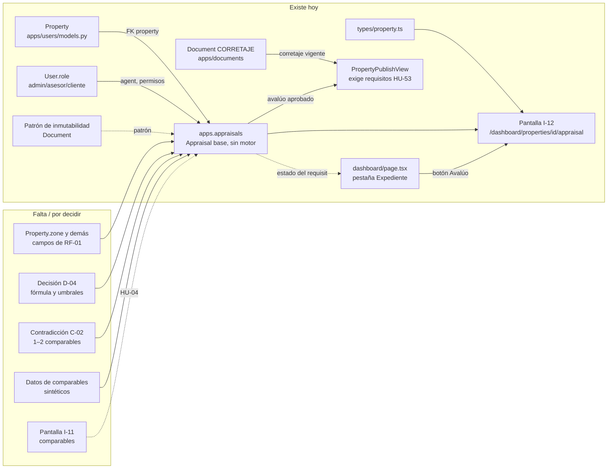

# Urbanex — GPS de archivos y dependencias

| Campo | Valor |
|---|---|
| Propósito | Saber qué archivo implementa qué HU, qué riesgo tiene tocarlo y de qué depende Avalúos |
| Fecha de auditoría | 2026-10-22 · rama `develop` con cambios sin commit |
| Última actualización | 2026-10-30 · `appraisals/admin.py` (FX-18, θ por rol admin) y `appraisals/tests.py` (44 pruebas). Antes: 2026-10-28 (noche) · motor DS-21 (FX-17): `engine/`, `services.py`, `EngineParameters`, comando `setup_comparables_demo` y pantalla I-11. Antes: 2026-10-28 · `setup_demo_data` no restaura el estado (DT-72); tarea 3 validada (V-13 a V-18). Antes: 2026-10-27 (tarea 3) · endpoint de requisitos de publicación, `components/Dialog.tsx` y dashboard sin `alert`/`confirm`. Antes: 2026-10-27 (tarea 5) · §3: precaución de seguridad para `users/views.py`/`serializers.py`. Antes: 2026-10-27 · comando `setup_demo_data` (DT-14, `817da84`) y 6 pruebas nuevas en `users/tests.py`. Antes: 2026-10-25 · fase 3 en `dashboard/page.tsx` (`3783919`); pantalla I-12 (`frontend/app/dashboard/properties/[id]/appraisal/page.tsx`), `frontend/types/appraisal.ts` y `authFetch` en `frontend/lib/api.ts` (DT-40, fases 1 y 2). Antes: 2026-10-24, app `apps.appraisals` y cambios en `users/views.py` y `users/tests.py` |
| Alcance | HU-01, HU-03, HU-05, HU-37, HU-44, HU-45, HU-46 + dependencias de HU-04, HU-06, HU-08 |

> **Este GPS es una guía de precauciones, no una lista de archivos intocables.** Sebas puede modificar lo necesario para Avalúos, siempre que revise las dependencias indicadas y ejecute las pruebas listadas.

Estados y validaciones: ver [Estado de procesos](URBANEX_ESTADO_PROCESOS.md). Deuda referenciada (DT-xx): ver [Deuda técnica](URBANEX_DEUDA_TECNICA.md).

Riesgo de regresión: **Alto** = lo usan varias HU o pantallas; **Medio** = una HU con integración frontend/backend; **Bajo** = aislado.

## 1. Mapa HU → archivos

### HU-01 · Registrar propiedad en captación → [estado](URBANEX_ESTADO_PROCESOS.md#hu-01)

| Ruta | Capa | Responsabilidad real | Evidencia | Estado | Riesgo | Precauciones |
|---|---|---|---|---|---|---|
| `backend/apps/users/models.py` (`Property`, `PropertyImage`) | Modelo | Datos de la propiedad e imágenes | Código + `test_create_property_as_agent` | En Curso | **Alto** | Cualquier campo nuevo exige migración en la app `users`; `documents` tiene FK `PROTECT` hacia `Property` |
| `backend/apps/users/serializers.py` (`PropertySerializer`) | Serializer | Contrato JSON de propiedades; regla de `no_disponible` y prohibición de `vendido`/`arrendado` | Código | En Curso | **Alto** | Mantener sincronizado con `frontend/types/property.ts`. `get_agent_name` está duplicado |
| `backend/apps/users/views.py` (`PUBLIC_STATUSES`, `PropertyListCreateView`, `MyPropertiesView`, `PropertyDetailView`, `PropertyImageViewSet`) | Vista | CRUD de propiedades e imágenes; filtro del catálogo público para anónimos (lista y detalle) | Código + tests | En Curso | **Alto** | `PUBLIC_STATUSES` usa `'reservador'` (DT-16): cambiarlo cuando se migre. Un `cliente` autenticado aún ve la captación (DT-39); imágenes sin control (DT-10) |
| `backend/apps/users/urls.py` | Rutas | `/api/auth/properties/…`, `/api/auth/property-images/` | Código | Listo | Medio | El frontend tiene estas URLs hardcodeadas |
| `backend/apps/users/tests.py` | Test | 21 pruebas: crear, `status` de solo lectura (2), catálogo público (3), publicación HU-53 (8), login fallido y, desde 2026-10-27, `SetupDemoDataCommandTests` (6) | 21/21 aprobadas (2026-10-27) | — | Medio | Los helpers `_add_corretaje` parchean el storage de `Document` a una carpeta temporal y `_add_image` guarda solo la ruta: no escriben en `private_media/` ni en `media/`. Las pruebas del seeder usan `MEDIA_ROOT` y storage temporales y `override_settings(DEBUG=True)` |
| `backend/apps/users/management/commands/setup_demo_data.py` (2026-10-27) | Comando (desarrollo) | Datos demo (DT-14, DS-17): admin y asesor demo + 4 propiedades en captación con distinto avance de los requisitos de HU-53 | 6 pruebas; commit `817da84` | Listo | Bajo | Solo con `DEBUG=True` y `DEMO_PASSWORD`. Depende de `get_missing_publication_requirements()`, `Document.upload_new_version()` y `Appraisal.create_draft()/calibrate()/approve()`: si cambian sus firmas, actualizar el comando. Requiere Pillow (DT-54). Crea registros inmutables que no se pueden borrar. **No restaura** propiedades ya publicadas ni quita avalúos o documentos (DT-72): antes de una ronda de validación, leer el estado real que imprime el comando |
| `frontend/app/dashboard/page.tsx` | UI (I-03 + modal I-10) | Lista "Mis propiedades" + modal de 4 pestañas + guardado de propiedad, imágenes y documentos | `tsc` OK; validación visual parcial del usuario | En Curso | **Alto** | Archivo de 927 líneas: si se modifica, revisar las 4 pestañas. `validateForm()` es la única validación de la foto |
| `frontend/types/property.ts` | Tipos | Contrato TS de `Property` | `tsc` OK | Listo | **Alto** | Lo usan el dashboard, el catálogo, la ficha, `PropertyCard` y `lib/api` |
| `frontend/app/properties/page.tsx`, `frontend/components/PropertyCard.tsx` | UI (P-02) | Catálogo público | `next build` OK | En Curso | Medio | Muestra lo que devuelva el backend, incluida la captación (DT-07) |

### HU-03 · Cargar documentación inicial → [estado](URBANEX_ESTADO_PROCESOS.md#hu-03)

| Ruta | Capa | Responsabilidad | Evidencia | Estado | Riesgo | Precauciones |
|---|---|---|---|---|---|---|
| `backend/apps/documents/models.py` | Modelo | `Document`, inmutabilidad, versionado, alerta a 30 días, `validate_document()` | 10 pruebas de modelo | Pruebas | Medio | No cambiar `MUTABLE_FIELDS` ni las restricciones sin actualizar las pruebas. `property` es nombre de FK: dentro de la clase usar `@builtins.property` |
| `backend/apps/documents/serializers.py` | Serializer | Lectura sin ruta de archivo; subida con detección de tipo real y permisos | 9 pruebas de API | Pruebas | Medio | `user_can_access_property()` es la regla de permisos por propiedad; reutilizable |
| `backend/apps/documents/views.py` | Vista | `DocumentViewSet`: listar, crear, detalle, descargar; sin update/delete | 9 pruebas de API | Pruebas | Medio | La descarga es provisional (HU-38 usará URLs firmadas) |
| `backend/apps/documents/urls.py`, `backend/config/urls.py` | Rutas | `/api/documents/` | Pruebas de API | Listo | Bajo | — |
| `backend/apps/documents/admin.py` | Admin | Admin de solo lectura | Código | Listo | Bajo | — |
| `backend/apps/documents/migrations/0001_initial.py` | Migración | Tabla y restricciones | Aplicada | Listo | Medio | **No editar** (ya aplicada); crear migraciones nuevas |
| `backend/apps/documents/tests.py` | Test | 19 pruebas | 19/19 aprobadas | — | — | Se ejecutan con `manage.py test apps.documents.tests` (DT-06) |
| `frontend/app/dashboard/page.tsx` (pestaña `docs`) | UI | Requisitos para publicar, expediente guardado, formulario y lista por subir | `tsc` OK; visual **pendiente** | Pruebas | Alto | Los tipos `DOC_TYPES` deben coincidir con `Document.DocType` |
| `.gitignore` (`backend/private_media/`) | Config | Excluir documentos privados de Git | `git check-ignore` OK | Listo | Alto | Nunca versionar `private_media/` |

### HU-05 · Características y ubicación → [estado](URBANEX_ESTADO_PROCESOS.md#hu-05)

| Ruta | Capa | Responsabilidad | Evidencia | Estado | Riesgo | Precauciones |
|---|---|---|---|---|---|---|
| `backend/apps/users/models.py` (`latitude`, `longitude`, `bedrooms`, `bathrooms`, `parking_spaces`, `area_m2`, `property_type`) | Modelo | Características estructuradas | Migración `0006` aplicada | En Curso | **Alto** | Faltan campos de RF-01 (DT-19) |
| `backend/apps/users/migrations/0006_property_latitude_property_longitude_and_more.py` | Migración | Coordenadas + tipo `terreno` | Aplicada (2026-10-22) | Listo | Medio | No editar |
| `frontend/components/MapPicker.tsx` | UI | Mapa Leaflet, clic para marcar, buscador Nominatim con `flyTo` | `tsc` OK; Nominatim probado con curl; visual **pendiente** | Pruebas | Medio | Solo se carga en cliente (`dynamic(..., { ssr: false })`). Exporta el tipo `LatLng` |
| `frontend/app/dashboard/page.tsx` (pestañas `general` y `location`) | UI | Formulario estructurado y coordenadas redondeadas a 6 decimales | `tsc` OK | En Curso | Alto | Si cambia `decimal_places`, cambiar también `toFixed(6)` |

### HU-37 · Validar un documento → [estado](URBANEX_ESTADO_PROCESOS.md#hu-37)

| Ruta | Capa | Responsabilidad | Evidencia | Estado | Riesgo | Precauciones |
|---|---|---|---|---|---|---|
| `backend/apps/documents/models.py` (`validate_document`) | Modelo | Solo admin, solo versión vigente, rechazo con motivo | 3 pruebas | En Curso | Bajo | Endpoint y UI corresponden al Sprint 7 |
| — | Endpoint / UI | **No existe** | — | — | — | — |

### HU-08 · Calibrar y aprobar el avalúo (modelo base, 2026-10-24) → [estado](URBANEX_ESTADO_PROCESOS.md#hu-08)

| Ruta | Capa | Responsabilidad | Evidencia | Estado | Riesgo | Precauciones |
|---|---|---|---|---|---|---|
| `backend/apps/appraisals/models.py` | Modelo | `Appraisal` (§7 + `status`/`approved_at`), `MUTABLE_FIELDS`, `create_draft()` (placeholder + `# TODO: Implementar motor de cálculo HITL`), `calibrate()`, `approve()` | 11 pruebas de modelo | Pruebas | Medio | No ampliar `MUTABLE_FIELDS` ni quitar restricciones sin actualizar pruebas y [DS-01](URBANEX_DEUDA_TECNICA.md#4-decisiones-tomadas-sesión-2026-10-24-aprobadas-por-pablo). HU-06 debe escribir `suggested_value`/`confidence_level` **al crear**, nunca después. `@builtins.property` dentro de la clase |
| `backend/apps/appraisals/serializers.py` | Serializer | Lectura (todo solo lectura), creación de borrador, calibración PATCH | 7 pruebas de API | Pruebas | Bajo | Reutiliza `user_can_access_property()` de `documents` |
| `backend/apps/appraisals/views.py` | Vista | `AppraisalViewSet`: list, retrieve, create, PATCH, `approve/`; sin PUT ni DELETE | 7 pruebas de API | Pruebas | Bajo | `http_method_names` excluye PUT/DELETE: no quitarlo |
| `backend/apps/appraisals/urls.py`, `backend/config/urls.py` | Rutas | `/api/appraisals/` | Pruebas de API | Listo | Bajo | — |
| `backend/apps/appraisals/admin.py` | Admin | `Appraisal` de solo lectura (auditoría A-05). `EngineParameters` (θ): el rol admin ve la app, la lista y crea y activa versiones (FX-18, 2026-10-30) | `EngineParametersAdminTests` (2 pruebas); V-25 aprobada | Listo | Bajo | El acceso a `/admin/` exige `is_staff`: un admin creado desde A-01 no lo tendrá (DT-82) |
| `backend/apps/appraisals/migrations/0001_initial.py` | Migración | Tabla + 3 restricciones | Generada; aplicada en la BD de Pablo el 2026-10-24 (`[X] 0001_initial`). Cada copia debe ejecutar `migrate` (DT-43) | Listo | Medio | No editar una vez compartida |
| `backend/apps/appraisals/tests.py` | Test | 44 pruebas (2026-10-30: modelo, API, motor DS-21, θ, comparables sintéticos y admin de θ) | 44/44 aprobadas con `apps.appraisals.tests` | — | — | Incluir `apps.appraisals.tests` en el comando (DT-41) |
| `backend/config/settings.py` (`INSTALLED_APPS`) | Config | Registro de `apps.appraisals.apps.AppraisalsConfig` | `manage.py check` | Listo | Alto (compartido) | — |
| `frontend/types/appraisal.ts` (2026-10-25) | Tipos | Contrato TS de `Appraisal`, `AppraisalCalibratePayload` y del 400 de publicar (`MissingRequirement`, `PublishErrorResponse`) | `tsc` OK (commit `161f845`) | Listo | Medio | Espejo de `AppraisalSerializer` y de `get_missing_publication_requirements()`: si cambia un campo o un `code`, cambiar ambos en el mismo commit. Los Decimal llegan como `string` |
| `frontend/lib/api.ts` (`authFetch`, `ApiError`, 2026-10-25) | Cliente HTTP | Fetch autenticado (token de `sessionStorage`), `NEXT_PUBLIC_API_URL`, error con `status` y cuerpo | `tsc` + `eslint` OK (commit `161f845`) | Listo | Medio | Usarlo en pantallas nuevas en vez de `fetch` con `127.0.0.1` (DT-22). `apiFetch` sigue igual para no romper el login |
| `frontend/app/dashboard/properties/[id]/appraisal/page.tsx` (2026-10-25) | UI (I-12) | Iniciar, calibrar, aprobar y ver el avalúo; precio de publicación como referencia; historial de aprobados | `tsc`, `eslint`, `next build` OK (commit `af9b416`); **visual pendiente** | Pruebas | Medio | No mostrar ni calcular un valor sugerido hasta D-04 (DS-02, DS-12). El campo "Precio actual de publicación" es solo referencia: el valor del motor irá en la tarjeta "Resultado del motor". Usa `useParams()` (devuelve el objeto, sin `await`). Botón "Iniciar avalúo" sin guarda de dueño (DT-48) |
| `backend/apps/appraisals/engine/` (`calculator.py`, `factors.py`, `theta.py`; 2026-10-28) | Dominio puro (HU-06) | Motor DS-21: capa 1 (homogeneización, atípicos, pesos, CV, confianza), registro de factores por nombre y versión, validación de θ, zona provisional por radio | 10 pruebas `EngineCalculatorTests`, incluido el ejemplo de DS-21 §8 (commit `739f7a7`) | Pruebas | Medio | **Sin acceso a la BD.** Cambiar una fórmula = registrar una versión nueva del factor (`superficie@2`), nunca editar la existente: los avalúos guardan la traza con el nombre del factor. `Decimal` siempre; `area_m2` se convierte con `str()` |
| `backend/apps/appraisals/models.py` (`EngineParameters`, `Appraisal.engine_parameters`, `create_draft(comparables=…)`; 2026-10-28) | Modelo | θ versionado e inmutable, una sola versión activa; FK del avalúo a la versión usada; `create_draft()` llama al motor | 4 pruebas `EngineParametersTests` + 7 de la API (commits `0b158da`, `ca3542a`) | Pruebas | Medio | Migraciones `0002_engine_parameters` y `0003_theta_v1` (datos): **cada copia ejecuta `migrate`** (DT-43). θ solo cambia creando versiones desde el admin |
| `backend/apps/appraisals/services.py` (2026-10-28) | Servicio (HU-04) | `find_candidates()`: mismo tipo, estados de θ, dato reciente (`updated_at`, DT-75), misma zona y orden del motor | Pruebas de la API | Pruebas | Medio | Cuando exista `Property.zone` (N-03), solo cambia `same_zone()` en el motor |
| `backend/apps/appraisals/views.py` (`candidates`) + `serializers.py` (`comparables`, `suggested_value_display`) (2026-10-28) | Vista / serializer | `GET /api/appraisals/candidates/`; `POST` con comparables revalidados | 7 pruebas `AppraisalEngineApiTests` | Pruebas | Medio | Muestra datos de mercado de otros asesores (DT-76) |
| `backend/apps/appraisals/management/commands/setup_comparables_demo.py` (2026-10-28) | Comando (desarrollo) | 11 comparables sintéticos en `vendido`, sin asesor (DS-23) | 3 pruebas (commit `97bb755`) | Listo | Bajo | Solo con `DEBUG=True`. Las coordenadas rodean a las propiedades de `setup_demo_data`: si estas cambian de lugar, ajustar ambos |
| `frontend/app/dashboard/properties/[id]/appraisal/comparables/page.tsx` (2026-10-28) | UI (I-11) | Elegir de 3 a 5 comparables, calcular o registrar manual, con confirmación en `Dialog` | `tsc`, `eslint`, `next build` OK (commit `ba466b8`); **visual pendiente** (V-20) | Pruebas | Medio | Sin pruebas automáticas (DT-37). Ruta nueva: `dashboard/page.tsx` no se tocó |

### HU-53 · Publicar una propiedad (2026-10-24) → [estado](URBANEX_ESTADO_PROCESOS.md#hu-53)

| Ruta | Capa | Responsabilidad | Evidencia | Estado | Riesgo | Precauciones |
|---|---|---|---|---|---|---|
| `backend/apps/users/views.py` (`get_missing_publication_requirements`, `PropertyPublishView`) | Vista / regla de dominio | Requisitos (foto, corretaje vigente no rechazado, avalúo aprobado) y transición `captacion → disponible` en transacción | 8 pruebas en `apps.users.tests` | Pruebas | **Alto** | Cualquier requisito nuevo va en `get_missing_publication_requirements()` con su `code`. El contrato del 400 (`detail` + `missing_requirements`) lo consumirá la UI |
| `backend/apps/users/serializers.py` (`PropertySerializer`) | Serializer | `status` en `read_only_fields` (DT-09 resuelto, FX-11) | `test_patch_cannot_change_status`, `test_create_ignores_status` | Listo | **Alto** | **No volver a hacer `status` escribible.** Nuevas transiciones (HU-09, reserva, cierre) = acciones explícitas en vistas propias |
| `backend/apps/users/views.py` (`PropertyPublicationRequirementsView`) + `urls.py` (2026-10-27) | Vista | `GET /api/auth/properties/<id>/publication-requirements/`: `{status, can_publish, missing_requirements}` sin cambiar el estado; dueño o admin (DS-15) | 6 pruebas en `apps.users.tests` (commit `5e68dce`) | Pruebas | Medio | Reutiliza `get_missing_publication_requirements()`: un requisito nuevo aparece aquí y en el 400 a la vez (`test_requirements_match_publish_rejection` lo comprueba) |
| `frontend/components/Dialog.tsx` (2026-10-27) | UI | Modal accesible de aviso o confirmación con Tailwind; reemplaza `alert`/`confirm` | `tsc`, `eslint` OK (commit `cf62881`) | Listo | Bajo | Usarlo en toda confirmación nueva (Estándares §3). Pendiente en I-12 (DT-51) |
| `frontend/app/dashboard/page.tsx` (`handlePublish`, `publishCandidate`, `publishProblem`, `notice`, `loadPublicationRequirements`, `saveErrors`; 2026-10-27; antes `publishFeedback`, 2026-10-25) | UI | Publica con `authFetch` y muestra `missing_requirements` como lista sobre la tabla (con "Ir al avalúo"); "Publicar" solo en `captacion`; botón "Avalúo" hacia I-12; fila "Avalúo aprobado" del Expediente con datos reales | `tsc`, `next build` OK; `eslint` sin errores nuevos (commit `3783919`); **validado** V-13 a V-18 (2026-10-28) | Pruebas | Alto | Los `code` de `missing_requirements` vienen del backend: si se agrega uno, el aviso lo muestra solo, pero el enlace solo existe para `appraisal`. Los enlaces del modal descartan cambios sin guardar (DT-50) |

### HU-44, HU-45, HU-46 · Acceso → estado [HU-44](URBANEX_ESTADO_PROCESOS.md#hu-44) · [HU-45](URBANEX_ESTADO_PROCESOS.md#hu-45) · [HU-46](URBANEX_ESTADO_PROCESOS.md#hu-46)

| Ruta | Capa | Responsabilidad | Evidencia | Estado | Riesgo | Precauciones |
|---|---|---|---|---|---|---|
| `backend/apps/users/models.py` (`User`) | Modelo | `role`, `failed_attempts`, `is_locked` | Código | En Curso | **Alto** | `AUTH_USER_MODEL = "users.User"`: cambios aquí afectan a todo |
| `backend/apps/users/views.py` (`LoginView`) | Vista | Login JWT, bloqueo a los 5 intentos | `test_login_failed_with_invalid_credentials` | En Curso | **Alto** | No comprueba `is_active` (DT-12) |
| `backend/apps/users/admin.py` | Admin | `UserAdmin` genérico | Código | En Curso | Bajo | No muestra `role` ni `is_locked` (DT-15) |
| `frontend/app/(auth)/login/page.tsx` | UI (I-01) | Formulario de login; guarda el token en `sessionStorage` | Código | En Curso | Medio | No guarda `refresh`; error de lint `any` |
| `frontend/lib/api.ts` (`apiFetch`) | Cliente HTTP | Fetch genérico | Código | Listo | Medio | Lanza `Error ${status}` sin el detalle del backend (DT-26). Desde 2026-10-25 existe `authFetch`/`ApiError` en el mismo archivo, que sí lo conserva |
| — | Recuperación de contraseña (I-02), gestión de usuarios (A-01) | **No existen** | — | — | — | — |

## 2. Mapa de dependencias de Avalúos (HU-04, HU-06, HU-08)

| Dependencia | Tipo | Detalle | Archivo |
|---|---|---|---|
| `Property` como sujeto del avalúo | **Confirmada** | FK a `'users.Property'` (el modelo vive en la app `users`, no en `apps.properties`) | `backend/apps/users/models.py` |
| Precio por m² de comparables | **Confirmada** | Existen `price` (Decimal) y `area_m2` (Float). Mezclar Decimal con Float exige conversión explícita | `backend/apps/users/models.py` |
| Mismo tipo de propiedad | **Confirmada** | `property_type`: `casa`, `departamento`, `local`, `terreno` | `backend/apps/users/models.py` |
| Segmentación por zona | **Provisional (2026-10-28, DS-21 §7)** | No existe `zone`: se usa un radio de 1,5 km entre coordenadas (θ). Las propiedades sin coordenadas no se pueden calcular (registro manual). Destino: `zone` con lista controlada (N-03) | DT-19, `engine/calculator.py` (`same_zone`) |
| Otras variables del motor (antigüedad, conservación, área útil, operación) | **Falta / D-04** | No existen; cuáles se usan depende de D-04 | DT-19 |
| Qué propiedades sirven de comparables (¿estados? ¿solo vendidas?) | **POR CONFIRMAR** | RF-11 dice "base interna" sin precisar estados | Decisión de negocio |
| Requisito de publicación | **Implementada (2026-10-24)** | `get_missing_publication_requirements()` usa `Appraisal.objects.approved()`; `test_publish_property_permission` reescrita | `backend/apps/users/views.py`, `backend/apps/users/tests.py` |
| Contrato de corretaje | **Implementada (2026-10-24)** | Versión vigente, no vencida y no `RECHAZADO` (DS-04) | `backend/apps/users/views.py` |
| Permisos | **Confirmada** | Patrón `role == 'admin' or property.agent_id == user.id` (en `PropertyOwnerOrAdminOrReadOnly` y `user_can_access_property`). En la BD de desarrollo **no hay asesores ni admins** hasta ejecutar `setup_demo_data` (2026-10-27, DT-14) | `backend/apps/users/views.py`, `backend/apps/documents/serializers.py` |
| Autenticación | **Confirmada** | JWT Bearer; el frontend lee `sessionStorage.getItem("access")` | `frontend/app/dashboard/page.tsx` |
| Inmutabilidad del avalúo (HU-08) | **Implementada (2026-10-24)** | Mismo enfoque que `Document` + ciclo BORRADOR → APROBADO | `backend/apps/appraisals/models.py` |
| Tipos TS | **Implementada (2026-10-25)** | `frontend/types/appraisal.ts`; importa `Property` de `types/property.ts` sin duplicarlo | `frontend/types/appraisal.ts` |
| Pantalla I-12 | **Implementada (2026-10-25), visual pendiente** | Ruta `/dashboard/properties/[id]/appraisal` (DS-10) | `frontend/app/dashboard/properties/[id]/appraisal/page.tsx` |
| Indicador en la UI | **Implementada (2026-10-25, fase 3), visual pendiente** | La fila "Avalúo aprobado" de la pestaña Expediente consulta `GET /api/appraisals/?property=<id>` al editar | `frontend/app/dashboard/page.tsx` |
| Zona horaria | **Confirmada** | `TIME_ZONE='UTC'`: las fechas del avalúo se guardarán en UTC (DT-01) | `backend/config/settings.py` |
| Borrador IA (HU-07) | Fuera del alcance de Sebas | No hay servicio LLM configurado; HU-08 necesita un campo de justificación aunque HU-07 no exista | — |

## 3. Archivos compartidos que requieren coordinación

| Archivo | Por qué es compartido | Qué coordinar antes de tocarlo |
|---|---|---|
| `backend/apps/users/models.py` | `User` + `Property` + `PropertyImage` en un solo archivo | Avisar antes de agregar campos; dos migraciones `users.0007` paralelas generan conflicto (`makemigrations --merge`) |
| `backend/apps/users/migrations/` | Numeración secuencial | Hacer pull antes de `makemigrations`; nunca editar migraciones aplicadas |
| `backend/config/settings.py` | `INSTALLED_APPS`, zona horaria, DRF | Un cambio de `TIME_ZONE` o de los permisos por defecto afecta a todas las apps |
| `backend/config/urls.py` | Rutas raíz | Ya incluye `api/appraisals/` (2026-10-24); agregar rutas nuevas sin tocar las demás |
| `backend/apps/users/views.py` | Catálogo, detalle y publicación | `PUBLIC_STATUSES` y `get_missing_publication_requirements()` son reglas de negocio: cambiarlas exige actualizar pruebas, Estado de procesos y Deuda |
| `frontend/app/dashboard/page.tsx` | Modal de propiedad + Expediente + lista | Si Avalúos se integra aquí, evitar que dos personas editen el archivo a la vez; mejor crear rutas nuevas (`/dashboard/properties/[id]/appraisal`) |
| `frontend/types/property.ts` | Contrato usado por 5 archivos | Cambiar el tipo y el serializer en el mismo commit |
| `backend/db.sqlite3` | Rastreado en Git | Cada desarrollador modifica su copia y aparecen conflictos binarios (DT-02) |
| `frontend/lib/api.ts` (2026-10-25) | Cliente HTTP de todas las pantallas (`apiFetch`, `authFetch`) | No cambiar la firma de `apiFetch` (lo usa el login); los cambios de `authFetch` afectan a I-12 y a la fase 3 |
| `backend/apps/users/views.py` + `serializers.py` (seguridad, 2026-10-27) | Visibilidad de propiedades e imágenes por usuario | Antes de tocar la visibilidad (DT-39) o las fotos (DT-10), leer el estado por componente de [Seguridad §1.1](URBANEX_SEGURIDAD_Y_DEUDA.md#11-estado-por-componente-confirmado-por-código-2026-10-27) y actualizarlo en el mismo cambio. **Riesgo Alto abierto: no desplegar** (DS-20) |
| `frontend/CLAUDE.md` (2026-10-25) | Instrucciones que lee cualquier asistente de IA en `frontend/` | Hoy apunta a `@AGENTS.md`, que no existe (DT-45). Acordar su contenido antes de cambiarlo |
