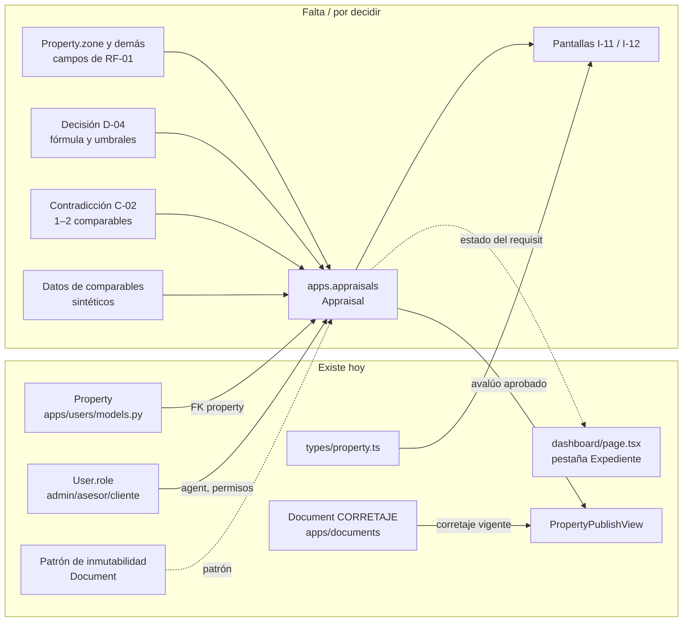

# Urbanex — GPS de archivos y dependencias

| Campo | Valor |
|---|---|
| Propósito | Saber qué archivo implementa qué HU, qué riesgo tiene tocarlo y de qué depende Avalúos |
| Fecha de auditoría | 2026-10-22 · rama `develop` con cambios sin commit |
| Alcance | HU-01, HU-03, HU-05, HU-37, HU-44, HU-45, HU-46 + dependencias de HU-04, HU-06, HU-08 |

> **Este GPS es una guía de precauciones, no una lista de archivos intocables.** Sebas puede modificar lo necesario para Avalúos, siempre que revise las dependencias indicadas y ejecute las pruebas listadas.

Estados y validaciones: ver [Estado de procesos](URBANEX_ESTADO_PROCESOS.md). Deuda referenciada (DT-xx): ver [Deuda técnica](URBANEX_DEUDA_TECNICA.md).

Riesgo de regresión: **Alto** = lo usan varias HU o pantallas; **Medio** = una HU con integración frontend/backend; **Bajo** = aislado.

## 1. Mapa HU → archivos

### HU-01 · Registrar propiedad en captación → [estado](URBANEX_ESTADO_PROCESOS.md#hu-01)

| Ruta | Capa | Responsabilidad real | Evidencia | Estado | Riesgo | Precauciones |
|---|---|---|---|---|---|---|
| `backend/apps/users/models.py` (`Property`, `PropertyImage`) | Modelo | Datos de la propiedad e imágenes | Código + `test_create_property_as_agent` | En Curso | **Alto** | Cualquier campo nuevo exige migración en la app `users`; `documents` tiene FK `PROTECT` hacia `Property` |
| `backend/apps/users/serializers.py` (`PropertySerializer`) | Serializer | Contrato JSON de propiedades; regla de `no_disponible` y prohibición de `vendido`/`arrendado` | Código | En Curso | **Alto** | Mantener sincronizado con `frontend/types/property.ts`. `get_agent_name` está duplicado |
| `backend/apps/users/views.py` (`PropertyListCreateView`, `MyPropertiesView`, `PropertyDetailView`, `PropertyImageViewSet`) | Vista | CRUD de propiedades e imágenes | Código + tests | En Curso | **Alto** | Catálogo público sin filtro (DT-07); imágenes sin control (DT-10) |
| `backend/apps/users/urls.py` | Rutas | `/api/auth/properties/…`, `/api/auth/property-images/` | Código | Listo | Medio | El frontend tiene estas URLs hardcodeadas |
| `backend/apps/users/tests.py` | Test | 3 pruebas (crear, publicar, login fallido) | 3/3 aprobadas | — | Medio | `test_publish_property_permission` cambiará con HU-53 |
| `frontend/app/dashboard/page.tsx` | UI (I-03 + modal I-10) | Lista "Mis propiedades" + modal de 4 pestañas + guardado de propiedad, imágenes y documentos | `tsc` OK; validación visual parcial del usuario | En Curso | **Alto** | Archivo de 927 líneas: si se modifica, revisar las 4 pestañas. `validateForm()` es la única validación de la foto |
| `frontend/types/property.ts` | Tipos | Contrato TS de `Property` | `tsc` OK | Listo | **Alto** | Lo usan el dashboard, el catálogo, la ficha, `PropertyCard` y `lib/api` |
| `frontend/app/properties/page.tsx`, `frontend/components/PropertyCard.tsx` | UI (P-02) | Catálogo público | `next build` OK | En Curso | Medio | Muestra lo que devuelva el backend, incluida la captación (DT-07) |

### HU-03 · Cargar documentación inicial → [estado](URBANEX_ESTADO_PROCESOS.md#hu-03)

| Ruta | Capa | Responsabilidad | Evidencia | Estado | Riesgo | Precauciones |
|---|---|---|---|---|---|---|
| `backend/apps/documents/models.py` | Modelo | `Document`, inmutabilidad, versionado, alerta a 30 días, `validate_document()` | 10 pruebas de modelo | Pruebas | Medio | No cambiar `MUTABLE_FIELDS` ni las restricciones sin actualizar las pruebas. `property` es nombre de FK: dentro de la clase usar `@builtins.property` |
| `backend/apps/documents/serializers.py` | Serializer | Lectura sin ruta de archivo; subida con detección de tipo real y permisos | 9 pruebas de API | Pruebas | Medio | `user_can_access_property()` es la regla de permisos por propiedad; reutilizable |
| `backend/apps/documents/views.py` | Vista | `DocumentViewSet`: listar, crear, detalle, descargar; sin update/delete | 9 pruebas de API | Pruebas | Medio | La descarga es provisional (HU-38 usará URLs firmadas) |
| `backend/apps/documents/urls.py`, `backend/config/urls.py` | Rutas | `/api/documents/` | Pruebas de API | Listo | Bajo | — |
| `backend/apps/documents/admin.py` | Admin | Admin de solo lectura | Código | Listo | Bajo | — |
| `backend/apps/documents/migrations/0001_initial.py` | Migración | Tabla y restricciones | Aplicada | Listo | Medio | **No editar** (ya aplicada); crear migraciones nuevas |
| `backend/apps/documents/tests.py` | Test | 19 pruebas | 19/19 aprobadas | — | — | Se ejecutan con `manage.py test apps.documents.tests` (DT-06) |
| `frontend/app/dashboard/page.tsx` (pestaña `docs`) | UI | Requisitos para publicar, expediente guardado, formulario y lista por subir | `tsc` OK; visual **pendiente** | Pruebas | Alto | Los tipos `DOC_TYPES` deben coincidir con `Document.DocType` |
| `.gitignore` (`backend/private_media/`) | Config | Excluir documentos privados de Git | `git check-ignore` OK | Listo | Alto | Nunca versionar `private_media/` |

### HU-05 · Características y ubicación → [estado](URBANEX_ESTADO_PROCESOS.md#hu-05)

| Ruta | Capa | Responsabilidad | Evidencia | Estado | Riesgo | Precauciones |
|---|---|---|---|---|---|---|
| `backend/apps/users/models.py` (`latitude`, `longitude`, `bedrooms`, `bathrooms`, `parking_spaces`, `area_m2`, `property_type`) | Modelo | Características estructuradas | Migración `0006` aplicada | En Curso | **Alto** | Faltan campos de RF-01 (DT-19) |
| `backend/apps/users/migrations/0006_property_latitude_property_longitude_and_more.py` | Migración | Coordenadas + tipo `terreno` | Aplicada (2026-10-22) | Listo | Medio | No editar |
| `frontend/components/MapPicker.tsx` | UI | Mapa Leaflet, clic para marcar, buscador Nominatim con `flyTo` | `tsc` OK; Nominatim probado con curl; visual **pendiente** | Pruebas | Medio | Solo se carga en cliente (`dynamic(..., { ssr: false })`). Exporta el tipo `LatLng` |
| `frontend/app/dashboard/page.tsx` (pestañas `general` y `location`) | UI | Formulario estructurado y coordenadas redondeadas a 6 decimales | `tsc` OK | En Curso | Alto | Si cambia `decimal_places`, cambiar también `toFixed(6)` |

### HU-37 · Validar un documento → [estado](URBANEX_ESTADO_PROCESOS.md#hu-37)

| Ruta | Capa | Responsabilidad | Evidencia | Estado | Riesgo | Precauciones |
|---|---|---|---|---|---|---|
| `backend/apps/documents/models.py` (`validate_document`) | Modelo | Solo admin, solo versión vigente, rechazo con motivo | 3 pruebas | En Curso | Bajo | Endpoint y UI corresponden al Sprint 7 |
| — | Endpoint / UI | **No existe** | — | — | — | — |

### HU-44, HU-45, HU-46 · Acceso → estado [HU-44](URBANEX_ESTADO_PROCESOS.md#hu-44) · [HU-45](URBANEX_ESTADO_PROCESOS.md#hu-45) · [HU-46](URBANEX_ESTADO_PROCESOS.md#hu-46)

| Ruta | Capa | Responsabilidad | Evidencia | Estado | Riesgo | Precauciones |
|---|---|---|---|---|---|---|
| `backend/apps/users/models.py` (`User`) | Modelo | `role`, `failed_attempts`, `is_locked` | Código | En Curso | **Alto** | `AUTH_USER_MODEL = "users.User"`: cambios aquí afectan a todo |
| `backend/apps/users/views.py` (`LoginView`) | Vista | Login JWT, bloqueo a los 5 intentos | `test_login_failed_with_invalid_credentials` | En Curso | **Alto** | No comprueba `is_active` (DT-12) |
| `backend/apps/users/admin.py` | Admin | `UserAdmin` genérico | Código | En Curso | Bajo | No muestra `role` ni `is_locked` (DT-15) |
| `frontend/app/(auth)/login/page.tsx` | UI (I-01) | Formulario de login; guarda el token en `sessionStorage` | Código | En Curso | Medio | No guarda `refresh`; error de lint `any` |
| `frontend/lib/api.ts` (`apiFetch`) | Cliente HTTP | Fetch genérico | Código | Listo | Medio | Lanza `Error ${status}` sin el detalle del backend |
| — | Recuperación de contraseña (I-02), gestión de usuarios (A-01) | **No existen** | — | — | — | — |

## 2. Mapa de dependencias de Avalúos (HU-04, HU-06, HU-08)

| Dependencia | Tipo | Detalle | Archivo |
|---|---|---|---|
| `Property` como sujeto del avalúo | **Confirmada** | FK a `'users.Property'` (el modelo vive en la app `users`, no en `apps.properties`) | `backend/apps/users/models.py` |
| Precio por m² de comparables | **Confirmada** | Existen `price` (Decimal) y `area_m2` (Float). Mezclar Decimal con Float exige conversión explícita | `backend/apps/users/models.py` |
| Mismo tipo de propiedad | **Confirmada** | `property_type`: `casa`, `departamento`, `local`, `terreno` | `backend/apps/users/models.py` |
| Segmentación por zona | **Falta** | No existe `zone`; las coordenadas existen pero las 28 propiedades de desarrollo tienen `latitude = NULL` | DT-19 |
| Otras variables del motor (antigüedad, conservación, área útil, operación) | **Falta / D-04** | No existen; cuáles se usan depende de D-04 | DT-19 |
| Qué propiedades sirven de comparables (¿estados? ¿solo vendidas?) | **POR CONFIRMAR** | RF-11 dice "base interna" sin precisar estados | Decisión de negocio |
| Requisito de publicación | **Confirmada** | `PropertyPublishView` debe exigir el avalúo aprobado (HU-53) y `test_publish_property_permission` debe actualizarse | `backend/apps/users/views.py`, `backend/apps/users/tests.py` |
| Contrato de corretaje | **Confirmada** | `Document.objects.current().filter(property=p, doc_type='CORRETAJE').exists()` | `backend/apps/documents/models.py` |
| Permisos | **Confirmada** | Patrón `role == 'admin' or property.agent_id == user.id` (en `PropertyOwnerOrAdminOrReadOnly` y `user_can_access_property`). En la BD de desarrollo **no hay asesores ni admins** | `backend/apps/users/views.py`, `backend/apps/documents/serializers.py` |
| Autenticación | **Confirmada** | JWT Bearer; el frontend lee `sessionStorage.getItem("access")` | `frontend/app/dashboard/page.tsx` |
| Inmutabilidad del avalúo (HU-08) | **Patrón disponible** | Copiar el enfoque de `Document` (`save`/`delete`/`QuerySet` bloqueados + restricciones) | `backend/apps/documents/models.py` |
| Tipos TS | **Confirmada** | Crear `frontend/types/appraisal.ts` (aún no existe); no duplicar `Property` | `frontend/types/property.ts` |
| Indicador en la UI | **Confirmada** | La fila "Avalúo aprobado" de la pestaña Expediente es un marcador fijo que hay que conectar | `frontend/app/dashboard/page.tsx` |
| Zona horaria | **Confirmada** | `TIME_ZONE='UTC'`: las fechas del avalúo se guardarán en UTC (DT-01) | `backend/config/settings.py` |
| Borrador IA (HU-07) | Fuera del alcance de Sebas | No hay servicio LLM configurado; HU-08 necesita un campo de justificación aunque HU-07 no exista | — |

## 3. Archivos compartidos que requieren coordinación

| Archivo | Por qué es compartido | Qué coordinar antes de tocarlo |
|---|---|---|
| `backend/apps/users/models.py` | `User` + `Property` + `PropertyImage` en un solo archivo | Avisar antes de agregar campos; dos migraciones `users.0007` paralelas generan conflicto (`makemigrations --merge`) |
| `backend/apps/users/migrations/` | Numeración secuencial | Hacer pull antes de `makemigrations`; nunca editar migraciones aplicadas |
| `backend/config/settings.py` | `INSTALLED_APPS`, zona horaria, DRF | Un cambio de `TIME_ZONE` o de los permisos por defecto afecta a todas las apps |
| `backend/config/urls.py` | Rutas raíz | Agregar `path("api/appraisals/", …)` sin tocar las demás |
| `frontend/app/dashboard/page.tsx` | Modal de propiedad + Expediente + lista | Si Avalúos se integra aquí, evitar que dos personas editen el archivo a la vez; mejor crear rutas nuevas (`/dashboard/properties/[id]/appraisal`) |
| `frontend/types/property.ts` | Contrato usado por 5 archivos | Cambiar el tipo y el serializer en el mismo commit |
| `backend/db.sqlite3` | Rastreado en Git | Cada desarrollador modifica su copia y aparecen conflictos binarios (DT-02) |
