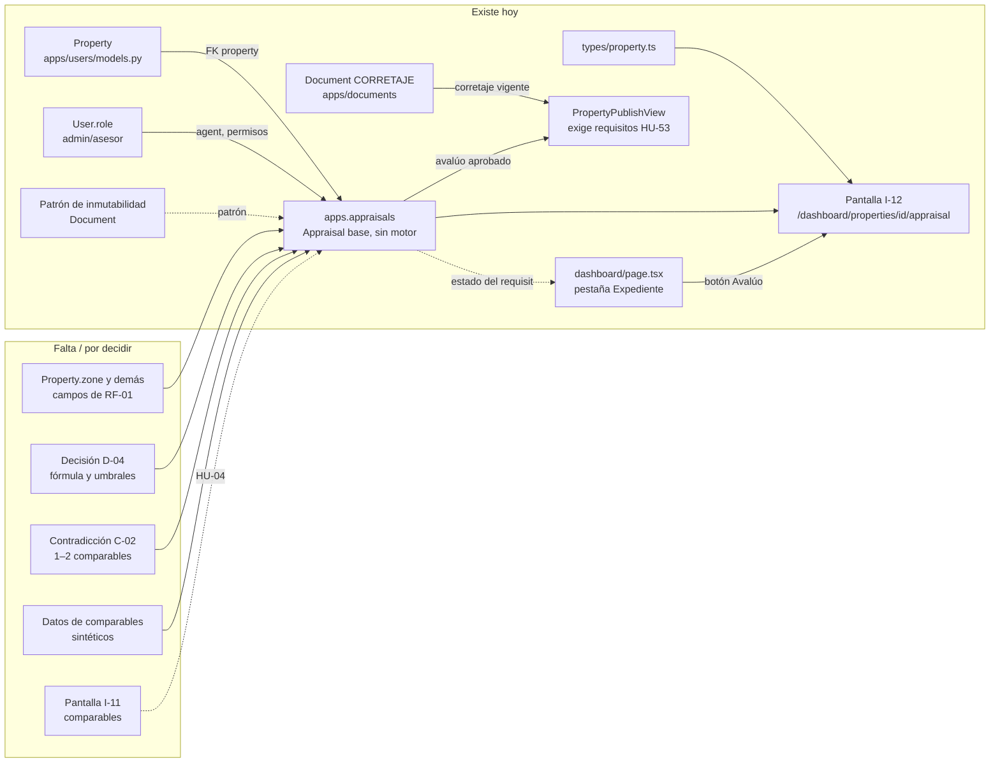

# Urbanex — GPS de archivos y dependencias

| Campo | Valor |
|---|---|
| Última actualización HU-10 · correcciones PR #27 | 2026-11-13 · Decisión de Pablo: Anexo 2 POR CONFIRMAR; DT-121..123; HU-10 en Pruebas sin sumar puntos; correcciones solo documentales sobre 43b1e18 |
| Última actualización HU-10 · integración comprobada | 2026-11-13 · develop c420e56 integrado; SQLite 372 OK, frontend 41/41 y check sin cambios; DT-92 Resuelto; sin push |
| Última actualización HU-10 · integración de develop | 2026-11-13 · Integración de c420e56, conflictos documentales conservados y pruebas de HU-09 adaptadas a results; suite integrada en ejecución |
| Última actualización HU-10 · preparación de integración | 2026-11-13 · DT-92 corregido con storage callable y migración de estado; commits e integración autorizados por Sebas |
| Última actualización HU-10 · distribución | 2026-11-13 · Filtrar, grupos uniformes y orden junto al conteo; V-46 humana Pendiente |
| Última actualización HU-10 · orden y simplificación | 2026-11-13 · Contrato sort, orden estable por precio y UI/URL conectados; sin modelos/migraciones |
| Última actualización HU-10 · preferencias | 2026-11-12 · CatalogFilters cambia parqueaderos a botones; consulta y etiquetas distinguen cero y sin preferencia |
| Última actualización HU-10 · slider e histograma | 2026-11-12 · GET del catálogo agrega price_distribution y filtro parking_spaces; contrato y controles conectados |
| Última actualización HU-10 · barra superior | 2026-11-11 · CatalogFilters integra navegación por URL, diálogos nativos y barra adherente; PropertyCard compacta |
| Última actualización HU-10 · usabilidad | 2026-11-11 · CatalogFilters, utilidades/pruebas numéricas y setup_catalog_demo; sin dependencias nuevas |
| Última actualización HU-10 | 2026-11-11 · Catálogo con filtros, contrato paginado y pruebas; archivos compartidos avisados en Fase 0 |
| Última actualización de corrección HU-09 | 2026-11-11 · representación pública del motivo en serializer y cobertura de privacidad; sin cambios de frontend |
| Última actualización aditiva HU-09 | 2026-11-11 · V-45 aprobada por Sebas el 2026-11-10; responsabilidades y precauciones sin cambios |
| Última actualización HU-46 · precisión JWT | 2026-11-09 · Corrección posterior a auditoría PR #20; HU-46 permanece en Pruebas |
| Última actualización · registro humano V-44 | 2026-11-09 · Fila incorporada por Sebas; auditoría y revisión pendientes |
| Última actualización HU-46 · desbloqueo | 2026-11-09 · Decisión de Sebas aplicada; validación visual del comportamiento nuevo Pendiente |
| Última actualización de integración HU-46 | 2026-11-09 · D-05 revisada; registro humano V-44 conservado; HU-46 en Pruebas |
| Última actualización aditiva HU-46 | 2026-11-06 · Código, pruebas y documentación de recuperación/sesión; V-44 Pendiente |
| Actualización HU-45 (2026-11-04) | Se conservaron `PropertyOwnershipTests` y `AccountUnlockApiTests`; suite integrada 159/159 OK en SQLite. Según Sebas, V-43 cubrió ambos criterios de HU-45 |
| Actualización lote 2 (2026-11-08) final | Se agregaron pruebas para visits (CleanWithoutTimesTests). 229/229 pruebas backend OK. Archivos nuevos documentados en §1: backend/apps/visits/*, frontend/components/FreeSlotsPicker.tsx, frontend/lib/visits.ts, frontend/lib/visitsCalendar.ts, frontend/types/visit.ts, páginas en dashboard/agenda y availability |
| Actualización lote 4 (2026-11-09, noche) | Pablo (con Claude Code) · rama `feat/URB-20-21-35-36-HU-15-HU-16-HU-29-HU-30-contactos-crm`: §1, sección HU-15/HU-16/HU-29/HU-30 (`apps.opportunities`, P-07, I-06 e I-06A nueva). Ningún archivo de §3 tocado en el código; `AGENTS.md` (§3) solo en la fila de rangos (DS-50) |
| Actualización lote 3 (2026-11-09) | Pablo (con Claude Code) · rama `feat/URB-23-24-28-HU-19-HU-20-HU-25-solicitud-visitas` (PR #21): §1, sección HU-19/HU-20/HU-25 (archivos de `apps.visits`, `apps.opportunities`, P-07, P-08 e I-08). Ningún archivo de §3 tocado |
| Propósito | Saber qué archivo implementa qué HU, qué riesgo tiene tocarlo y de qué depende Avalúos |
| Fecha de auditoría | 2026-10-22 · rama `develop` con cambios sin commit |
| Última actualización | 2026-11-04 · Pablo (con Claude Code) · rama `feat/URB-30-34-HU-27-HU-34-oportunidades`: merge de `origin/develop` (`5fb3910`, con los PR #14 y #16); se conservan las entradas de ambos lados. Antes (develop): 2026-11-03 · Pablo (con Claude Code), rama `docs/user-story-mapping` · §3: fila de `docs/handoff/URBANEX_USM_TRAZABILIDAD.md` (mapa de historias, procesos y trazabilidad; columna Código revisada contra `develop` `d71c7f2`). Antes: 2026-11-02 · HU-44: V-33..V-42 Pendiente; observaciones manuales atribuidas a Sebas, no verificadas en esta sesión. Suite automatizada en SQLite; Sebas reportó validación manual en Supabase PostgreSQL; suite local PostgreSQL No ejecutado. DT-95..DT-97 y DS-40. Fila base de `dashboard/page.tsx` preservada desde `2c07f7d8`; se agregan filas actuales separadas para A-01 y `SiteNav`. Antes: 2026-10-31 · §3: `AGENTS.md`, `CLAUDE.md` y `.github/` (reglas para la IA, DS-25); `backend/db.sqlite3` y `frontend/CLAUDE.md` ya no se versionan. HU-44: migración histórica `users.0007`, 53/53 pruebas de users y suite 116/116 en SQLite. Antes: 2026-10-30 · `appraisals/admin.py` (FX-18, θ por rol admin) y `appraisals/tests.py` (44 pruebas). Antes: 2026-10-28 (noche) · motor DS-21 (FX-17): `engine/`, `services.py`, `EngineParameters`, comando `setup_comparables_demo` y pantalla I-11. Antes: 2026-10-28 · `setup_demo_data` no restaura el estado (DT-72); tarea 3 validada (V-13 a V-18). Antes: 2026-10-27 · endpoint de requisitos de publicación, `components/Dialog.tsx` y dashboard sin `alert`/`confirm`; seguridad para `users/views.py`/`serializers.py`; comando `setup_demo_data` (DT-14, `817da84`) y 6 pruebas nuevas. Antes: 2026-10-25 · fase 3 en `dashboard/page.tsx` (`3783919`); pantalla I-12, `frontend/types/appraisal.ts` y `authFetch` en `frontend/lib/api.ts` (DT-40, fases 1 y 2). Antes: 2026-10-24, app `apps.appraisals` y cambios en `users/views.py` y `users/tests.py` · Rama HU-12: 2026-11-01 · §1: HU-12 (metaetiquetas de la ficha, FX-24): `frontend/lib/propertyMetadata.ts`, sus pruebas `node --test` y `generateMetadata` en `frontend/app/properties/[id]/page.tsx`; script `npm test` en `frontend/package.json`. Antes: 2026-10-31 · §3: `AGENTS.md`, `CLAUDE.md` y `.github/` (reglas para la IA, DS-25); `backend/db.sqlite3` y `frontend/CLAUDE.md` ya no se versionan. Antes: 2026-10-30 · `appraisals/admin.py` (FX-18, θ por rol admin) y `appraisals/tests.py` (44 pruebas). Antes: 2026-10-28 (noche) · motor DS-21 (FX-17): `engine/`, `services.py`, `EngineParameters`, comando `setup_comparables_demo` y pantalla I-11. Antes: 2026-10-28 · `setup_demo_data` no restaura el estado (DT-72); tarea 3 validada (V-13 a V-18). Antes: 2026-10-27 (tarea 3) · endpoint de requisitos de publicación, `components/Dialog.tsx` y dashboard sin `alert`/`confirm`. Antes: 2026-10-27 (tarea 5) · §3: precaución de seguridad para `users/views.py`/`serializers.py`. Antes: 2026-10-27 · comando `setup_demo_data` (DT-14, `817da84`) y 6 pruebas nuevas en `users/tests.py`. Antes: 2026-10-25 · fase 3 en `dashboard/page.tsx` (`3783919`); pantalla I-12 (`frontend/app/dashboard/properties/[id]/appraisal/page.tsx`), `frontend/types/appraisal.ts` y `authFetch` en `frontend/lib/api.ts` (DT-40, fases 1 y 2). Antes: 2026-10-24, app `apps.appraisals` y cambios en `users/views.py` y `users/tests.py` · Rama de oportunidades: 2026-11-03 (noche, 23:50) · I-06 e I-07: validación visual repetida con hora y captura (V-26 a V-32). Antes, el mismo día · correcciones de la auditoría: API de oportunidades con 21 pruebas; I-06 e I-07 con la validación visual aprobada el 2026-11-01 y la repetición con captura pendiente. Antes: 2026-11-03 (tarde) · `opportunities/tests.py` (37 pruebas) y nota de `users/tests.py` (55 pruebas, `PropertyOwnershipTests`), FX-25. Antes: 2026-11-03 · Pablo (con Claude Code), rama `feat/URB-30-34-HU-27-HU-34-oportunidades`: merge de `origin/develop` (`a071b97`, con los PR #9 y #13); se conservan las entradas de ambos lados. Antes (rama de oportunidades, sin develop): 2026-10-30 (tarde) · EP-5, primer corte (FX-19): app nueva `apps.opportunities` (DS-27), pantallas I-06 e I-07, `types/opportunity.ts` y `lib/opportunities.ts`; una línea en `config/settings.py` y una en `config/urls.py` (§3). |
| Alcance | HU-01, HU-03, HU-05, HU-37, HU-44, HU-45, HU-46 + dependencias de HU-04, HU-06, HU-08 + (2026-10-30) HU-27 y HU-34 (EP-5) + HU-12 (2026-11-01) |

> **Este GPS es una guía de precauciones, no una lista de archivos intocables.** Sebas puede modificar lo necesario para Avalúos, siempre que revise las dependencias indicadas y ejecute las pruebas listadas.

Estados y validaciones: ver [Estado de procesos](URBANEX_ESTADO_PROCESOS.md). Deuda referenciada (DT-xx): ver [Deuda técnica](URBANEX_DEUDA_TECNICA.md).

Riesgo de regresión: **Alto** = lo usan varias HU o pantallas; **Medio** = una HU con integración frontend/backend; **Bajo** = aislado.

### Actualización aditiva HU-46 — 2026-11-09

`backend/apps/users/tests.py` agrega cobertura de invalidación de access/refresh tras cambio manual y activación, y Secure según DEBUG. No se modifican modelos, migraciones, vistas, serializers ni contratos frontend. Se revisó la integración de los compartidos `backend/config/settings.py`, `backend/config/urls.py`, `frontend/components/SiteNav.tsx` y `frontend/lib/api.ts`: se conservan la sesión HU-46 y las rutas/enlaces de oportunidades, disponibilidad y agenda de develop. El registro humano V-44 de Sebas (2026-11-07, 16:19) consta en `Project_Progress.md`; su captura existe localmente y no se incorpora a Git. HU-46 permanece en Pruebas; esta revisión no añade una aprobación humana.

### Decisión de recuperación y desbloqueo — 2026-11-09

`backend/apps/users/views.py` (**compartido**) guarda el desbloqueo y el contador cero al confirmar una recuperación válida. `backend/apps/users/tests.py` agrega tres pruebas: cuenta bloqueada puede recuperar e iniciar sesión; enlaces inválidos/vencidos/usados no desbloquean; cuenta aún no bloqueada también reinicia intentos. No cambia el contrato API ni el frontend y no hay migraciones nuevas.

**Decisión indicada por Sebas el 2026-11-09:** una cuenta activa que completa correctamente la recuperación segura de contraseña queda con `is_locked=False` y `failed_attempts=0`. El cambio se guarda junto con la contraseña dentro de la transacción existente de `PasswordResetConfirmView`; conserva la invalidación de JWT por `password_changed_at` y el consumo de los enlaces. Solicitar el correo no desbloquea. Los enlaces inválidos, vencidos o usados no cambian la contraseña, el bloqueo ni los contadores. Esta nota supersede la pregunta anterior sobre conservar el bloqueo; no se atribuye esta decisión a Pablo.

**Evidencia humana:** según Sebas en esta conversación (2026-11-09), las evidencias existentes están bien. Se conserva la fila humana de V-44 del 2026-11-07 sin añadir una aprobación del agente. El nuevo comportamiento de desbloqueo requiere una comprobación visual adicional por una persona; queda Pendiente y no se considera cubierto por la evidencia anterior.

### Registro humano de ampliación V-44 — 2026-11-09

Sebas incorporó personalmente en `Project_Progress.md`, ampliación V-44, su comprobación del 2026-11-09 a las 15:13:56: recuperación válida con desbloqueo, reinicio de intentos e inicio de sesión con la contraseña nueva. Evidencia local: `evidence/ResetPasswordUsuarioBloqueado.png`; la fecha y hora fueron confirmadas por Sebas en la conversación. La fila humana supersede las menciones anteriores que dejaban esa comprobación o su transcripción Pendiente. El agente conserva ese registro sin emitir una aprobación nueva ni recalcular porcentajes. HU-46 permanece en Pruebas; auditoría de solo lectura y revisión para el merge pendientes. DT-92, DT-68 y los riesgos de seguridad no se cierran con esta nota.

## 1. Mapa HU → archivos

### HU-01 · Registrar propiedad en captación → [estado](URBANEX_ESTADO_PROCESOS.md#hu-01)

| Ruta | Capa | Responsabilidad real | Evidencia | Estado | Riesgo | Precauciones |
|---|---|---|---|---|---|---|
| `backend/apps/users/models.py` (`Property`, `PropertyImage`) | Modelo | Datos de la propiedad e imágenes | Código + `test_create_property_as_agent` | En Curso | **Alto** | Cualquier campo nuevo exige migración en la app `users`; `documents` tiene FK `PROTECT` hacia `Property` |
| `backend/apps/users/serializers.py` (`PropertySerializer`) | Serializer | Contrato JSON de propiedades; regla de `no_disponible` y prohibición de `vendido`/`arrendado` | Código | En Curso | **Alto** | Mantener sincronizado con `frontend/types/property.ts`. `get_agent_name` está duplicado |
| `backend/apps/users/views.py` (`PUBLIC_STATUSES`, `PropertyListCreateView`, `MyPropertiesView`, `PropertyDetailView`, `PropertyImageViewSet`) | Vista | CRUD de propiedades e imágenes; filtro del catálogo público para anónimos (lista y detalle) | Código + tests | En Curso | **Alto** | `PUBLIC_STATUSES` usa `'reservador'` (DT-16): cambiarlo cuando se migre. C-08 elimina `cliente`; `users.0007` pasa superusuarios heredados a admin y las demás cuentas a asesor inactivo con motivo. Las bases donde 0007 ya estaba aplicada requieren corrección separada (DT-93). Imágenes sin control (DT-10) |
| `backend/apps/users/urls.py` | Rutas | `/api/auth/properties/…`, `/api/auth/property-images/` | Código | Listo | Medio | El frontend tiene estas URLs hardcodeadas |
| `backend/apps/users/tests.py` | Test | 53 pruebas: regresiones de propiedades/publicación, `SetupDemoDataCommandTests` y `UserManagementApiTests` (23) | 53/53 aprobadas (2026-10-30) | — | Medio | Las pruebas de gestión fuerzan `EMAIL_PROVIDER=console`; las dos pruebas específicas de Resend simulan su punto de uso. Los helpers de documentos y del seeder usan storage temporal |
| `backend/apps/users/management/commands/setup_demo_data.py` (2026-10-27) | Comando (desarrollo) | Datos demo (DT-14, DS-17): admin y asesor demo + 4 propiedades en captación con distinto avance de los requisitos de HU-53 | 6 pruebas del comando; suite users 53/53 y backend 116/116 (2026-10-31, SQLite) | Listo | Bajo | Solo con `DEBUG=True` y `DEMO_PASSWORD`. Depende de `get_missing_publication_requirements()`, `Document.upload_new_version()` y `Appraisal.create_draft()/calibrate()/approve()`: si cambian sus firmas, actualizar el comando. Requiere Pillow (DT-54). Crea registros inmutables que no se pueden borrar. **No restaura** propiedades ya publicadas ni quita avalúos o documentos (DT-72): antes de una ronda de validación, leer el estado real que imprime el comando |
| `frontend/app/dashboard/page.tsx` | UI (I-03 + modal I-10) | Lista "Mis propiedades" + modal de 4 pestañas + guardado de propiedad, imágenes y documentos | `tsc` OK; validación visual parcial reportada por Sebas | En Curso | **Alto** | Registro base conservado de `2c07f7d8`: archivo compartido; al modificarlo, revisar las 4 pestañas. `validateForm()` es la única validación de la foto |
| `frontend/types/property.ts` | Tipos | Contrato TS de `Property` | `tsc` OK | Listo | **Alto** | Lo usan el dashboard, el catálogo, la ficha, `PropertyCard` y `lib/api` |
| `frontend/app/properties/page.tsx`, `frontend/components/PropertyCard.tsx` | UI (P-02) | Catálogo público | `next build` OK | En Curso | Medio | Muestra lo que devuelva el backend, incluida la captación (DT-07) |

> **Nota añadida (Pablo, con Claude Code, 2026-11-03), rama `feat/URB-30-34-HU-27-HU-34-oportunidades`:** `backend/apps/users/tests.py` tiene **55 pruebas** en esta rama: se sumó la clase `PropertyOwnershipTests` al final (2 pruebas, DT-107, FX-25, `1ee3c1b`) y se corrigió el comentario de `client_user` (`tests.py:45`), sin renombrarlo. Es carpeta de Sebas: el cambio va en un commit propio y con el menor diff posible por HU-45.

### HU-03 · Cargar documentación inicial → [estado](URBANEX_ESTADO_PROCESOS.md#hu-03)

| Ruta | Capa | Responsabilidad | Evidencia | Estado | Riesgo | Precauciones |
|---|---|---|---|---|---|---|
| `backend/apps/documents/models.py` | Modelo | `Document`, inmutabilidad, versionado, alerta a 30 días, `validate_document()` | 10 pruebas de modelo | Pruebas | Medio | No cambiar `MUTABLE_FIELDS` ni las restricciones sin actualizar las pruebas. `property` es nombre de FK: dentro de la clase usar `@builtins.property` |
| `backend/apps/documents/serializers.py` | Serializer | Lectura sin ruta de archivo; subida con detección de tipo real y permisos | 9 pruebas de API | Pruebas | Medio | `user_can_access_property()` es la regla de permisos por propiedad; reutilizable |
| `backend/apps/documents/views.py` | Vista | `DocumentViewSet`: listar, crear, detalle, descargar; sin update/delete | 9 pruebas de API | Pruebas | Medio | La descarga es provisional (HU-38 usará URLs firmadas) |
| `backend/apps/documents/urls.py`, `backend/config/urls.py` | Rutas | `/api/documents/` | Pruebas de API | Listo | Bajo | — |
| `backend/apps/documents/admin.py` | Admin | Admin de solo lectura | Código | Listo | Bajo | — |
| `backend/apps/documents/migrations/0001_initial.py` | Migración | Tabla y restricciones | Aplicada | Listo | Medio | **No editar** (ya aplicada); crear migraciones nuevas |
| `backend/apps/documents/tests.py` | Test | 19 pruebas | 19/19 aprobadas | — | — | Se ejecutan con `manage.py test apps.documents.tests` (DT-06) |
| `frontend/app/dashboard/page.tsx` (pestaña `docs`) | UI | Requisitos para publicar, expediente guardado, formulario y lista por subir | `tsc` OK; visual **pendiente** | Pruebas | Alto | Los tipos `DOC_TYPES` deben coincidir con `Document.DocType` |
| `.gitignore` (`backend/private_media/`) | Config | Excluir documentos privados de Git | `git check-ignore` OK | Listo | Alto | Nunca versionar `private_media/` |

### HU-05 · Características y ubicación → [estado](URBANEX_ESTADO_PROCESOS.md#hu-05)

| Ruta | Capa | Responsabilidad | Evidencia | Estado | Riesgo | Precauciones |
|---|---|---|---|---|---|---|
| `backend/apps/users/models.py` (`latitude`, `longitude`, `bedrooms`, `bathrooms`, `parking_spaces`, `area_m2`, `property_type`) | Modelo | Características estructuradas | Migración `0006` aplicada | En Curso | **Alto** | Faltan campos de RF-01 (DT-19) |
| `backend/apps/users/migrations/0006_property_latitude_property_longitude_and_more.py` | Migración | Coordenadas + tipo `terreno` | Aplicada (2026-10-22) | Listo | Medio | No editar |
| `frontend/components/MapPicker.tsx` | UI | Mapa Leaflet, clic para marcar, buscador Nominatim con `flyTo` | `tsc` OK; Nominatim probado con curl; visual **pendiente** | Pruebas | Medio | Solo se carga en cliente (`dynamic(..., { ssr: false })`). Exporta el tipo `LatLng` |
| `frontend/app/dashboard/page.tsx` (pestañas `general` y `location`) | UI | Formulario estructurado y coordenadas redondeadas a 6 decimales | `tsc` OK | En Curso | Alto | Si cambia `decimal_places`, cambiar también `toFixed(6)` |

### HU-37 · Validar un documento → [estado](URBANEX_ESTADO_PROCESOS.md#hu-37)

| Ruta | Capa | Responsabilidad | Evidencia | Estado | Riesgo | Precauciones |
|---|---|---|---|---|---|---|
| `backend/apps/documents/models.py` (`validate_document`) | Modelo | Solo admin, solo versión vigente, rechazo con motivo | 3 pruebas | En Curso | Bajo | Endpoint y UI corresponden al Sprint 7 |
| — | Endpoint / UI | **No existe** | — | — | — | — |

### HU-08 · Calibrar y aprobar el avalúo (modelo base, 2026-10-24) → [estado](URBANEX_ESTADO_PROCESOS.md#hu-08)

| Ruta | Capa | Responsabilidad | Evidencia | Estado | Riesgo | Precauciones |
|---|---|---|---|---|---|---|
| `backend/apps/appraisals/models.py` | Modelo | `Appraisal` (§7 + `status`/`approved_at`), `MUTABLE_FIELDS`, `create_draft()` (placeholder + `# TODO: Implementar motor de cálculo HITL`), `calibrate()`, `approve()` | 11 pruebas de modelo | Pruebas | Medio | No ampliar `MUTABLE_FIELDS` ni quitar restricciones sin actualizar pruebas y [DS-01](URBANEX_DEUDA_TECNICA.md#4-decisiones-tomadas-sesión-2026-10-24-aprobadas-por-pablo). HU-06 debe escribir `suggested_value`/`confidence_level` **al crear**, nunca después. `@builtins.property` dentro de la clase |
| `backend/apps/appraisals/serializers.py` | Serializer | Lectura (todo solo lectura), creación de borrador, calibración PATCH | 7 pruebas de API | Pruebas | Bajo | Reutiliza `user_can_access_property()` de `documents` |
| `backend/apps/appraisals/views.py` | Vista | `AppraisalViewSet`: list, retrieve, create, PATCH, `approve/`; sin PUT ni DELETE | 7 pruebas de API | Pruebas | Bajo | `http_method_names` excluye PUT/DELETE: no quitarlo |
| `backend/apps/appraisals/urls.py`, `backend/config/urls.py` | Rutas | `/api/appraisals/` | Pruebas de API | Listo | Bajo | — |
| `backend/apps/appraisals/admin.py` | Admin | `Appraisal` de solo lectura (auditoría A-05). `EngineParameters` (θ): el rol admin ve la app, la lista y crea y activa versiones (FX-18, 2026-10-30) | `EngineParametersAdminTests` (2 pruebas); V-25 aprobada | Listo | Bajo | El acceso a `/admin/` exige `is_staff`: un admin creado desde A-01 no lo tendrá (DT-82) |
| `backend/apps/appraisals/migrations/0001_initial.py` | Migración | Tabla + 3 restricciones | Generada; aplicada en la BD de Pablo el 2026-10-24 (`[X] 0001_initial`). Cada copia debe ejecutar `migrate` (DT-43) | Listo | Medio | No editar una vez compartida |
| `backend/apps/appraisals/tests.py` | Test | 44 pruebas (2026-10-30: modelo, API, motor DS-21, θ, comparables sintéticos y admin de θ) | 44/44 aprobadas con `apps.appraisals.tests` | — | — | Incluir `apps.appraisals.tests` en el comando (DT-41) |
| `backend/config/settings.py` (`INSTALLED_APPS`) | Config | Registro de `apps.appraisals.apps.AppraisalsConfig` | `manage.py check` | Listo | Alto (compartido) | — |
| `frontend/types/appraisal.ts` (2026-10-25) | Tipos | Contrato TS de `Appraisal`, `AppraisalCalibratePayload` y del 400 de publicar (`MissingRequirement`, `PublishErrorResponse`) | `tsc` OK (commit `161f845`) | Listo | Medio | Espejo de `AppraisalSerializer` y de `get_missing_publication_requirements()`: si cambia un campo o un `code`, cambiar ambos en el mismo commit. Los Decimal llegan como `string` |
| `frontend/lib/api.ts` (`authFetch`, `ApiError`, 2026-10-25) | Cliente HTTP | Fetch autenticado (token de `sessionStorage`), `NEXT_PUBLIC_API_URL`; ante cualquier HTTP 401, `authFetch` sustituye el cuerpo por un mensaje genérico de sesión vencida | `tsc` + `eslint` OK | Listo | Medio | Un 401 de cualquier endpoint pierde su detalle original; afecta los errores de I-06, I-07, I-11 e I-12. Revisar esa UX antes de cambiar el comportamiento. `apiFetch` sigue igual para no romper el login |
| `frontend/app/dashboard/properties/[id]/appraisal/page.tsx` (2026-10-25) | UI (I-12) | Iniciar, calibrar, aprobar y ver el avalúo; precio de publicación como referencia; historial de aprobados | `tsc`, `eslint`, `next build` OK (commit `af9b416`); **visual pendiente** | Pruebas | Medio | No mostrar ni calcular un valor sugerido hasta D-04 (DS-02, DS-12). El campo "Precio actual de publicación" es solo referencia: el valor del motor irá en la tarjeta "Resultado del motor". Usa `useParams()` (devuelve el objeto, sin `await`). Botón "Iniciar avalúo" sin guarda de dueño (DT-48) |
| `backend/apps/appraisals/engine/` (`calculator.py`, `factors.py`, `theta.py`; 2026-10-28) | Dominio puro (HU-06) | Motor DS-21: capa 1 (homogeneización, atípicos, pesos, CV, confianza), registro de factores por nombre y versión, validación de θ, zona provisional por radio | 10 pruebas `EngineCalculatorTests`, incluido el ejemplo de DS-21 §8 (commit `739f7a7`) | Pruebas | Medio | **Sin acceso a la BD.** Cambiar una fórmula = registrar una versión nueva del factor (`superficie@2`), nunca editar la existente: los avalúos guardan la traza con el nombre del factor. `Decimal` siempre; `area_m2` se convierte con `str()` |
| `backend/apps/appraisals/models.py` (`EngineParameters`, `Appraisal.engine_parameters`, `create_draft(comparables=…)`; 2026-10-28) | Modelo | θ versionado e inmutable, una sola versión activa; FK del avalúo a la versión usada; `create_draft()` llama al motor | 4 pruebas `EngineParametersTests` + 7 de la API (commits `0b158da`, `ca3542a`) | Pruebas | Medio | Migraciones `0002_engine_parameters` y `0003_theta_v1` (datos): **cada copia ejecuta `migrate`** (DT-43). θ solo cambia creando versiones desde el admin |
| `backend/apps/appraisals/services.py` (2026-10-28) | Servicio (HU-04) | `find_candidates()`: mismo tipo, estados de θ, dato reciente (`updated_at`, DT-75), misma zona y orden del motor | Pruebas de la API | Pruebas | Medio | Cuando exista `Property.zone` (N-03), solo cambia `same_zone()` en el motor |
| `backend/apps/appraisals/views.py` (`candidates`) + `serializers.py` (`comparables`, `suggested_value_display`) (2026-10-28) | Vista / serializer | `GET /api/appraisals/candidates/`; `POST` con comparables revalidados | 7 pruebas `AppraisalEngineApiTests` | Pruebas | Medio | Muestra datos de mercado de otros asesores (DT-76) |
| `backend/apps/appraisals/management/commands/setup_comparables_demo.py` (2026-10-28) | Comando (desarrollo) | 11 comparables sintéticos en `vendido`, sin asesor (DS-23) | 3 pruebas (commit `97bb755`) | Listo | Bajo | Solo con `DEBUG=True`. Las coordenadas rodean a las propiedades de `setup_demo_data`: si estas cambian de lugar, ajustar ambos |
| `frontend/app/dashboard/properties/[id]/appraisal/comparables/page.tsx` (2026-10-28) | UI (I-11) | Elegir de 3 a 5 comparables, calcular o registrar manual, con confirmación en `Dialog` | `tsc`, `eslint`, `next build` OK (commit `ba466b8`); **visual pendiente** (V-20) | Pruebas | Medio | Sin pruebas automáticas (DT-37). Ruta nueva: `dashboard/page.tsx` no se tocó |

### HU-53 · Publicar una propiedad (2026-10-24) → [estado](URBANEX_ESTADO_PROCESOS.md#hu-53)

| Ruta | Capa | Responsabilidad | Evidencia | Estado | Riesgo | Precauciones |
|---|---|---|---|---|---|---|
| `backend/apps/users/views.py` (`get_missing_publication_requirements`, `PropertyPublishView`) | Vista / regla de dominio | Requisitos (foto, corretaje vigente no rechazado, avalúo aprobado) y transición `captacion → disponible` en transacción | 8 pruebas en `apps.users.tests` | Pruebas | **Alto** | Cualquier requisito nuevo va en `get_missing_publication_requirements()` con su `code`. El contrato del 400 (`detail` + `missing_requirements`) lo consumirá la UI |
| `backend/apps/users/serializers.py` (`PropertySerializer`) | Serializer | `status` en `read_only_fields` (DT-09 resuelto, FX-11) | `test_patch_cannot_change_status`, `test_create_ignores_status` | Listo | **Alto** | **No volver a hacer `status` escribible.** Nuevas transiciones (HU-09, reserva, cierre) = acciones explícitas en vistas propias |
| `backend/apps/users/views.py` (`PropertyPublicationRequirementsView`) + `urls.py` (2026-10-27) | Vista | `GET /api/auth/properties/<id>/publication-requirements/`: `{status, can_publish, missing_requirements}` sin cambiar el estado; dueño o admin (DS-15) | 6 pruebas en `apps.users.tests` (commit `5e68dce`) | Pruebas | Medio | Reutiliza `get_missing_publication_requirements()`: un requisito nuevo aparece aquí y en el 400 a la vez (`test_requirements_match_publish_rejection` lo comprueba) |
| `frontend/components/Dialog.tsx` (2026-10-27) | UI | Modal accesible de aviso o confirmación con Tailwind; reemplaza `alert`/`confirm` | `tsc`, `eslint` OK (commit `cf62881`) | Listo | Bajo | Usarlo en toda confirmación nueva (Estándares §3). Pendiente en I-12 (DT-51) |
| `frontend/app/dashboard/page.tsx` (`handlePublish`, `publishCandidate`, `publishProblem`, `notice`, `loadPublicationRequirements`, `saveErrors`; 2026-10-27; antes `publishFeedback`, 2026-10-25) | UI | Publica con `authFetch` y muestra `missing_requirements` como lista sobre la tabla (con "Ir al avalúo"); "Publicar" solo en `captacion`; botón "Avalúo" hacia I-12; fila "Avalúo aprobado" del Expediente con datos reales | `tsc`, `next build` OK; `eslint` sin errores nuevos (commit `3783919`); validado V-13 a V-18 (2026-10-28) | Pruebas | Alto | Sus cambios de acceso a I-12, expediente y publicación forman parte de la misma funcionalidad: sin ellos la pantalla nueva no se integra al proceso real. Mantener un commit de integración pequeño y separado de la pantalla nueva (DS-13). Los 401 genéricos de `authFetch` afectan también a esta pantalla |

### HU-12 · Compartir la ficha (2026-11-01) → [estado](URBANEX_ESTADO_PROCESOS.md#hu-12)

| Ruta | Capa | Responsabilidad | Evidencia | Estado | Riesgo | Precauciones |
|---|---|---|---|---|---|---|
| `frontend/lib/propertyMetadata.ts` | Lógica (frontend) | `buildPropertyMetadata()`: título, descripción con precio referencial, Open Graph y Twitter de una ficha; "Propiedad no disponible" + `noindex` si no es pública. `PUBLIC_STATUSES` copia la regla de `backend/apps/users/views.py` | 9 pruebas (`npm test`), commit `2305868` | Pruebas | Bajo | Solo `import type`: así `node --test` lo ejecuta sin compilar. Si cambia `PUBLIC_STATUSES` en el backend o la errata `reservador` (DT-16), cambiarlo aquí también |
| `frontend/lib/propertyMetadata.test.mjs` | Pruebas | Casos de metadatos por estado, foto y descripción | `npm test` → 9/9 | Pruebas | Bajo | Es `.mjs` para que `tsc` no lo revise e importa `./propertyMetadata.ts` con extensión |
| `frontend/app/properties/[id]/page.tsx` (`generateMetadata`, `getProperty`) | UI (P-03) | Publica las metaetiquetas de la ficha; `metadataBase` desde `NEXT_PUBLIC_SITE_URL` (por defecto `http://localhost:3000`); `cache()` comparte una consulta entre metadatos y página | `next build` exit 0, HTML comprobado (FX-24), commit `d690286` | Pruebas | Medio | En producción, `NEXT_PUBLIC_SITE_URL` debe ser el dominio público (DT-110). Navbar duplicada: DT-25 |
| `frontend/package.json` (`"test"`) | Configuración | `node --test "lib/**/*.test.mjs"`; requiere un Node que ejecute TypeScript sin flags (v22.18+ o v23.6+; Pablo usa v25.9.0; la versión de Sebas **No verificada**) | `npm test` | Listo | Bajo | Sin dependencias nuevas. Node avisa `MODULE_TYPELESS_PACKAGE_JSON`; no agregar `"type": "module"` sin revisar la configuración de Next |

### HU-44, HU-45, HU-46 · Acceso → estado [HU-44](URBANEX_ESTADO_PROCESOS.md#hu-44) · [HU-45](URBANEX_ESTADO_PROCESOS.md#hu-45) · [HU-46](URBANEX_ESTADO_PROCESOS.md#hu-46)

| Ruta | Capa | Responsabilidad | Evidencia | Estado | Riesgo | Precauciones |
|---|---|---|---|---|---|---|
| `backend/apps/users/models.py` (`User`, `UserActivationToken`) | Modelo | Roles `admin`/`asesor`, email único, teléfono, motivo de desactivación y token hash de activación | Migraciones `0007`/`0008` + suite en SQLite; Sebas informó que estaban aplicadas en Supabase | Pruebas | **Alto** | `AUTH_USER_MODEL = "users.User"`: no editar migraciones ya aplicadas; la edición local de `0007` no corrige Supabase (DT-93/DT-96). Restablecimiento y migración desde `develop` propuestos por Sebas: **POR CONFIRMAR**, no ejecutados (corregido por Pablo, 2026-11-03) |
| `backend/apps/users/views.py` (`LoginView`, gestión/activación de usuarios) | Vista | Login JWT activo; API admin-only para listar/crear/editar/desactivar/reinvitar; activación de un solo uso | 23 pruebas de `UserManagementApiTests`; suite backend 116/116 ejecutada en SQLite | Pruebas | **Alto** | V-33..V-39 Pendiente; observaciones anteriores atribuidas a Sebas, sin evidencia visual adjunta. V-37 fue parcial; la desasignación está cubierta por `test_deactivation_keeps_user_and_unassigns_properties`. Django Admin no es la A-01; errores de email deben atenderse explícitamente |
| `backend/config/settings.py` | Configuración compartida | SQLite por defecto; PostgreSQL opcional por `DB_ENGINE`; correo de consola por defecto y Resend opcional | `manage.py check`; suite backend | Pruebas | **Alto (compartido)** | Secretos solo en entorno; probar PostgreSQL por separado antes de usarlo |
| `backend/apps/users/admin.py` | Admin interno | Herramienta Django para desarrolladores; no es la interfaz diaria de administración | Código | Intencional | Bajo | La administración de la inmobiliaria vive en Next.js; desbloqueo HU-45 pendiente |
| `frontend/app/(auth)/login/page.tsx` | UI (I-01) | Formulario de login; guarda token, rol y email en `sessionStorage` | `tsc`, ESLint y build OK | Listo | Medio | La recuperación de contraseña (I-02) sigue pendiente |
| `frontend/app/dashboard/users/page.tsx` | UI (A-01) | Lista, crea, edita y desactiva usuarios; permite reenviar activación; muestra teléfonos y limita entrada a 10 dígitos | `tsc`, ESLint y build reportados previamente; V-33..V-39 Pendiente, observaciones anteriores atribuidas a Sebas | Pruebas | **Alto** | Solo rol admin; no ofrece acción DELETE; API vuelve a autorizar cada operación. La tabla de propiedades no expone el asesor responsable; el comportamiento de desasignación está cubierto por prueba automática |
| `frontend/app/dashboard/page.tsx` (acceso a A-01) | UI | Botón **Administrar usuarios** en el dashboard, dirigido a `/dashboard/users` | Validación visual V-40 Pendiente | Pruebas | **Alto** | Comprobar que solo se muestre a rol `admin`; la API sigue autorizando cada operación |
| `frontend/app/activate/page.tsx` | UI de activación | Establecer contraseña desde enlace con token, una vez y dentro de 24 h | `tsc`, ESLint y build reportados previamente; V-33..V-36 Pendiente | Pruebas | Medio | En desarrollo el enlace aparece en la consola de Django; entrega real por Resend no verificada |
| `frontend/components/SiteNav.tsx` | Navegación compartida | Navegación según rol y cierre de sesión global trasladado a esta barra | `tsc`, ESLint y build reportados previamente; validación visual V-41 Pendiente | Pruebas | Medio (compartido) | Logout emite el evento de sesión para sincronizar componentes; validar que invalide la sesión desde A-01 |
| `frontend/lib/auth-session.ts` | Sesión compartida | Notifica cambios de sesión a la navegación | `tsc`, ESLint y build | Pruebas | Medio | Mantener el evento sincronizado con login, activación y logout |
| `frontend/types/user.ts` | Tipos | Contrato TypeScript para usuarios gestionados por A-01 | Comparación con `ManagedUserSerializer`; `tsc` | Pruebas | Medio | Cambios deben reflejar exactamente el serializer |
| `frontend/lib/api.ts` (`apiFetch`, `authFetch`, `ApiError`) | Cliente HTTP | Fetch público/autenticado; conserva el cuerpo y el estado de error de DRF | `tsc`, ESLint y build reportados previamente | Listo | Medio | `authFetch` lee JWT desde `sessionStorage`; convierte respuestas 401 en un mensaje genérico de sesión vencida (DT-97); validar pantallas afectadas con V-42 |
| `backend/apps/users/views.py` + `urls.py` (HU-45, 2026-11-03) | API | Login con mensaje genérico centralizado; `POST /api/auth/users/<id>/unlock/` admin-only, reinicia `is_locked` y `failed_attempts` | Suite backend: 120 OK en SQLite en memoria; `makemigrations --check --dry-run` sigue detectando `documents/0002` | Pruebas | Alto | Sin modelo ni migración nueva; el bloqueo ya existente se conserva. No ejecutar pruebas PostgreSQL hasta confirmar el destino de la base de pruebas |
| `backend/apps/users/tests.py` (HU-45, clase nueva al final) | Pruebas API | Cobertura de autorización, desbloqueo, contador, 400 de cuenta desbloqueada y respuesta genérica | 120 pruebas backend OK en SQLite en memoria | Pruebas | Medio | V-43 completada por Sebas el 2026-11-04; la suite PostgreSQL no se verificó |
| `frontend/app/dashboard/users/page.tsx` (A-01, HU-45) | UI | Estado bloqueado y acción **Desbloquear** solo cuando la cuenta está bloqueada | `npm run build`, TypeScript y ESLint ejecutados; V-43 completada por Sebas | Pruebas | Alto | La API vuelve a autorizar la acción; no cambiar el tipo existente, que ya incluye `is_locked` y `failed_attempts` |
| `frontend/app/(auth)/login/page.tsx` (HU-45, 2026-11-04) | UI (I-01) | Conserva correo, limpia contraseña tras `401` y muestra «No se pudo iniciar sesión. Revisa tus credenciales.» | `npm run build` y TypeScript exit 0; ESLint exit 0 con 2 avisos preexistentes; V-43 completada por Sebas el 2026-11-04 | Pruebas | Medio | Mantener el mismo mensaje para credenciales incorrectas y cuentas bloqueadas |

**Actualización aditiva HU-46 (2026-11-06):** D-05 personalizado aprobado por Pablo, según Sebas. La suite integrada reportó 165/165 OK en SQLite; V-44 Pendiente; PostgreSQL No ejecutado.

| Ruta | Capa | Responsabilidad HU-46 | Evidencia técnica | Estado | Riesgo | Precauciones |
|---|---|---|---|---|---|---|
| `backend/apps/users/models.py` (`User.password_changed_at`, `PasswordResetToken`) y `migrations/0009_password_reset_and_password_changed_at.py` | Modelo y migración | Guarda el cambio de contraseña y hashes de enlaces de un solo uso, vigentes 60 minutos | Suite backend; `makemigrations --check --dry-run` aún detecta solo `documents/0002_alter_document_file.py` (DT-92) | Pruebas | Alto | No editar migraciones históricas ni correr migraciones contra Supabase |
| `backend/apps/users/authentication.py` | Autenticación | Rechaza access JWT emitidos antes de `password_changed_at` | Pruebas de tokens anteriores al cambio de contraseña | Pruebas | Alto | Mantener el criterio sincronizado con el serializer de refresh |
| `backend/apps/users/serializers.py` y `views.py` | API | Solicitud neutral, confirmación de recuperación, envío por consola/Resend, refresh y logout con CSRF | Suite backend: 165 OK en SQLite | Pruebas | Alto | El refresh no se devuelve en JSON; envío fallido queda registrado y no revela si existe la cuenta |
| `backend/apps/users/urls.py`, `backend/config/urls.py` y `backend/config/settings.py` | Rutas y configuración compartida | I-02, cookie refresh, CORS con credenciales, CSRF y autenticación por versión de contraseña | Suite backend y comprobación de configuración | Pruebas | **Alto (compartido)** | En local, ambos servicios deben usar `localhost`; en producción, configurar `CORS_ALLOWED_ORIGINS` y `FRONTEND_BASE_URL` por entorno |
| `backend/apps/users/tests.py` | Pruebas API | Cobertura de solicitud neutral, vencimiento, uso único, invalidación de JWT, cookie HttpOnly, CSRF y logout | Suite integrada: 165/165 OK en SQLite | Pruebas | Medio | PostgreSQL No ejecutado |
| `frontend/app/(auth)/forgot-password/page.tsx` y `reset-password/page.tsx` | UI (I-02) | Solicita instrucciones y establece una nueva contraseña; elimina el token del fragmento de URL | `npm test`, TypeScript, ESLint y build | Pruebas | Medio | V-44 visual Pendiente; no incluir tokens ni correos reales en capturas |
| `frontend/app/(auth)/login/page.tsx` | UI (I-01) | Recibe access en JSON y refresh solo en cookie HttpOnly; enlace a recuperación | TypeScript y build; suite backend | Pruebas | Medio | Mantener respuesta de error neutral |
| `frontend/lib/api.ts`, `auth-session.ts` y `components/SiteNav.tsx` | Cliente HTTP y navegación compartidos | Renueva access con CSRF, repite la petición, elimina sesión local y borra la cookie al cerrar sesión | TypeScript, ESLint y build; V-44 visual Pendiente | Pruebas | **Alto (compartido)** | Probar rutas protegidas y logout desde la interfaz |

### HU-27 y HU-34 · Abrir oportunidades y cartera con filtros (EP-5, 2026-10-30) → estado [HU-27](URBANEX_ESTADO_PROCESOS.md#hu-27) · [HU-34](URBANEX_ESTADO_PROCESOS.md#hu-34)

| Ruta | Capa | Responsabilidad | Evidencia | Estado | Riesgo | Precauciones |
|---|---|---|---|---|---|---|
| `backend/apps/opportunities/models.py` | Modelo | `Contact`, `Opportunity` (todos los campos de §7) y `OpportunityStatusHistory` inmutable; restricción `opportunity_single_active_per_contact_property` | 16 pruebas de modelo (commit `257ba1c`) | Pruebas | Medio | `TERMINAL_STATUSES` (`CIERRE`, `PERDIDA`) define qué es "activa" (DS-28): cambiarlo exige una migración de la restricción. El historial no admite `update` ni `delete`. `property` es nombre de FK: dentro de la clase usar `@builtins.property` |
| `backend/apps/opportunities/validators.py` | Dominio | `normalize_phone()`: celular de Ecuador → `+5939XXXXXXXX` (DS-28) | `NormalizePhoneTests` | Pruebas | Bajo | `Contact.phone` es único sobre el valor normalizado: cualquier entrada nueva (RF-02, RF-03, Messenger) debe pasar por esta función |
| `backend/apps/opportunities/services.py` | Servicio | `open_manual_opportunity()` (HU-27) y `get_or_create_contact()`, reutilizable por HU-15/HU-16; `eligible_properties()` y `assignable_agents()` | Pruebas de API (commit `4282a87`) | Pruebas | Medio | Única vía para abrir una oportunidad: transacción, 409 por `OpportunityConflict` y fila de apertura en el historial. No crear oportunidades con `Opportunity.objects.create` fuera de un servicio |
| `backend/apps/opportunities/serializers.py`, `views.py`, `urls.py` | Serializer / vista | `POST` y `GET /api/opportunities/` (filtros, paginación de 20, rango en hora de Ecuador), `eligible-properties/` y `agents/` | ~~19~~ 21 pruebas de API (+2 del 403 de `IsInternalUser`, DT-106, FX-25) (corregido por Pablo, 2026-11-03) | Pruebas | Medio | `IsInternalUser` deja fuera al rol `cliente` (valor heredado, C-08; 403 probado, DT-106). `EligiblePropertySerializer` solo expone datos públicos (DS-28): no agregar el asesor. Los querysets de entrada están limitados a lo elegible (DT-67) |
| `backend/apps/opportunities/admin.py` | Admin | Solo lectura de las tres tablas | Código | Listo | Bajo | — |
| `backend/apps/opportunities/migrations/0001_initial.py` | Migración | Tablas, índices y restricción | Aplicada en las pruebas; **cada copia ejecuta `migrate`** (DT-43) | Listo | Medio | Depende de `users.0006`: no choca con las `users.0007`/`0008` de la rama de HU-44. No editar una vez compartida |
| `backend/apps/opportunities/tests.py` | Test | ~~35 pruebas (modelo y API)~~ 37 pruebas (modelo y API; +2 del 403 de `IsInternalUser`, DT-106, FX-25) (corregido por Pablo, 2026-11-03) | 37/37 OK; suite completa 155/155 con `develop` fusionado (2026-11-03). Antes: 35/35 y 125/125 (2026-10-30) | — | — | Se ejecuta con la etiqueta `apps.opportunities.tests` (DT-06) |
| `frontend/types/opportunity.ts` | Tipos | Contrato TS de la API | `tsc` OK (commit `199294a`) | Listo | Medio | Espejo de `serializers.py`: cambiar ambos en el mismo commit |
| `frontend/lib/opportunities.ts` | Cliente HTTP | Llamadas a `/api/opportunities/` con `authFetch` | `tsc`, `eslint` OK | Listo | Bajo | No modifica `lib/api.ts` (compartido) |
| `frontend/app/dashboard/opportunities/page.tsx` | UI (I-06) | Cartera paginada con filtros; `?opened=` y `?property=` en la URL | `tsc`, `eslint`, `next build` OK; ~~**visual pendiente**~~ visual aprobada 2026-11-01 (V-30, V-31, Pablo); repetida con hora y captura el 2026-11-03 (corregido por Pablo, 2026-11-03) | Pruebas | Medio | Sin pruebas automáticas (DT-37). El rol de `sessionStorage` solo decide qué controles se ven. Filtro de propiedad limitado (DT-103) |
| `frontend/app/dashboard/opportunities/new/page.tsx` | UI (I-07) | Apertura manual con confirmación en `Dialog`, errores por campo, aviso de 409 y de contacto reutilizado | `tsc`, `eslint`, `next build` OK; ~~**visual pendiente**~~ visual aprobada 2026-11-01 (V-26 a V-29, V-32, Pablo); repetida con hora y captura el 2026-11-03 (corregido por Pablo, 2026-11-03) | Pruebas | Medio | Sin enlace en el menú (DT-101) |

### HU-22, HU-18, HU-24 · Gestión de Disponibilidad, Visitas y Agenda (Lote 2)

| Ruta | Capa | Responsabilidad | Evidencia | Estado | Riesgo | Precauciones |
|---|---|---|---|---|---|---|
| `backend/apps/visits/*` | Backend | Modelos (`AgentAvailability`, `Visit`), vistas, URLs y tests de la gestión de turnos y agenda | Suite 229/229 OK | Listo | Medio | Reglas estrictas de turnos cruzados y 30 mins mínimo. |
| `frontend/lib/visits.ts`, `visitsCalendar.ts`, `types/visit.ts` | Lógica/Tipos | Tipos compartidos y lógica para el calendario de visitas | `tsc` OK | Listo | Medio | Sincronizar siempre con el backend. |
| `frontend/components/FreeSlotsPicker.tsx` | Componente UI | Selector de franjas horarias libres | Visual V-65 a V-77 | Listo | Medio | — |
| `frontend/app/dashboard/agenda/page.tsx`, `frontend/app/dashboard/availability/page.tsx` | Pantallas UI | Interfaz para la agenda del asesor/admin y la configuración de disponibilidad | Visual V-65 a V-77 | Listo | Medio | — |

### HU-19, HU-20, HU-25 · Solicitud de visita, confirmación y resultado (lote 3, 2026-11-09, DS-39) → estado [HU-19](URBANEX_ESTADO_PROCESOS.md#hu-19) · [HU-20](URBANEX_ESTADO_PROCESOS.md#hu-20) · [HU-25](URBANEX_ESTADO_PROCESOS.md#hu-25)

| Ruta | Capa | Responsabilidad | Evidencia | Estado | Riesgo | Precauciones |
|---|---|---|---|---|---|---|
| `backend/apps/visits/services.py` | Servicio | `request_visit()` (HU-19: transacción, bloqueo del asesor, `free_slots()`, contacto y oportunidad, cambio a Visita Programada), `send_visit_notifications()` (HU-20, con `on_commit`), `public_visit_by_token()` (P-08) y `record_outcome()` (HU-25) | `VisitRequestTests`, `VisitNotificationTests`, `PublicVisitTests`, `VisitOutcomeTests` | Pruebas | Alto | Única vía para que el cliente cree visitas. La concurrencia real en PostgreSQL depende de DT-143 (fuera de este PR) |
| `backend/apps/visits/views.py`, `urls.py`, `serializers.py` | API | `POST properties/<id>/request/` (público, 3/min y 10/día por IP), `GET public/<token>/` (público, 30/min), `POST <id>/outcome/` (asesor de la visita o admin); campos nuevos en la agenda | Mismas pruebas + `VisitRequestThrottleTests` | Pruebas | Medio | La respuesta pública nunca lleva el token ni datos del cliente; los límites cuentan por proceso (DT-148, DT-149) |
| `backend/apps/visits/models.py` + `migrations/0003_…` | Modelo | `Visit.confirmation_email`, `outcome_recorded_at`, `outcome_recorded_by` | `makemigrations --check` (solo `documents/0002`, DT-92) | Pruebas | Medio | Migración nueva, sin editar `0001`/`0002` |
| `backend/apps/visits/admin.py` | Admin | Campos nuevos de solo lectura | — | Pruebas | Bajo | El estado sigue editable a mano (DT-151) |
| `backend/apps/opportunities/models.py` + `migrations/0002_…` | Modelo | `OpportunityStatusHistory.changed_by` opcional; `SYSTEM_REASON_CLIENT_PORTAL` | Pruebas de HU-19 (historial sin usuario) | Pruebas | Medio | Migración nueva en `opportunities` (Pablo) |
| `backend/apps/opportunities/services.py` | Servicio | `get_or_create_contact(email_opt_in=…)` (solo en un contacto nuevo) y `change_status()` (estado + historial) | Pruebas de `apps.opportunities` y de HU-19/HU-25 | Pruebas | Medio | Lo reutilizarán HU-15, HU-16 y HU-29: no cambiar la firma sin revisar `apps.visits` |
| `frontend/components/FreeSlotsPicker.tsx` | Componente UI (P-07) | Las horas son botones; abre el formulario y muestra la confirmación | `tsc`, `eslint`, build; visual Pendiente (V-78) | Pruebas | Medio | — |
| `frontend/components/VisitRequestForm.tsx` (nuevo) | Componente UI (P-07) | Formulario de HU-19: nombre, celular, correo opcional, casillas de correo y LOPDP; errores por campo, 409 y 429 | Visual Pendiente (V-78 a V-81) | Pruebas | Medio | Sin enlace a la política de privacidad (DT-150) |
| `frontend/app/visits/[token]/page.tsx`, `PublicVisitView.tsx` (nuevos) | Pantalla P-08 | Solo lectura por token: propiedad, fecha, estado y asesores; `noindex` y `no-referrer` | Build (`ƒ /visits/[token]`); visual Pendiente (V-82) | Pruebas | Medio | El token es privado: no registrarlo en logs ni enlaces externos |
| `frontend/app/dashboard/agenda/page.tsx` | Pantalla I-08 | "Confirmar por WhatsApp", asesor de seguimiento, resultado registrado y modal de HU-25 (reutiliza `components/Dialog.tsx` sin cambiarlo) | Visual Pendiente (V-83 a V-85) | Pruebas | Medio | — |
| `frontend/lib/visits.ts`, `frontend/types/visit.ts` | Lógica/Tipos | `requestVisit`, `getPublicVisit`, `recordVisitOutcome` y sus tipos | `tsc` exit 0 | Pruebas | Medio | Cambiar el tipo y el serializer en el mismo commit |

### HU-15, HU-16, HU-29, HU-30 · Contactos, avance de estado e interacciones (lote 4, 2026-11-09, DS-50) → estado [HU-15](URBANEX_ESTADO_PROCESOS.md#hu-15) · [HU-16](URBANEX_ESTADO_PROCESOS.md#hu-16) · [HU-29](URBANEX_ESTADO_PROCESOS.md#hu-29) · [HU-30](URBANEX_ESTADO_PROCESOS.md#hu-30)

| Ruta | Capa | Responsabilidad | Evidencia | Estado | Riesgo | Precauciones |
|---|---|---|---|---|---|---|
| `backend/apps/opportunities/models.py` + `migrations/0003_opportunityinteraction.py` | Modelo | `OpportunityInteraction` (NOTA, CONTRAOFERTA, SISTEMA): inmutable, `CheckConstraint` de precio (solo contraoferta, > 0) y de autor (vacío solo en SISTEMA), `visit` opcional | `OpportunityInteractionModelTests` (13) | Pruebas | Medio | Migración nueva sobre `opportunities.0002` del lote 3: fusionar el PR #21 antes que este |
| `backend/apps/opportunities/services.py` | Servicio | `agent_whatsapp_number()` (HU-15), `validate_web_interest()` y `register_web_interest()` (HU-16), `advance_blocker()` y `advance_status()` (HU-29), `add_interaction()` (HU-30); `get_or_create_contact(refresh_privacy=…)` | `WhatsAppContactApiTests`, `WebInterestApiTests`, `StatusAdvanceApiTests`, `InteractionApiTests` | Pruebas | Alto | `NEXT_STATUS` es el corte temporal de RF-06 (C-09). `refresh_privacy` es `False` por defecto: HU-19 y HU-27 no cambian. `apps.visits` importa este módulo, por eso `Visit` se importa dentro de las funciones |
| `backend/apps/opportunities/views.py`, `urls.py`, `serializers.py` | API | Públicas: `public/properties/<id>/whatsapp/` (30/min) e `/interest/` (3/min y 10/día). Internas: detalle `<id>/`, `<id>/status/` e `<id>/interactions/` (asesor asignado o `role == 'admin'`; otro asesor 404) | Las mismas pruebas + `OpportunityDetailApiTests`, `WebInterestThrottleTests` | Pruebas | Medio | Tasas en la vista y configurables por `scope` (DT-155); las rutas públicas van antes del router. Inventario público en Seguridad §1.3 |
| `backend/apps/opportunities/admin.py` | Admin | `OpportunityInteraction` de solo lectura | — | Pruebas | Bajo | — |
| `frontend/types/opportunity.ts`, `frontend/lib/opportunities.ts` | Tipos/Lógica | Contratos y llamadas del lote 4 (`getWhatsAppContact`, `registerInterest`, `getOpportunity`, `advanceOpportunity`, `createInteraction`) | `tsc` exit 0 | Pruebas | Medio | Cambiar el tipo y el serializer en el mismo commit |
| `frontend/lib/opportunityPipeline.ts` (+ `.test.mjs`, nuevos) | Lógica pura | Etapas de la barra, enlace `wa.me` prellenado, validación de montos y línea de tiempo | `npm test` (5 pruebas nuevas, 22/22) | Pruebas | Bajo | Solo `import type`, para que `node --test` lo ejecute |
| `frontend/components/WhatsAppContactButton.tsx`, `InterestForm.tsx`, `AutoGrowTextarea.tsx` (nuevos) | Componentes UI (P-07) | Botón de WhatsApp (oculto con `null`/404/error), formulario de interés y campo de texto que crece con el contenido | Build; visual Pendiente (V-86 a V-90) | Pruebas | Medio | `AutoGrowTextarea` se reutiliza en I-06A |
| `frontend/app/properties/[id]/page.tsx` | Pantalla P-07 | Monta el botón (bajo el precio) y el formulario (antes de las franjas), solo si la propiedad está Disponible | Build | Pruebas | Medio | La ficha la tocan también HU-12, HU-18 y HU-19 |
| `frontend/app/dashboard/opportunities/[id]/page.tsx` (nuevo) | Pantalla I-06A | Barra de 4 etapas, avance con confirmación (`Dialog`), historial, formulario de nota o contraoferta y visitas | Build (`ƒ /dashboard/opportunities/[id]`); visual Pendiente (V-91 a V-95) | Pruebas | Medio | Reutiliza `components/Dialog.tsx` sin cambiarlo |
| `frontend/app/dashboard/opportunities/page.tsx` | Pantalla I-06 | Enlace "Ver detalle" y nombre del contacto hacia I-06A | Build | Pruebas | Bajo | — |

## 2. Mapa de dependencias de Avalúos (HU-04, HU-06, HU-08)

| Dependencia | Tipo | Detalle | Archivo |
|---|---|---|---|
| `Property` como sujeto del avalúo | **Confirmada** | FK a `'users.Property'` (el modelo vive en la app `users`, no en `apps.properties`) | `backend/apps/users/models.py` |
| Precio por m² de comparables | **Confirmada** | Existen `price` (Decimal) y `area_m2` (Float). Mezclar Decimal con Float exige conversión explícita | `backend/apps/users/models.py` |
| Mismo tipo de propiedad | **Confirmada** | `property_type`: `casa`, `departamento`, `local`, `terreno` | `backend/apps/users/models.py` |
| Segmentación por zona | **Provisional (2026-10-28, DS-21 §7)** | No existe `zone`: se usa un radio de 1,5 km entre coordenadas (θ). Las propiedades sin coordenadas no se pueden calcular (registro manual). Destino: `zone` con lista controlada (N-03) | DT-19, `engine/calculator.py` (`same_zone`) |
| Otras variables del motor (antigüedad, conservación, área útil, operación) | **Falta / D-04** | No existen; cuáles se usan depende de D-04 | DT-19 |
| Qué propiedades sirven de comparables (¿estados? ¿solo vendidas?) | **POR CONFIRMAR** | RF-11 dice "base interna" sin precisar estados | Decisión de negocio |
| Requisito de publicación | **Implementada (2026-10-24)** | `get_missing_publication_requirements()` usa `Appraisal.objects.approved()`; `test_publish_property_permission` reescrita | `backend/apps/users/views.py`, `backend/apps/users/tests.py` |
| Contrato de corretaje | **Implementada (2026-10-24)** | Versión vigente, no vencida y no `RECHAZADO` (DS-04) | `backend/apps/users/views.py` |
| Permisos | **Confirmada** | Patrón `role == 'admin' or property.agent_id == user.id` (en `PropertyOwnerOrAdminOrReadOnly` y `user_can_access_property`). En la BD de desarrollo **no hay asesores ni admins** hasta ejecutar `setup_demo_data` (2026-10-27, DT-14) | `backend/apps/users/views.py`, `backend/apps/documents/serializers.py` |
| Autenticación | **Confirmada** | JWT Bearer; el frontend lee `sessionStorage.getItem("access")` | `frontend/app/dashboard/page.tsx` |
| Inmutabilidad del avalúo (HU-08) | **Implementada (2026-10-24)** | Mismo enfoque que `Document` + ciclo BORRADOR → APROBADO | `backend/apps/appraisals/models.py` |
| Tipos TS | **Implementada (2026-10-25)** | `frontend/types/appraisal.ts`; importa `Property` de `types/property.ts` sin duplicarlo | `frontend/types/appraisal.ts` |
| Pantalla I-12 | **Implementada (2026-10-25), visual pendiente** | Ruta `/dashboard/properties/[id]/appraisal` (DS-10) | `frontend/app/dashboard/properties/[id]/appraisal/page.tsx` |
| Indicador en la UI | **Implementada (2026-10-25, fase 3), visual pendiente** | La fila "Avalúo aprobado" de la pestaña Expediente consulta `GET /api/appraisals/?property=<id>` al editar | `frontend/app/dashboard/page.tsx` |
| Zona horaria | **Confirmada** | `TIME_ZONE='UTC'`: las fechas del avalúo se guardarán en UTC (DT-01) | `backend/config/settings.py` |
| Borrador IA (HU-07) | Fuera del alcance de Sebas | No hay servicio LLM configurado; HU-08 necesita un campo de justificación aunque HU-07 no exista | — |

## 3. Archivos compartidos que requieren coordinación

| Archivo | Por qué es compartido | Qué coordinar antes de tocarlo |
|---|---|---|
| `backend/apps/users/models.py` | `User` + `Property` + `PropertyImage` en un solo archivo | Avisar antes de agregar campos; dos migraciones `users.0007` paralelas generan conflicto (`makemigrations --merge`) |
| `backend/apps/users/migrations/` | Numeración secuencial e historial compartido | Hacer pull antes de `makemigrations`; no editar migraciones aplicadas. `0007` se ajustó por C-08 después de su aplicación en Supabase; no corrige allí los datos (DT-93/DT-96). Sebas propuso restablecer la base de desarrollo y migrar desde `develop` junto a Pablo: propuesta **POR CONFIRMAR**, no ejecutada (corregido por Pablo, 2026-11-03) |
| `backend/config/settings.py` | `INSTALLED_APPS`, zona horaria, DRF | Un cambio de `TIME_ZONE` o de los permisos por defecto afecta a todas las apps. (2026-10-30) Incluye `apps.opportunities` (una línea, FX-19); la rama de HU-44 cambia otras zonas del archivo (BD y correo). Si DT-01 cambia `TIME_ZONE`, el filtro de fechas de I-06 sigue bien: ya usa `America/Guayaquil` de forma explícita |
| `backend/config/urls.py` | Rutas raíz | Ya incluye `api/appraisals/` (2026-10-24) y `api/opportunities/` (2026-10-30); agregar rutas nuevas sin tocar las demás |
| `backend/apps/users/views.py` | Catálogo, detalle y publicación | `PUBLIC_STATUSES` y `get_missing_publication_requirements()` son reglas de negocio: cambiarlas exige actualizar pruebas, Estado de procesos y Deuda |
| `frontend/app/dashboard/page.tsx` | Modal de propiedad + Expediente + lista | Es el punto de entrada y la integración del flujo funcional de I-12; mantener sus cambios acotados y en un commit de integración propio dentro de la funcionalidad (DS-13) |
| `frontend/types/property.ts` | Contrato usado por 5 archivos | Cambiar el tipo y el serializer en el mismo commit |
| `backend/db.sqlite3` | **Ya no se versiona (2026-10-31, DS-25, `9872e98`)**; cada copia tiene la suya | Antes del primer pull de `develop` con DS-25, copiarla fuera del repo: Git la borra de la carpeta. Los datos demo se recrean con `setup_demo_data` (DT-02) |
| `frontend/lib/api.ts` (2026-10-25) | Cliente HTTP de todas las pantallas (`apiFetch`, `authFetch`) | No cambiar la firma de `apiFetch` (lo usa el login). `authFetch` convierte los 401 en un mensaje genérico de sesión vencida; afecta a I-06, I-07, I-11, I-12 y el dashboard |
| `backend/apps/users/views.py` + `serializers.py` (seguridad, 2026-10-27) | Visibilidad de propiedades e imágenes por usuario | Antes de tocar la visibilidad (DT-39) o las fotos (DT-10), leer el estado por componente de [Seguridad §1.1](URBANEX_SEGURIDAD_Y_DEUDA.md#11-estado-por-componente-confirmado-por-código-2026-10-27) y actualizarlo en el mismo cambio. **Riesgo Alto abierto: no desplegar** (DS-20) |
| `frontend/CLAUDE.md` (2026-10-25) | **Ya no se versiona (2026-10-31, FX-21):** `next dev` lo genera en cada copia | Nada: está en el `.gitignore`. Las reglas para la IA están en `AGENTS.md` de la raíz (DT-45 resuelto) |
| `AGENTS.md` (2026-10-31) | **Única fuente de reglas** para cualquier asistente de IA (DS-25) | Lo editan Pablo y Sebas; cambiar una regla es una decisión (DS): acordarla antes y registrarla en Deuda técnica |
| `CLAUDE.md` (raíz) y `.github/copilot-instructions.md` (2026-10-31) | Puntos de entrada de Claude Code y de Copilot: solo apuntan a `AGENTS.md` | No agregar reglas aquí; van en `AGENTS.md` |
| `.github/pull_request_template.md` y `docs/handoff/PLANTILLA_TAREA.md` (2026-10-31) | Plantilla de cada PR y ficha de cada tarea (DS-25) | Mantenerlas alineadas con `AGENTS.md` §2, §10 y §11 |
| `docs/handoff/URBANEX_USM_TRAZABILIDAD.md` (2026-11-03) | User Story Mapping: etapas, procesos PROC-01..08, HU → RF/RNF/pantalla y la columna **Código** (archivos y endpoints de cada paso, sin números de línea). Lo leen los dos y lo cita `AGENTS.md` §1 | No copia estados: enlaza a Estado de procesos. Al implementar un paso, actualizar su celda Código en el mismo PR; si se fusiona una rama citada como "rama sin fusionar", quitar esa marca. El corte del 60 % (§2) y el §6 son **PROPUESTA**: no cambiarlos sin acuerdo de Pablo y Sebas |

### Corrección aditiva de privacidad HU-09 — 2026-11-11

| Archivo | Responsabilidad añadida | Precaución |
|---|---|---|
| `backend/apps/users/serializers.py` | `PropertySerializer.to_representation()` devuelve motivo `null` para solicitudes anónimas o sin contexto | Conservar la forma del DTO y el motivo almacenado; el acceso autenticado existente se mantiene |
| `backend/apps/users/tests.py` | Dos pruebas nuevas y ampliación de la republicación: privacidad pública, consulta interna y serializer sin contexto | Datos sintéticos; resultados completos en Estándares §4 |
| `docs/handoff/URBANEX_AVANCE_EPICAS.md` (**compartido**) | Restaura el bloque histórico de EP-2 y agrega la actualización de HU-09 por separado | Mantener filas ajenas y la atribución de V-45 a Sebas |

El frontend sigue usando el DTO `Property` existente (`unavailability_reason: string | null`): el catálogo recibe `null` y el panel autenticado conserva el texto del motivo. No se editan vistas, rutas, modelos, migraciones, tipos ni componentes frontend en esta corrección.

### Actualización aditiva HU-09 — 2026-11-09

| Archivo | Responsabilidad | Riesgo / precaución |
|---|---|---|
| `backend/apps/users/serializers.py` | `PropertyWithdrawalSerializer` exige motivo no vacío; `PropertySerializer` permite editar sin confundir el estado guardado con una transición | Mantener `status` de solo lectura; afecta a creación/edición de propiedades |
| `backend/apps/users/views.py` (**compartido**) | `PropertyWithdrawalView` y `PropertyReactivationView`: permiso dueño/admin, transacción y bloqueo de propiedad, transición controlada, respuesta Property | No tocar login HU-46; integrar develop después del merge de PR #20 y repetir comprobaciones si cambia el código |
| `backend/apps/users/urls.py` | Rutas `properties/<id>/withdraw/` y `properties/<id>/reactivate/` | Conservar rutas existentes; ninguna transición genérica por PATCH |
| `backend/apps/users/tests.py` | `PropertyWithdrawalApiTests`, permisos/errores, edición, visibilidad y republicación | SQLite; PostgreSQL No ejecutado (DT-68) |
| `frontend/app/dashboard/page.tsx` (**compartido**) | Botones Retirar/Reactivar, motivo y confirmación mediante Dialog; actualiza la fila con el DTO del servidor | V-45 aprobada por Sebas el 2026-11-10; no modificar modal de expediente ni flujo de avalúos |

Sin cambios de modelos, migraciones, contratos de tipos ni dependencias. API y cliente usan el DTO `Property` existente. Se conserva el último motivo al reactivar; no se crea un historial adicional. Resultados en Estándares §4.

### Corrección posterior a auditoría PR #20 — precisión de JWT (2026-11-09)

`backend/apps/users/authentication.py` define `PasswordVersionRefreshToken`: añade `password_version` al refresh y el access la hereda. La comprobación compartida exige coincidencia con `User.password_changed_at` completo; conserva compatibilidad conservadora para JWT antiguos, rechazando el segundo ambiguo. `backend/apps/users/views.py` (**compartido**, incluido en la Fase 0 autorizada) usa esa clase en `LoginView`; no cambia otras vistas. `backend/apps/users/tests.py` comprueba login anterior, recuperación y nuevo login con el mismo `iat`, rechazo de access/refresh anteriores, acceso con los nuevos y renovación válida; también cubre tokens heredados ambiguos. Sin cambios de frontend, dependencias, modelos ni migraciones. Comandos y resultados en Estándares §4.

### HU-10 / URB-16 — archivos del catálogo (2026-11-11)

| Archivo | Función y conexión | Compartido / precaución |
|---|---|---|
| `backend/apps/users/views.py` | Valida query mediante `PropertyCatalogQuerySerializer`; filtros combinados y paginación de 20 con `PropertyCatalogPagination`; orden estable por fecha/id. Lista GET cambia a `count/next/previous/results`; POST conserva su respuesta | **Sí**, avisado y aprobado en Fase 0. Conserva PUBLIC_STATUSES y visibilidad autenticada; sin cambiar permisos |
| `backend/apps/users/tests.py` | Diez pruebas de API nuevas para filtros, límites, entradas inválidas, visibilidad y paginación; prueba existente adaptada a results | Área users de Sebas |
| `backend/apps/appraisals/tests.py` | Única adaptación de prueba de comparables sintéticos al campo results | Ampliación de alcance autorizada expresamente por Sebas; sin cambio de motor |
| `frontend/lib/api.ts`, `frontend/types/property.ts` | `getProperties(filters)` usa `apiFetch` para conservar errores 400/404 y devolver el contrato paginado; tipos específicos de búsqueda/respuesta | **Sí**, avisados en Fase 0; firmas de apiFetch/authFetch sin cambios |
| `frontend/app/properties/page.tsx` | P-02: formulario GET, filtros persistidos en URL, errores por campo, limpiar búsqueda, resultados/paginación y metadatos SEO | Catálogo; validación humana V-46 Pendiente |
| `frontend/components/PropertyCard.tsx` | Traduce el valor heredado reservador a la etiqueta Reservado | Sin cambiar estados guardados ni ficha |

Sin dependencias, cambios de esquema ni rutas nuevas. Evidencia automática en Estándares §4; no equivale a aprobación humana.

### HU-10 — archivos adicionales de usabilidad (2026-11-11)

| Archivo / recurso | Función y precaución |
|---|---|
| `frontend/components/CatalogFilters.tsx` (nuevo) | Componente cliente del formulario GET; panel móvil expandible y visible en escritorio, campos decimales controlados, selectores de mínimos, mensajes accesibles y campos vacíos sin límite |
| `frontend/lib/catalogFilters.ts`, `frontend/lib/catalogFilters.test.mjs` (nuevos) | Normalización decimal sin exponentes/signos/letras, valores iniciales y vista previa con unidades; cuatro pruebas de lógica |
| `frontend/app/properties/page.tsx` | Mantiene carga/errores/paginación en servidor; integra el componente y distribución lateral. Cambiar la query reinicia el estado del formulario mediante key |
| `backend/apps/users/management/commands/setup_catalog_demo.py` (nuevo), `users/tests.py` | Comando local SQLite/DEBUG con 24 ejemplos por defecto (21–60), asesor existente, sin cambiar usuarios; requisitos demo reutilizados y publicación por HU-53. Seis pruebas de conservación, idempotencia, rechazo y rollback |
| SQLite/media locales y `evidence/HU-10/sqlite-antes-visits-20261111.sqlite3` | Respaldo antes de aplicar migraciones existentes de visits y agregar ejemplos; no versionar. No se editan migraciones ni archivos de visits |

Ampliación presentada y aprobada por Sebas; sin dependencias nuevas. `setup_catalog_demo` es de uso local y no se ejecuta contra Supabase. V-46 conserva validación humana Pendiente.

### HU-10 — evolución a barra superior (2026-11-11)

| Archivo | Responsabilidad actual |
|---|---|
| `frontend/components/CatalogFilters.tsx` | Sustituye lateral: barra sticky con altura de SiteNav observada mediante ResizeObserver; búsqueda, paneles y diálogo nativo móvil con Aplicar/Cancelar/Escape, borradores independientes, etiquetas y limpieza. useTransition/useRouter solicitan resultados al servidor conservando URL |
| `frontend/lib/catalogFilters.ts`, `catalogFilters.test.mjs` | Composición de URL conservando filtros y reiniciando página, validación por panel, escala visual ampliable y límites de manijas del slider. Siete pruebas adicionales, once de catálogo en total |
| `frontend/app/properties/page.tsx` | Mantiene consulta al backend/errores/paginación; grid de ancho completo hasta 1600 px y columnas de objetivo 280 px, adaptables a móvil |
| `frontend/components/PropertyCard.tsx` | Imagen 4:3, precio destacado, atributos en línea, título enlazado y ubicación truncada; mantiene estados públicos y acceso a ficha |

Sin tocar SiteNav, layout, backend, modelos ni SQLite en este rediseño. No se añaden dependencias: diálogo y sliders nativos. Comprobaciones Edge/capturas en Estándares §4; evidencia visual local ignorada por Git. V-46 humana Pendiente.

### HU-10 — conexión de distribución y parqueaderos (2026-11-12)

| Archivo | Cambio autorizado y conexión |
|---|---|
| `backend/apps/users/views.py` (**compartido**) | Query serializer/lookup para mínimo parking_spaces; list mantiene las cuatro claves y agrega price_distribution. `catalog_price_distribution` calcula hasta 20 intervalos con centavos y Count/Min/Max, sobre visibilidad/otros filtros antes de precio y paginación |
| `backend/apps/users/tests.py` | Siete pruebas nuevas para parqueaderos inválidos/combinados, conteo sobre todas las páginas, exclusión de estados ocultos, exclusión del propio precio, precio único/cero y fronteras en centavos; ajusta contrato vacío |
| `frontend/types/property.ts` (**compartido**) | PriceDistribution y bins; parking_spaces en filtros; metadata del catálogo en el contrato |
| `frontend/app/properties/page.tsx` | Conserva parking_spaces en query/paginación y pasa price_distribution del resultado al componente |
| `frontend/components/CatalogFilters.tsx` | Una pista con dos controles ARIA slider, pointer capture para ratón/táctil, teclado a 100 USD, barras reales, parqueaderos en Más filtros y etiquetas; chevrón SVG con espacio |
| `frontend/lib/catalogFilters.ts`, `catalogFilters.test.mjs` | Límites reales ampliables por inputs, saltos en centavos de 100 USD, bloqueo de cruce y validación/URL de parqueaderos; tres casos nuevos y actualización de los anteriores del slider |

Sin editar modelos, migraciones, configuración, rutas, SiteNav o datos locales. Documentación y contratos actualizados en el alcance aprobado; V-46 humana Pendiente.

### HU-10 — archivos de preferencias y cantidades (2026-11-12)

| Archivo | Responsabilidad actualizada |
|---|---|
| `backend/apps/users/views.py` (**compartido**) | Reemplaza parking_spaces__gte por igualdad para 0/1/2; 3 y mayores mantienen mínimo. La selección alimenta tanto resultados como distribución; sin cambio de permisos |
| `backend/apps/users/tests.py` | Cubre 0/1/2 exactos, 3+ incluyendo cuatro, ausencia de filtro, combinación y distribución coherente; agrega prueba de diferencia cero/sin preferencia y adapta fixture de histograma |
| `frontend/components/CatalogFilters.tsx` | Sin preferencia en habitaciones/baños/parqueaderos; primera opción en fila propia y estado activo visible. Parqueaderos usa botones 0/1/2/3+ y título sin mínimos; chip explícito para cero |
| `frontend/lib/catalogFilters.ts`, `catalogFilters.test.mjs` | parkingFilterLabel distingue Sin parqueadero, singular/exacto y mínimo 3+; prueba conservación del string 0 y eliminación del filtro al volver a Sin preferencia |

Cinco archivos de código y siete documentos en Fase 0 aprobada. No cambian modelos, migraciones, datos, dependencias, layout o SiteNav. Tipos/contrato mantienen el mismo parámetro, con interpretación de 0/1/2 explicitada aquí y en Deuda. V-46 humana Pendiente.

### HU-10 — archivos de orden y simplificación (2026-11-13)

| Archivo | Responsabilidad actualizada |
|---|---|
| `backend/apps/users/views.py` (**compartido**) | sort recent/price_asc/price_desc validado; orden en servidor antes de paginar y desempate por id. Parqueaderos vuelve a __gte en todos los valores; distribución conserva alcance y filtros |
| `backend/apps/users/tests.py` | Orden global sobre varias páginas y empates, rechazo de sort inválido, alcance/distribución invariantes; adapta parqueaderos a mínimos y cero heredado sin restricción |
| `frontend/types/property.ts` (**compartido**) | sort en el contrato de parámetros, sin cambiar respuesta o esquema de modelo |
| `frontend/app/properties/page.tsx` | Lee y conserva sort al paginar, lo excluye del indicador de filtros; normaliza ceros numéricos heredados como sin restricción |
| `frontend/lib/catalogFilters.ts`, `catalogFilters.test.mjs` | toggleSelection para desmarcar; URL conserva orden al cambiar/limpiar filtros y reinicia página; normaliza mínimo cero; etiquetas de parqueaderos positivas siempre con + |
| `frontend/components/CatalogFilters.tsx` | Dropdown de orden, grupos numéricos sin preferencia/cero visibles, tooltip del importe al mover/enfocar control; placeholders con ejemplos y explicaciones sr-only; errores visibles preservados |

Siete archivos de código y siete documentos presentados en Fase 0; aclaración posterior de parqueaderos atribuida a Sebas. Sin SiteNav, layout, modelos, migraciones, datos o dependencias nuevos. V-46 humana Pendiente; evidencia visual automatizada local no se versiona.

### HU-10 — distribución de controles (2026-11-13)

Fase 0 aprobada por Sebas para tres archivos frontend y siete documentos. `CatalogFilters.tsx` distribuye botones de igual ancho: habitaciones/baños en cuatro columnas, parqueaderos en tres y tipos en dos con Todos en fila completa. El único botón de acción del panel es **Filtrar**; se elimina Cancelar visible y se conservan X, Escape y cierre exterior que descartan el borrador, con retorno del foco. **Limpiar filtros** es global junto a las etiquetas activas, que permiten eliminación individual; no se repite dentro de los paneles y conserva el orden.

El nuevo `CatalogResultsHeader.tsx` muestra conteo a la izquierda y **Ordenar por** a la derecha, fuera de la barra, con ajuste de filas en móvil. `app/properties/page.tsx` conecta conteo, filtros y errores; sin respuesta válida muestra Resultados sin inventar cero coincidencias. Opciones: Más recientes, Precio: menor a mayor y Precio: mayor a menor. No cambia la API. Sin modelos, migraciones, datos, dependencias, SiteNav o layout modificados en esta ampliación.

UX: [Baymard, filtros aplicados](https://baymard.com/research-articles/how-to-design-applied-filters) respalda visibilidad y eliminación de filtros; ubicar el borrado global junto a etiquetas es una aplicación al catálogo, no un requisito literal. [W3C APG, diálogo modal](https://www.w3.org/WAI/ARIA/apg/patterns/dialog-modal/) contempla cierre visible, Escape y retorno del foco; la X permite quitar Cancelar. Referencias consultadas el 2026-11-13.

Edge automático: orden fuera de barra, sin Cancelar y con Filtrar; tipos con Todos de 366 px y otras opciones de 179 px. A 320 px, documento de 320 px, botones de habitaciones/baños de 57.5 px y parqueaderos de aproximadamente 79.33 px. Escape cierra y devuelve el foco a Filtros. Capturas locales `evidence/HU-10/distribucion-*-20261113.png`, ignoradas por Git. Los primeros envíos de Escape por CDP no cerraron; activar pestaña y enviar código virtual 27 permitió comprobar el cierre. No se atribuye ese fallo del arnés al producto.

HU-10 sigue **Pruebas**, V-46 humana **Pendiente**. Pasos humanos adicionales: revisar alineación y grupos en escritorio/móvil; Filtrar aplica; X/Escape/exterior descartan; foco retorna al disparador; cada etiqueta quita su filtro; Limpiar filtros elimina todos conservando orden; ordenar conserva filtros y reinicia página. Cotejo literal Anexo 2, Reservado humano y auditoría en chat nuevo pendientes. No se cambian porcentajes ni aprobaciones.

### HU-10 — DT-92 y preparación de integración (2026-11-13)

Sebas autorizó corregir DT-92, crear commits por grupos e incorporar develop; no autorizó push ni PR. `backend/apps/documents/models.py` cambia private_storage de instancia con ruta absoluta a función que resuelve BASE_DIR/private_media en el equipo actual; FileField conserva su contrato y serializa la función. `backend/apps/documents/migrations/0002_alter_document_file.py` usa SeparateDatabaseAndState con database_operations vacío: actualiza el estado de migraciones sin reconstruir tablas, mover archivos o reescribir rutas guardadas. No se modifica documents.0001 ni se aplica migrate a la SQLite de trabajo o Supabase. `backend/apps/documents/tests.py` agrega tres casos de serialización sin ruta de equipo, traslado de carpeta y lectura/escritura privada fuera de MEDIA_ROOT. Sin dependencias nuevas.

DT-92: corrección implementada; resultado técnico y criterio de cierre en Estándares §4. Historial previo de exit 1 se conserva. Seguridad: N/A, mantiene ubicación privada y permisos; no cambia exposición pública. V-46 mantiene las nueve aprobaciones humanas de Sebas, con el alcance y limitaciones escritos por él; Reservado humano permanece Pendiente y HU-10 en Pruebas. La decisión de Sebas de no usar Anexo 2 para esta entrega consta en V-46; no se reescriben reglas generales ni registros anteriores.

Archivos compartidos de HU-10: users/views.py, frontend/types/property.ts y frontend/lib/api.ts se preparan en commits propios. Incorporar origin/develop traerá también los cambios ajenos ya fusionados (incluido HU-09), sin atribuirlos a HU-10. Los conflictos se resolverán conservando ambas aportaciones; si requieren nuevos cambios funcionales fuera de alcance, se consultará. Auditoría de solo lectura en chat nuevo sigue Pendiente.

### HU-10 — integración de develop c420e56 (2026-11-13)

`git pull --no-rebase --no-commit origin develop` incorporó `c420e56` (PR #24, incluye HU-09 y lotes anteriores). Hubo conflictos solo en los siete documentos de seguimiento. Resolución aditiva: conserva todas las líneas de develop y todas las adiciones de HU-10 respecto de la base común; comprobación por conteos de líneas → ALL_HU10_ADDITIONS_AND_ALL_DEVELOP_LINES_PRESERVED. El primer control que comparaba también líneas históricas de HEAD señaló metadatos modificados legítimamente en develop; se ajustó el control a adiciones de HU-10 frente a base común y contenido completo de develop. No se descartaron aportaciones ajenas. AGENTS incorpora únicamente el cambio entrante de rango DS-50..69 de Pablo.

Las pruebas de retirada/privacidad de HU-09 necesitaban leer results del catálogo paginado. `users/tests.py` adapta cuatro lecturas, conservando las aserciones de ausencia del motivo público y visibilidad interna; /properties/mine/ mantiene array. Primer intento focal: 10 pruebas, 1 error por una lectura heredada adicional; corregida → 10 OK (2.539s), exit 0. No se cambia el serializer ni la implementación de HU-09. La primera suite integrada se interrumpió voluntariamente al detectar la incompatibilidad para corregirla; no cuenta como ejecución completa.

La SQLite de trabajo no se migró: showmigrations devuelve pendientes documents.0002, visits.0003 y opportunities.0002/0003. Las suites usan base de prueba independiente y aplican allí las migraciones. Antes de usar en navegador las funcionalidades entrantes, coordinar respaldo y aplicación local de las migraciones pendientes; no se atribuye la suite a esa SQLite. PostgreSQL No ejecutado (DT-68). Las aprobaciones humanas previas se conservan, Reservado humano y auditoría permanecen Pendiente. Sin push ni PR.

**Resultado final de integración HU-10 (2026-11-13):** suite integrada SQLite 372 OK (443.805s), exit 0; migraciones No changes detected, exit 0; frontend 41/41, TypeScript/ESLint/build exit 0, un aviso previo. DT-92 Resuelto por su criterio técnico; sqlmigrate de documents.0002 no-op. Se conserva develop c420e56 y el alcance de HU-10; controles documentales 7/7 y nueve aprobaciones humanas conservadas. Sin push, PR ni migrate en la base de trabajo. PostgreSQL No ejecutado (DT-68). Las notas previas de integración/suite en curso son historial y quedan sustituidas por este resultado. HU-10 en Pruebas; Reservado humano y auditoría Pendiente. Las migraciones locales pendientes indicadas arriba requieren respaldo y aplicación coordinada antes de usar los flujos entrantes en la SQLite de trabajo.

### HU-10 — correcciones documentales PR #27 (2026-11-13)

Corrección exclusivamente documental en Progress, Estado, Deuda, Avance, GPS, Estándares y Trazabilidad. Los archivos frontend/components/PropertyCard.tsx, frontend/app/properties/page.tsx y backend/apps/users/views.py se citan como evidencia de DT-121..123 y no se modifican. Borrador de descripción local en evidence/HU-10/pr-27.md, ignorado por Git. Sin cambios de dependencias, datos, modelos, migraciones, permisos o exposición; Seguridad N/A por no cambiar riesgo.
